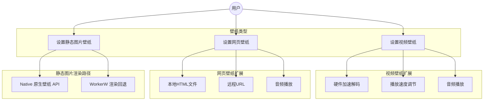
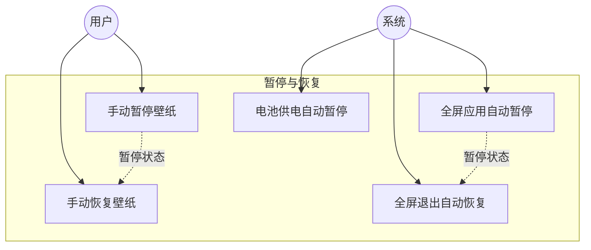
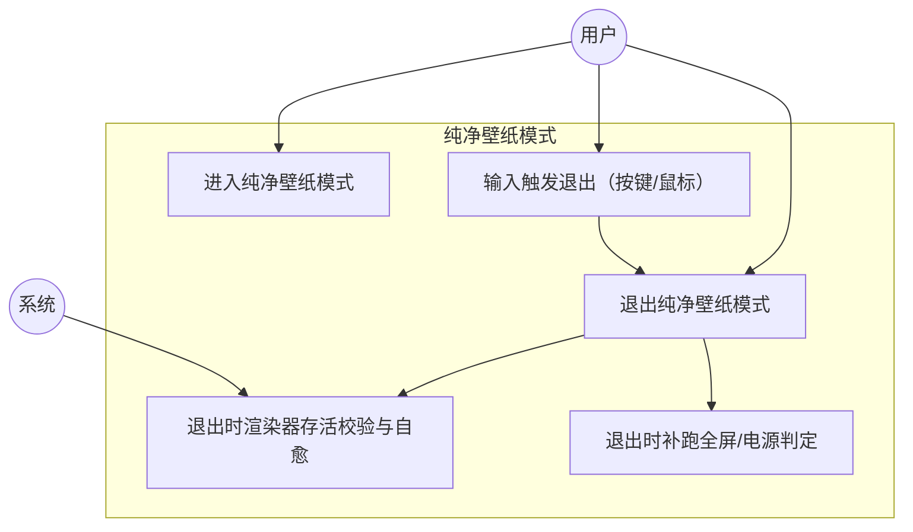

# MirrorStar Wallpaper（镜星壁纸）需求文档 — 用例 / Use Cases

[← 返回文档索引](../index.md) > [需求文档](./01-项目概述-Overview.md) > 用例

> 相关文档：[项目概述](./01-项目概述-Overview.md) | [功能性需求](./02-功能性需求-Functional-Requirements.md) | [非功能性需求](./03-非功能性需求-Non-Functional-Requirements.md) | [约束与术语](./05-约束与术语-Constraints-and-Terminology.md)

## 7. 用例图

### 7.1 系统用例图

```mermaid
graph TB
    Actor((用户))

    subgraph MirrorStar Wallpaper
        UC001[设置视频壁纸]
        UC002[设置网页壁纸]
        UC003[全屏应用自动暂停]
        UC004[拖放添加壁纸]
        UC005[多显示器独立壁纸设置]
        UC006[系统托盘操作]
        UC007[配置持久化]
        UC008[设置静态图片壁纸]
        UC009[删除壁纸]
        UC010[调节壁纸音量]
        UC011[开机自启设置]
        UC012[壁纸缩放模式设置]
        UC013[Explorer 重启后自动恢复]
        UC014[电池供电自动暂停]
        UC015[重复启动提示]
        UC016[壁纸预览]
        UC017[壁纸搜索]
        UC018[纯净壁纸模式]
        UC019[多屏排列切换]
        UC020[壁纸拖拽排序]
        UC021[预览播放器控制]
        UC022[播放速度精细化调节]
    end

    Actor --> UC001
    Actor --> UC002
    Actor --> UC004
    Actor --> UC005
    Actor --> UC006
    Actor --> UC008
    Actor --> UC009
    Actor --> UC010
    Actor --> UC011
    Actor --> UC012
    Actor --> UC015
    Actor --> UC016
    Actor --> UC017
    Actor --> UC018
    Actor --> UC019
    Actor --> UC020
    Actor --> UC021
    Actor --> UC022

    Sys((系统)) --> UC003
    Sys --> UC007
    Sys --> UC013
    Sys --> UC014
```

### 7.2 壁纸类型用例图

### 7.3 暂停/恢复用例图

### 7.4 纯净壁纸模式用例图

---

## 8. 用例描述

### UC-001：设置视频壁纸

| 项目 | 内容 |
|------|------|
| 用例 ID | UC-001 |
| 用例名称 | 设置视频壁纸 |
| 参与者 | 用户 |
| 前置条件 | 程序已启动，系统托盘图标可见 |
| 基本流程 | 1. 用户打开主窗口 2. 用户通过文件选择对话框或拖放方式添加视频文件 3. 系统识别文件为视频类型 4. 系统生成首帧缩略图并添加到壁纸库 5. 系统启动 mpv 子进程播放视频（mpv `--hwdec=auto`，命名管道 `\\.\pipe\mirrorstar-mpv-*` 承载原生 JSON IPC） 6. 系统将 mpv 窗口嵌入 WorkerW 层 7. 视频壁纸在桌面背景显示 |
| 替代流程 | 3a. 文件格式不支持：系统提示"不支持的文件格式" 5a. mpv 启动失败：系统显示错误信息，回退到上一壁纸 |
| 后置条件 | 视频壁纸在桌面背景播放，壁纸库中新增该壁纸 |
| 非功能约束 | 壁纸切换时间标称 < 1 秒（NFR-007；⚠️ 实测约 3s，待优化/待复测），CPU 占用 < 5%（NFR-004） |

### UC-002：设置网页壁纸

| 项目 | 内容 |
|------|------|
| 用例 ID | UC-002 |
| 用例名称 | 设置网页壁纸 |
| 参与者 | 用户 |
| 前置条件 | 程序已启动，系统已安装 WebView2 Runtime |
| 基本流程 | 1. 用户打开主窗口 2. 用户添加本地 HTML 文件或输入 URL 3. 系统识别为网页类型 4. 系统生成默认缩略图并添加到壁纸库 5. 系统以壳 exe 的 `--wp-proc` 模式启动子进程（`mirrorstar-wp-proc` 库 crate 由壳 exe 承载），通过 WebView2 渲染网页 6. 系统将 WebView2 窗口嵌入 WorkerW 层 7. 网页壁纸在桌面背景显示 |
| 替代流程 | 5a. WebView2 不可用：系统提示"需要安装 WebView2 Runtime" 5b. URL 无法访问：系统显示加载失败提示 |
| 后置条件 | 网页壁纸在桌面背景渲染，壁纸库中新增该壁纸。主进程通过命名管道 `\\.\pipe\mirrorstar-wp-*`（高熵 UUID）与 wp-proc 通信，实现崩溃隔离 |
| 非功能约束 | 活跃态主进程内存 < 50MB（NFR-002，不含 WebView2 子进程） |

### UC-003：全屏应用自动暂停

| 项目 | 内容 |
|------|------|
| 用例 ID | UC-003 |
| 用例名称 | 全屏应用自动暂停 |
| 参与者 | 系统 |
| 前置条件 | 壁纸正在播放 |
| 基本流程 | 1. 系统监测到全屏应用程序启动（`SetWinEventHook` / `EVENT_SYSTEM_FOREGROUND` 事件） 2. 系统通过 `pause_all_fast` 暂停所有壁纸播放 3. 壁纸显示当前帧的静态画面 4. 系统切换托盘菜单文本为"恢复壁纸"（图标本身不变化） 5. 全屏应用退出 6. 系统自动恢复所有壁纸播放 7. 系统切换托盘菜单文本为"暂停壁纸"（图标本身不变化） |
| 替代流程 | 2a. 用户已手动暂停：不重复操作 5a. 用户在全屏期间手动恢复：尊重用户操作，恢复播放 |
| 后置条件 | 壁纸暂停时 CPU 占用 < 0.1%（NFR-003） |
| 非功能约束 | 暂停响应时间 < 500ms（NFR-019） |

### UC-004：拖放添加壁纸

| 项目 | 内容 |
|------|------|
| 用例 ID | UC-004 |
| 用例名称 | 拖放添加壁纸 |
| 参与者 | 用户 |
| 前置条件 | 程序主窗口已打开 |
| 基本流程 | 1. 用户从资源管理器拖拽文件到主窗口 2. 系统检测到拖放事件 3. 系统识别文件类型（视频/GIF/网页/图片） 4. 系统将文件添加到壁纸库并生成缩略图 5. 系统自动设置为当前壁纸 |
| 替代流程 | 3a. 文件类型不支持：系统提示"不支持的文件类型" 3b. 多个文件拖入：逐个添加到壁纸库，最后一个设为当前壁纸 |
| 后置条件 | 壁纸库新增壁纸，当前壁纸已切换 |
| 非功能约束 | 支持同时拖入多个文件 |

### UC-005：多显示器独立壁纸设置

| 项目 | 内容 |
|------|------|
| 用例 ID | UC-005 |
| 用例名称 | 多显示器独立壁纸设置 |
| 参与者 | 用户 |
| 前置条件 | 系统连接了多个显示器 |
| 基本流程 | 1. 用户打开主窗口 2. 系统显示所有已连接的显示器列表 3. 用户选择目标显示器（仅在"每屏独立"排列下有效，其他排列下该选择置灰） 4. 用户为该显示器选择壁纸 5. 系统在目标显示器上设置指定壁纸 6. 其他显示器壁纸不受影响 |
| 替代流程 | 2a. 仅一个显示器：跳过选择步骤，直接设置壁纸 5a. 排列为"全部相同"：一张壁纸在各屏顺序各 apply 一次（N 渲染器，换图窗口期各屏瞬时新/旧混杂为已知接受项） 5b. 排列为"跨屏拉伸"：单个跨屏渲染器贯通虚拟桌面，仅 1 次 apply |
| 后置条件 | 目标显示器显示新壁纸，其他显示器不变（"每屏独立"排列下） |
| 非功能约束 | 每个显示器的壁纸进程独立管理。多屏排列语义详见 UC-019 与术语表 `Arrangement` |

### UC-006：系统托盘操作

| 项目 | 内容 |
|------|------|
| 用例 ID | UC-006 |
| 用例名称 | 系统托盘操作 |
| 参与者 | 用户 |
| 前置条件 | 程序已启动 |
| 基本流程 | 1. 程序启动后在系统托盘显示图标（不创建主窗口） 2. 用户右键托盘图标 3. 系统显示上下文菜单：打开主窗口 / 暂停或恢复壁纸 / 纯净壁纸（勾选） / 退出 4. 用户选择菜单项 5. 系统执行对应操作 |
| 替代流程 | 2a. 单击托盘图标：按主窗口可见性状态切换（不判断系统前台）——可见且未最小化则隐藏；最小化则还原并置前聚焦；已隐藏则显示（居中到鼠标所在显示器）并置前聚焦（300ms 内重复点击只生效一次） 4a. 用户选择"打开主窗口"：壳侧按需 spawn 原生 UI 子进程 `mirrorstar-ui`（Slint），确保窗口可见并置前聚焦（已可见仅置前聚焦、最小化则还原） 4b. 用户选择"退出"：程序保存配置后退出 |
| 后置条件 | 对应操作已执行 |
| 非功能约束 | 托盘菜单响应时间 < 200ms（NFR-020） |

### UC-007：配置持久化

| 项目 | 内容 |
|------|------|
| 用例 ID | UC-007 |
| 用例名称 | 配置持久化 |
| 参与者 | 系统 |
| 前置条件 | 用户修改了设置或切换了壁纸 |
| 基本流程 | 1. 用户修改配置（切换壁纸、调节音量等） 2. 系统将配置变更写入配置文件（TOML） 3. 程序重启时读取配置文件 4. 系统恢复上次壁纸和设置 |
| 替代流程 | 3a. 配置文件不存在：使用默认配置 3b. 配置文件损坏：使用默认配置，记录警告日志 |
| 后置条件 | 用户设置在重启后完整恢复 |
| 非功能约束 | 配置文件使用 TOML 格式，人类可读可编辑（NFR-015） |

### UC-008：设置静态图片壁纸

| 项目 | 内容 |
|------|------|
| 用例 ID | UC-008 |
| 用例名称 | 设置静态图片壁纸 |
| 参与者 | 用户 |
| 前置条件 | 程序已启动，系统托盘图标可见 |
| 基本流程 | 1. 用户打开主窗口 2. 用户通过文件选择对话框或拖放方式添加图片文件 3. 系统识别文件为图片类型 4. 系统生成缩略图并添加到壁纸库 5a. **Native 路径**（jpg/jpeg/png/bmp/tif/tiff/dib，见 FR-004）：系统调用 Windows 原生壁纸 API（`SystemParametersInfoW` + 注册表）设置壁纸，零渲染器、不嵌入 WorkerW 5b. **WorkerW 路径**（WebP 等非原生格式）：系统解码图片，通过 GDI 双缓冲渲染到壁纸窗口，嵌入 WorkerW 层 6. 图片壁纸在桌面背景显示 |
| 替代流程 | 3a. 图片格式不支持：系统提示"不支持的图片格式" |
| 后置条件 | 图片壁纸在桌面背景显示，壁纸库中新增该壁纸 |
| 非功能约束 | 图片加载/设置时间 < 500ms |

### UC-009：删除壁纸

| 项目 | 内容 |
|------|------|
| 用例 ID | UC-009 |
| 用例名称 | 删除壁纸 |
| 参与者 | 用户 |
| 前置条件 | 壁纸库中至少有一个壁纸 |
| 基本流程 | 1. 用户在壁纸库中选择要删除的壁纸 2. 用户点击删除按钮 3. 系统弹出确认对话框，询问是否同时删除源文件 4. 用户选择"仅从库中移除" 5. 系统从壁纸库中移除该壁纸条目 6. 系统删除对应的缩略图文件 7. 如果该壁纸正在使用，壁纸继续运行（当前版本不处理活跃壁纸的终止） |
| 替代流程 | 4a. 用户选择"移除并删除文件"：系统同时删除壁纸源文件和壁纸库条目 |
| 后置条件 | 壁纸从壁纸库中移除，缩略图已清理。注：如该壁纸正在使用，壁纸不会自动停止 |
| 非功能约束 | 删除操作不可撤销，需确认对话框 |

### UC-010：调节壁纸音量

| 项目 | 内容 |
|------|------|
| 用例 ID | UC-010 |
| 用例名称 | 调节壁纸音量 |
| 参与者 | 用户 |
| 前置条件 | 壁纸正在播放（视频或网页壁纸，含音频） |
| 基本流程 | 1. 用户在设置面板中调节音量滑块或点击静音按钮 2. 系统通过 Core Audio API 设置壁纸子进程的音量 3. 音量变更立即生效 4. 系统持久化音量设置到配置文件 |
| 替代流程 | 2a. 音频会话未找到：系统记录警告日志，音量设置在下次播放时生效 |
| 后置条件 | 壁纸音量已调整，配置已保存 |
| 非功能约束 | 音量调节响应时间 < 100ms（待复测） |

### UC-011：开机自启设置

| 项目 | 内容 |
|------|------|
| 用例 ID | UC-011 |
| 用例名称 | 开机自启设置 |
| 参与者 | 用户 |
| 前置条件 | 程序已启动 |
| 基本流程 | 1. 用户在设置面板中切换"开机自启"开关 2. 系统通过 `tauri-plugin-autostart` 写入注册表启动项（`HKEY_CURRENT_USER\Software\Microsoft\Windows\CurrentVersion\Run`） 3. 系统更新设置面板的开关状态 |
| 替代流程 | 2a. 注册表写入失败：系统显示错误提示，记录错误日志 |
| 后置条件 | 开机自启状态已更新 |
| 非功能约束 | 注册表操作响应时间 < 200ms（待复测） |

### UC-012：壁纸缩放模式设置

| 项目 | 内容 |
|------|------|
| 用例 ID | UC-012 |
| 用例名称 | 壁纸缩放模式设置 |
| 参与者 | 用户 |
| 前置条件 | 壁纸正在播放 |
| 基本流程 | 1. 用户在壁纸设置中选择缩放模式（填充 / 适应 / 拉伸 / 居中） 2. 系统根据缩放模式重新计算壁纸渲染区域 3. 系统根据壁纸类型更新渲染参数：Image/GIF 通过 `PostMessageW` 消息触发壁纸线程重绘（更新 scaling_mode + InvalidateRect）；Video 通过 mpv 启动参数设置（运行时仅记录，需重启 mpv 生效）；Web 仅记录模式（WebView2 自行处理渲染） 4. 壁纸按新模式渲染 |
| 替代流程 | 无 |
| 后置条件 | 壁纸按指定缩放模式渲染 |
| 非功能约束 | 缩放模式切换响应时间 < 200ms（待复测） |

### UC-013：Explorer 重启后自动恢复

| 项目 | 内容 |
|------|------|
| 用例 ID | UC-013 |
| 用例名称 | Explorer 重启后自动恢复 |
| 参与者 | 系统 |
| 前置条件 | 壁纸正在播放 |
| 基本流程 | 1. Windows Explorer 进程重启（用户手动重启或系统更新） 2. 系统检测到 WorkerW 窗口句柄失效 3. 系统重新查找 Progman 窗口 4. 系统发送 `0x052C` 消息创建新的 WorkerW 5. 系统将所有活跃壁纸窗口重新嵌入新的 WorkerW 6. 壁纸恢复正常显示 |
| 替代流程 | 3a. WorkerW 失效兜底：5 分钟轮询检测 WorkerW 句柄有效性（`is_workerw_valid`），失效时调用 `check_and_reinitialize` 重新初始化。同时 `TaskbarCreated` 事件驱动即时检测（注册窗口消息，收到时立即重新初始化） |
| 后置条件 | 壁纸在新的 WorkerW 中正常显示 |
| 非功能约束 | Explorer 重启后壁纸恢复时间 < 5 秒（`TaskbarCreated` 事件驱动即时恢复；5 分钟轮询作为兜底） |

### UC-014：电池供电自动暂停

| 项目 | 内容 |
|------|------|
| 用例 ID | UC-014 |
| 用例名称 | 电池供电自动暂停 |
| 参与者 | 系统 |
| 前置条件 | 壁纸正在播放，用户已启用"电池供电暂停"设置（`pause.pause_on_battery`） |
| 基本流程 | 1. 系统检测到电源状态从交流电切换到电池供电（`PBT_APMPOWERSTATUSCHANGE` 事件） 2. 系统暂停所有壁纸播放 3. 壁纸显示当前帧静态画面 4. 系统切换托盘菜单文本为"恢复壁纸"（图标本身不变化） 5. 系统检测到电源状态恢复为交流电 6. 系统自动恢复壁纸播放 7. 系统切换托盘菜单文本为"暂停壁纸"（图标本身不变化） |
| 替代流程 | 5a. 用户在电池供电期间手动恢复：尊重用户操作，恢复播放 |
| 后置条件 | 电池供电时壁纸暂停，接通电源后自动恢复 |
| 非功能约束 | 电源状态切换检测延迟 < 1 秒（待复测） |

### UC-015：重复启动唤起主窗口

| 项目 | 内容 |
|------|------|
| 用例 ID | UC-015 |
| 用例名称 | 重复启动唤起主窗口 |
| 参与者 | 用户 |
| 前置条件 | 镜星壁纸已在运行 |
| 基本流程 | 1. 用户尝试再次启动镜星壁纸 2. 系统检测到已有实例运行（通过命名互斥体 `MirrorStarWallpaper_SingleInstance`） 3. 新实例通过命名事件 `MirrorStarWallpaper_ShowMainWindow` 通知已运行实例显示主窗口（隐藏→显示、最小化→还原、已可见→置前，并置前聚焦） 4. 新实例自动退出 |
| 替代流程 | 3a. 命名事件尚不可用（主实例仍在早期启动或创建失败）：系统弹出提示对话框"镜星壁纸已在运行中"，新实例退出 |
| 后置条件 | 原有实例继续运行，新实例已退出 |
| 非功能约束 | 检测和唤起时间 < 500ms（待复测） |

### UC-016：壁纸预览

| 项目 | 内容 |
|------|------|
| 用例 ID | UC-016 |
| 用例名称 | 壁纸预览 |
| 参与者 | 用户 |
| 前置条件 | 壁纸库中至少有一个壁纸 |
| 基本流程 | 1. 用户在壁纸库中点击壁纸卡片（或按 Enter/空格） 2. 系统弹出预览弹窗，按类型分别渲染：图片（Slint `Image`，限幅解码 + contain）、视频（独立 mpv `--wid` 子窗口，循环播放）、GIF（自研逐帧，Slint 定时器驱动）、网页（按需临时 WebView2） 3. 弹窗底部为"播放器化"控制条（播放/暂停、进度拖动、倍速、音量/静音、全屏），详见 UC-021； 4. 用户点击"设为壁纸" 5. 系统将该壁纸设置到当前选中显示器 6. 系统关闭弹窗并显示成功状态 |
| 替代流程 | 3a. 用户点击遮罩区域：关闭弹窗 3b. 用户按 ESC：若处于全屏则**先退出全屏**，再次按 ESC 才关闭弹窗 3c. 用户点击关闭按钮：关闭弹窗 |
| 后置条件 | 壁纸已设置或弹窗已关闭（关闭时释放全部原生资源，杜绝后台残留） |
| 非功能约束 | 弹窗打开时间 < 200ms（待复测） |

### UC-017：壁纸搜索

| 项目 | 内容 |
|------|------|
| 用例 ID | UC-017 |
| 用例名称 | 壁纸搜索 |
| 参与者 | 用户 |
| 前置条件 | 壁纸库中至少有一个壁纸 |
| 基本流程 | 1. 用户在搜索框中输入关键词 2. 系统实时过滤壁纸列表，仅显示文件名包含关键词的壁纸 3. 搜索不区分大小写 |
| 替代流程 | 2a. 无匹配结果：显示"未找到匹配的壁纸"提示 3a. 用户清空搜索框：恢复显示全部壁纸 |
| 后置条件 | 壁纸列表已按关键词过滤 |
| 非功能约束 | 搜索响应时间 < 50ms（本地过滤，待复测） |

### UC-018：纯净壁纸模式

| 项目 | 内容 |
|------|------|
| 用例 ID | UC-018 |
| 用例名称 | 纯净壁纸模式（Pure Mode） |
| 参与者 | 用户（触发）、系统（编排） |
| 前置条件 | 程序已启动；已至少设置一个壁纸（无壁纸时引擎拒绝进入） |
| 基本流程 | 1. 用户点击托盘菜单"纯净壁纸" 2. 系统按权威运行态判定当前应进入：安装键盘/鼠标输入捕获钩子 → 关闭托盘溢出浮出窗（best-effort，必须在壁纸置顶之前）→ 引擎进入纯模式（将壁纸窗口从 WorkerW 摘出并以 `HWND_TOPMOST` 置顶全屏；**刻意不抢前台**，壁纸窗口带 `WS_EX_NOACTIVATE`） 3. 系统同步勾选托盘菜单项并启动退出监听 4. 用户按任意键 / 点击鼠标 / 再次点击托盘"纯净壁纸"任一触发退出 5. 系统执行退出编排：先恢复桌面（回嵌 WorkerW）→ 卸载输入钩子 → 取消勾选 → 补跑全屏/电源判定 → 视频渲染器存活校验与自愈 → 唤醒轮换调度器重算 deadline |
| 替代流程 | 2a. 输入钩子安装失败 / 引擎进入失败：系统回滚并保持未勾选，拒绝进入（避免"进得去出不来"） 2b. 进入期间检测到在途退出编排：先等待其落位（约 10s 上界），超时则拒绝进入 4a. 退出期间收到显示器变更（`WM_DISPLAYCHANGE`）：投递退出请求，同样走完整退出编排 |
| 后置条件 | 退出后壁纸恢复在 WorkerW 中正常显示，且退出时若视频渲染器停滞会被校验并自愈（暂停态下不自愈） |
| 非功能约束 | 进入/退出无阻塞主线程（全部经异步/阻塞线程池执行）；模式期间不触发定时轮换；降低 UI 遮挡与后台干扰。实际进入/退出时延待复测 |

### UC-019：多屏排列切换

| 项目 | 内容 |
|------|------|
| 用例 ID | UC-019 |
| 用例名称 | 多屏排列切换 |
| 参与者 | 用户 |
| 前置条件 | 程序已启动，系统连接了多个显示器 |
| 基本流程 | 1. 用户打开设置面板，选择"多屏排列"下拉项 2. 系统提供三态选项：**每屏独立（PerMonitor，`per_monitor`）/ 全部相同（AllSame）/ 跨屏拉伸（Span）** 3. 用户选择目标排列 4. 系统更新配置并同步引擎排列（`engine.set_arrangement`），由布局域（`mirrorstar-core::layout`）按（排列 × 显示器拓扑）重算调度单元 5. 调度器对账重建渲染器并即时生效：`PerMonitor` 每屏一个单元（key = 显示器 id）；`AllSame` 唯一全局单元 `all`，一张壁纸各屏顺序各 apply 一次（N 渲染器）；`Span` 唯一全局单元 `all`，1 个跨屏渲染器贯通虚拟桌面、1 次 apply |
| 替代流程 | 2a. 非"每屏独立"排列下，"目标显示器"选择项置灰（无意义） 4a. 排列未发生变化：短路，不做重建、不闪屏 |
| 后置条件 | 壁纸按所选排列在全部显示器上呈现，配置已持久化 |
| 非功能约束 | 排列切换即时生效（无需重启）；`AllSame` 换图窗口期各屏瞬时新/旧混杂为已知接受项（DR-39） |

### UC-020：壁纸拖拽排序

| 项目 | 内容 |
|------|------|
| 用例 ID | UC-020 |
| 用例名称 | 壁纸拖拽排序 |
| 参与者 | 用户 |
| 前置条件 | 壁纸库中至少有两个壁纸 |
| 基本流程 | 1. 用户在壁纸库网格中按住某张壁纸卡片并拖拽 2. 系统显示拖影（卡片式半透明拖影）与插入位指示，其他卡片按线性位移让位 3. 用户释放鼠标，落在目标插入位 4. 系统按新顺序提交（`reorder_wallpapers`，传入当前壁纸 id 集合的完全重排） 5. 系统落盘壁纸库顺序，并唤醒轮换调度器失效重建采样器（壁纸库顺序影响隐式"全部"池的 Sequential 采样顺序，DR-5） |
| 替代流程 | 3a. 拖拽取消 / 落点与源位置相同：不提交变更 4a. 传入的 id 集合不是当前壁纸 id 的完全重排：系统返回错误且不落盘 |
| 后置条件 | 壁纸库顺序已更新并持久化，采样顺序随之更新 |
| 非功能约束 | 拖拽交互流畅、落位即时反馈（待复测） |

### UC-021：预览播放器控制

| 项目 | 内容 |
|------|------|
| 用例 ID | UC-021 |
| 用例名称 | 预览播放器控制 |
| 参与者 | 用户 |
| 前置条件 | 已打开某壁纸的预览（UC-016） |
| 基本流程 | 1. 预览弹窗底部提供播放器化控制条（chrome）：播放/暂停、进度拖动、倍速、音量滑块、静音、全屏（四角箭头） 2. 用户操作控制项：视频经 mpv IPC 生效（播放/暂停、seek、`speed`、`volume`、`mute`）；GIF 由 Slint 定时器开关驱动播放/暂停 3. 全屏：进入真·系统全屏（覆盖整屏含任务栏），复位并重排原生子窗口；全屏下 chrome 支持自动隐藏（光标静止约 1.5s 且位于内容区时隐藏，移动/单击画面重新唤起），双击画面切换播放/暂停 4. 音量/静音按会话态种子化（打开预览时若会话未初始化则以配置值播种，会话内用户改动优先） |
| 替代流程 | 2a. 非视频类型（图片/网页/GIF）：不适用的控制项不生效（如进度/倍速仅视频生效） 4a. 按 ESC / 关闭弹窗 / 切换预览：清理全屏态与全部原生资源 |
| 后置条件 | 播放控制已应用；关闭后无后台残留 |
| 非功能约束 | 控制响应即时（视频经 IPC 往返）；全屏 chrome 自动隐藏轮询周期 100ms |

### UC-022：播放速度精细化调节

| 项目 | 内容 |
|------|------|
| 用例 ID | UC-022 |
| 用例名称 | 播放速度精细化调节 |
| 参与者 | 用户 |
| 前置条件 | 已打开视频壁纸预览（或设置面板的速度调节项可用） |
| 基本流程 | 1. 用户点击"播放速度"标签右侧的 **−/+ 微调按钮**，或拖动速度滑块/选择预设倍速 2. 系统以 **0.01× 步长**增减速度，先量化到 0.01 再 clamp 到量程（0.25× ~ 4.0×），避免连续累加产生浮点漂移 3. 系统将速度写回并在 UI 显示（保留两位小数） 4. 视频经 mpv IPC `set_speed` 生效；GIF 经定时器间隔调整 |
| 替代流程 | 2a. 速度到达量程两端（0.25× 或 4.0×）：对应 − 或 + 按钮**置灰禁用** 2b. 非视频类型：微调不生效 |
| 后置条件 | 播放速度已按精细步长调整并生效 |
| 非功能约束 | 步长精度 0.01×；量程 0.25× ~ 4.0×（与 FR-026 一致） |