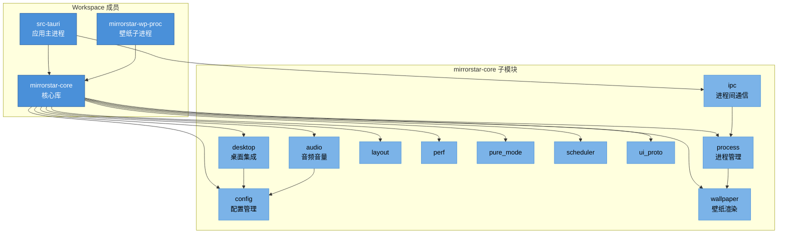
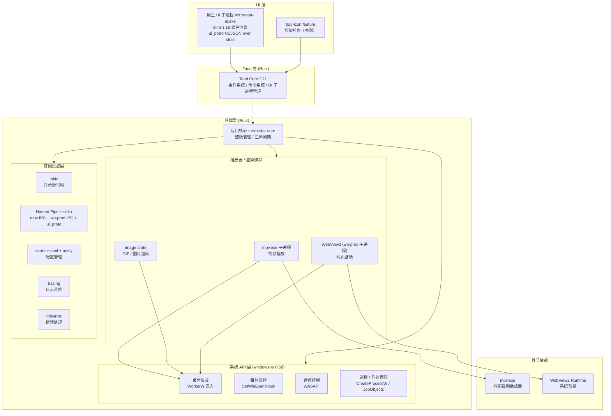

[← 返回文档索引](../index.md) > 架构与技术栈 > 架构与技术栈总览

# MirrorStar Wallpaper（镜星壁纸）— 架构与技术栈总览

| 项目   | 内容                                  |
| ---- | ----------------------------------- |
| 项目名称 | MirrorStar Wallpaper（镜星壁纸）         |
| 文档版本 | v3.0                                |
| 更新日期 | 2026-10-11                          |
| 文档状态 | 已实现（已按真实代码合并重组，2026-10）             |

> 本文由原《架构概述与系统架构》《技术栈总览》《风险评估》及《UI 框架》的选型/内存对比合并去重而成。技术选型表、进程模型等事实在《03-进程架构与IPC》《05-壁纸渲染》等处一并交叉引用，不重复展开。

***

## 1. 架构概述

### 1.1 架构哲学

MirrorStar Wallpaper 的架构设计遵循 **"少即是多"** 的哲学——通过精简功能集、选择高效的技术方案、采用事件驱动模型，实现极致的轻量化与高性能。架构设计的每一个决策都围绕以下核心问题展开：**如何在提供完整动态壁纸体验的同时，将系统资源占用降到最低？**

MirrorStar 的架构围绕以下几项关键设计决策进行根本性重构，以达到轻量化与高性能的目标：

* **事件驱动进程监控**：采用 `SetWinEventHook` 消息钩子替代固定间隔轮询，仅在前台窗口切换时触发检测，暂停态 CPU 占用趋近 0%。
* **精简壁纸类型**：聚焦 4 种核心壁纸类型（视频/GIF/网页/静态图），静态图支持 Native（原生 API）/ WorkerW（窗口嵌入）双路径。
* **独立 IPC 协议**：对外部渲染进程分别建立命名管道协议（mpv 原生 JSON IPC + wp-proc 自定义协议），并对壳↔UI 使用 stdio NDJSON 协议（`ui_proto`），实现稳定的跨进程通信。
* **TOML 配置**：使用 TOML（serde）作为配置格式，简洁、类型安全且便于解析。
* **编译期内存安全**：依托 Rust 所有权模型在编译期保证无数据竞争、无悬垂指针、无缓冲区溢出，规避运行时 GC 泄漏风险。
* **精简进程模型**：采用"壳进程 + 原生 UI 子进程 + 壁纸子进程"模型，不引入独立看门狗进程（watchdog 已移除），子进程异常退出由操作系统自动回收。
* **原生 UI 子进程**：主窗口改为独立进程 `mirrorstar-ui.exe`（Slint 1.18，绑定软件渲染），壳（Tauri）不再创建任何 WebView2 主窗口；壳与 UI 之间通过 `mirrorstar-core::ui_proto` 的 NDJSON 行协议（over stdio）通信，业务逻辑仅保留在壳侧。

### 1.2 设计原则

#### 1.2.1 轻量化（Lightweight）

* **功能精简**：仅保留视频、GIF、网页、静态图片四种壁纸类型，去除 Unity/Godot/模拟器/YouTube/壁纸创建器等非核心功能
* **依赖最小化**：无 .NET Runtime 依赖，仅依赖系统自带的 WebView2 Runtime 和随程序分发的外部 mpv.exe
* **体积控制**：目标二进制 < 10MB，单文件部署
* **静态壁纸零资源**：JPG/JPEG/PNG/BMP/TIF/TIFF/DIB 使用 Windows 原生壁纸 API（`SystemParametersInfoW`），无需创建窗口、线程或 GDI 对象
* **UI 子进程按需启动**：主窗口 UI 运行在独立进程 `mirrorstar-ui.exe`（Slint 原生渲染），启动时仅创建系统托盘图标；窗口隐藏超时（默认 300s）后 UI 子进程退出回收内存（壳侧≈7.6MB），再次打开时按需拉起；同一时刻至多一个实例

#### 1.2.2 高性能（High Performance）

* **事件驱动**：以 SetWinEventHook 替代轮询，暂停态 CPU 占用目标为 0%
* **零成本抽象**：利用 Rust 的 trait 系统实现多态，编译期单态化，无虚函数表开销
* **硬件加速**：视频播放利用 GPU 硬件解码，GIF 渲染利用 CPU 软件渲染
* **PauseSender 快速通道**：暂停/恢复/音量/静音操作绕过引擎 Mutex，通过 `tokio::sync::mpsc::UnboundedSender<PauseCommand>` 直接发送到渲染器线程，消除锁竞争
* **WorkerW 异步初始化**：`DesktopIntegrator::new()` 通过后台线程预初始化 WorkerW，不阻塞主进程启动

#### 1.2.3 内存安全（Memory Safety）

* **所有权模型**：Rust 编译器在编译期保证无数据竞争、无悬垂指针、无缓冲区溢出
* **无 GC**：确定性析构，无垃圾回收停顿
* **进程隔离**：壁纸渲染在独立子进程中运行，崩溃不影响主进程

#### 1.2.4 模块化（Modularity）

* **Trait 抽象**：壁纸后端通过 `WallpaperRenderer` trait 统一抽象，便于扩展
* **松耦合**：模块间通过消息传递和事件总线通信，减少直接依赖
* **可测试性**：核心逻辑与平台 API 解耦，便于单元测试

***

## 2. 系统架构图

### 2.1 分层架构

```mermaid
graph TB
    subgraph UI["UI 层 (原生 UI 子进程 mirrorstar-ui.exe + Tauri 壳托盘)"]
        UI_Main["主窗口（Slint 1.18，软件渲染）<br/>独立子进程按需启动 · 隐藏超时退出<br/>虚拟化壁纸网格 · 四类预览（图片/视频/GIF/网页）"]
        UI_Tray["系统托盘（壳进程）<br/>图标 / 右键菜单<br/>启动时仅创建托盘图标"]
        UI_Proto["壳↔UI 协议<br/>ui_proto NDJSON over stdio"]
    end

    subgraph BIZ["业务逻辑层 (Rust Core，仅壳侧)"]
        BIZ_Engine["壁纸引擎<br/>WallpaperEngine<br/>WallpaperMode 双路径（Native/WorkerW）"]
        BIZ_ProcMgr["进程管理器<br/>ProcessManager"]
        BIZ_UiMgr["UI 子进程管理<br/>spawn / 握手 / 空闲退出 / 单实例"]
        BIZ_Config["配置管理器<br/>ConfigManager"]
        BIZ_Audio["音频控制<br/>AudioController"]
        BIZ_PauseSender["PauseSender 快速通道<br/>绕过 Mutex，直接 mpsc 通道"]
    end

    subgraph SYS["系统层 (Rust Core + windows-rs)"]
        SYS_Desktop["桌面集成<br/>DesktopIntegrator<br/>异步初始化（后台线程）"]
        SYS_Native["原生壁纸 API<br/>SystemParametersInfoW + 注册表"]
    end

    subgraph OS["OS 层 (Windows APIs)"]
        OS_User32["user32.dll<br/>SetParent / SetWinEventHook"]
        OS_SysParams["SystemParametersInfoW<br/>SPI_SETDESKWALLPAPER"]
        OS_Registry["注册表<br/>WallPaperStyle / TileWallpaper"]
        OS_CoreAudio["Core Audio API<br/>ISimpleAudioVolume"]
        OS_Kernel32["kernel32.dll<br/>CreateProcessW"]
        OS_WebView2["WebView2 Runtime<br/>Edge Chromium（仅网页壁纸/按需网页预览）"]
        OS_mpv["mpv.exe<br/>视频解码（外部子进程）"]
    end

    UI --> BIZ
    BIZ --> SYS
    SYS --> OS

    style UI fill:#4FC3F7,stroke:#0288D1,color:#000
    style BIZ fill:#81C784,stroke:#388E3C,color:#000
    style SYS fill:#FFB74D,stroke:#F57C00,color:#000
    style OS fill:#E57373,stroke:#D32F2F,color:#FFF
```



### 2.2 层次职责说明

| 层次        | 职责                      | 关键技术                                        |
| --------- | ----------------------- | ------------------------------------------- |
| **UI 层**  | 用户交互、壁纸库展示、设置面板、拖放处理；主窗口为独立进程 `mirrorstar-ui.exe`（Slint 原生，按需启动 + 隐藏超时退出 + 单实例 + stdio NDJSON 协议），不复制业务逻辑、不直接读写配置；系统托盘在 Tauri 壳应用层构建（lib.rs setup + state.rs 状态管理，3 项菜单：打开/暂停-恢复/退出）；全屏检测在 platform/fullscreen.rs（SetWinEventHook 事件驱动） | Slint 1.18（软件渲染）、`mirrorstar-core::ui_proto`（Hello/Request/Response/Event/Control）、tray-icon |
| **业务逻辑层** | 壁纸生命周期管理（WallpaperMode 双路径）、进程调度、配置读写、音频控制、PauseSender 快速通道 | Rust、tokio 异步运行时、mpsc 通道 |
| **系统层**   | 桌面窗口嵌入（异步初始化）、原生壁纸 API（SystemParametersInfoW + 注册表） | windows-rs、SetWinEventHook、SystemParametersInfoW |
| **OS 层**  | Windows 系统调用、硬件加速、进程操作、原生壁纸设置 | Win32 API、Core Audio、mpv.exe（外部子进程）、WebView2、SystemParametersInfoW、注册表 |

### 2.3 模块依赖关系

项目由 4 个 workspace 成员构成：`src-tauri`（应用主进程）、`crates/mirrorstar-core`（核心库）、`crates/mirrorstar-wp-proc`（**库 crate**，网页壁纸子进程逻辑，经壳 exe 的 `--wp-proc` 模式运行）、`crates/mirrorstar-ui`（Slint 主窗口独立进程）。其中 `mirrorstar-core` 内部进一步划分为 11 个 `pub mod` 子模块：`audio` / `config` / `desktop` / `ipc` / `layout` / `perf` / `process` / `pure_mode` / `scheduler` / `ui_proto` / `wallpaper`。



各模块的职责与状态见《[模块设计](./02-模块设计-Module-Design.md)》，仓库目录布局见《[项目目录结构](../03-实施与验证/03-项目目录结构-Project-Structure.md)》。

### 2.4 数据流方向

- **配置流**：UI 子进程（`mirrorstar-ui`）经 `ui_proto` → `src-tauri` → `config` 模块持久化（TOML 文件）；`config` 通过 `notify` 热重载反向通知变更。
- **壁纸控制流**：UI 子进程（`mirrorstar-ui`） → `src-tauri` → `ipc` → `process`（spawn 子进程）→ `mirrorstar-wp-proc` → `wallpaper`（渲染）→ `desktop`（嵌入 WorkerW）。
- **输入流**：交互模式由 `wallpaper/manager.rs` 直接处理 → `desktop`（判断是否点击壁纸区域）→ 前端（`mirrorstar-ui`）事件。
- **音频流**：`audio`（系统音量查询）→ `config`（持久化）→ `mirrorstar-ui` 展示。

> 详细数据模型与流转见《[依赖与数据流](./08-依赖与数据流-Dependency-and-Data-Flow.md)》。

***

## 3. 技术栈总览

下表基于当前实际代码审计得出，版本号以 workspace `Cargo.toml` 为准。

| 类别 | 技术 | 版本 | 用途 | 许可证 |
|------|------|------|------|--------|
| 核心语言 | Rust | 1.80（`rust-version`） | 应用主体开发（workspace edition 2021） | MIT / Apache-2.0 |
| 应用壳 | Tauri | v2.11（启用 `tray-icon` feature） | 桌面应用壳（托盘 / 壁纸引擎 / 轮换调度 / 命令桥 / UI 子进程管理，Rust） | MIT / Apache-2.0 |
| 主窗口 UI | Slint（原生 UI 子进程 `mirrorstar-ui.exe`） | 1.18（`default-features=false` + `renderer-software`） | 主窗口界面渲染（Rust 原生声明式 UI，无 Web 运行时，软件渲染） | GPL-3.0 / 商业（双许可） |
| Windows API | windows-rs | 0.58 | Windows 系统 API 绑定 | MIT / Apache-2.0 |
| 视频播放 | mpv.exe（外部子进程） | 外部进程（无 Rust crate） | 通过 mpv.exe 播放视频，捆绑于 `<exe_dir>/mpv/` 或 PATH | GPL-2.0 (mpv) |
| 图片 / GIF | image crate | 0.25（`default-features=false`，启用 png/jpeg/gif/bmp/webp/tiff + rayon） | 静态图片与 GIF 解码（WebP 回退路径 + GIF 渲染） | MIT |
| 网页壁纸 | webview2-com | 0.34 | WebView2 SDK Rust 绑定（由壳进程 `--wp-proc` 模式子进程使用） | MIT |
| 配置管理 | serde + toml | serde 1 / toml 0.8 | TOML 配置读写 | MIT |
| 热重载 | notify | 7 | 配置文件系统监控 | CC0-1.0 / MIT |
| 日志系统 | tracing + tracing-subscriber + tracing-appender | tracing 0.1 / subscriber 0.3 / appender 0.2 | 结构化日志 | MIT |
| 系统托盘 | Tauri 2 内置 `tray-icon` feature | v2.11 | 系统托盘图标与菜单（不作为独立 crate 依赖） | MIT / Apache-2.0 |
| 进程间通信 | Windows 命名管道（CreateNamedPipeW / ConnectNamedPipe） + stdio（`ui_proto`） | - | 主进程与子进程双向 IPC（同步 Win32 API + NDJSON over stdio） | - |
| 异步运行时 | tokio | 1.52（`rt` / `rt-multi-thread` / `macros` / `time` / `fs` / `sync` / `io-util`） | 多线程异步运行时 | MIT |
| 序列化 | serde + serde_json + toml | serde 1 / serde_json 1 / toml 0.8 | 数据序列化 / 反序列化 | MIT |
| 错误处理 | thiserror | 2 | 库级错误类型定义（无 anyhow） | MIT / Apache-2.0 |
| 文件锁 | fs2 | 0.4 | 配置文件写入原子保护 | MIT / Apache-2.0 |
| 命令行解析 | clap | 4（`derive`） | 子进程命令行参数解析 | MIT / Apache-2.0 |
| 系统目录 | dirs | 6 | 获取系统目录路径 | MIT / Apache-2.0 |
| 注册表操作 | winreg | 0.55 | 开机自启与壁纸缩放模式注册表读写 | MIT |
| UUID | uuid | 1（`v4`） | 命名管道、实例等唯一标识 | MIT / Apache-2.0 |
| URL 工具 | percent-encoding | 2 | （**已废弃**）`wpfile://` 自定义协议路径解码，随旧前端删除已移除 | MIT / Apache-2.0 |
| 文件对话框 | tauri-plugin-dialog | 2.7 | Tauri 文件选择对话框插件 | MIT / Apache-2.0 |
| 开机自启 | tauri-plugin-autostart | 2.5 | Tauri 开机自启插件 | MIT / Apache-2.0 |
| 构建 / 测试工具 | Cargo / Tauri CLI / Rust 测试 | tauri-cli（`cargo install`）/ `cargo test` | 构建与测试（**无 npm / Vite / Vitest / ESLint / Prettier**） | MIT / Apache-2.0 |

> 说明：早期文档中列出的 `anyhow`、`bitflags`、`softbuffer`、`raw-window-handle` 均为虚构依赖，实际代码未引入，已从本表移除。

***

## 4. 核心语言与运行时

### 选择：Rust 1.80+

**选择理由：**

- **零成本抽象**：泛型、trait、迭代器等高级特性在编译时内联，适合对性能敏感的壁纸渲染
- **内存安全**：所有权系统在编译期保证内存安全，无需运行时垃圾回收
- **无 GC 暂停**：Rust 无 GC，帧率稳定，避免画面卡顿
- **无运行时依赖**：用户无需安装 .NET、Java、Python 等运行时，开箱即用
- **现代工具链**：Cargo 包管理器、rustfmt、clippy 静态分析

### 运行时与性能特性

采用 Rust 原生静态链接，运行时不携带任何第三方运行时（无需 .NET、Java、Python 等），具体特性如下：

| 维度 | Rust (stable) 本方案 |
|------|---------------------|
| 运行时依赖 | 无（静态链接） |
| 二进制体积 | 相对更小 |
| 内存占用 | 显著更低 |
| GC 暂停 | 无 |
| 启动速度 | 原生启动，极快 |

Rust 的零运行时依赖与无 GC 特性，确保壁纸渲染在长时间运行时保持稳定的帧率与极低的内存开销，开箱即用、无需安装额外运行时。

### 编译目标

```
x86_64-pc-windows-msvc
```

使用 MSVC 工具链，确保与 Windows SDK 和 WebView2 的最佳兼容性。Release 构建启用 `lto = true`、`codegen-units = 1`、`strip = "symbols"`、`panic = "abort"` 以减小体积。

***

## 5. UI 框架选型

> 本节聚焦**选型与内存对比**。UI 子进程的进程边界、按需启动、空闲退出、单实例与托盘实现细节见《03-进程架构与IPC》。

### 选择：Tauri 壳 + Slint 原生 UI 子进程

主窗口已从 Tauri 内嵌 WebView2 重构为**独立原生 UI 子进程**（`mirrorstar-ui.exe`），Tauri 仅保留为壳（托盘、壁纸引擎、轮换调度、命令桥、UI 子进程管理）。

**选择理由：**

- **内存优先**：WebView2 主窗口需拉起多进程 Chromium 基线（约 +150-300MB），与"极低资源占用"目标冲突；原生 Slint UI 子进程软件渲染后在主窗口打开并静置时，壳 + UI 合计 private ≈ **16.8MB**（验收门槛 ≤40MB）
- **Slint 1.18**：Rust 原生声明式 UI，无 Node/Chromium 运行时依赖，二进制体积小、启动快
- **壳-UI 进程解耦**：UI 崩溃不影响壳与壁纸引擎，可持续驻留托盘
- **Rust 后端**：业务逻辑继续用 Rust 编写（`src-tauri/` + `mirrorstar-core`），与核心业务代码无缝集成
- **安全**：UI 子进程不复制业务、不直接读写配置文件，所有业务经 `ui_proto` 请求壳侧处理，攻击面收敛

### 与替代方案对比

| 方案 | 优势 | 劣势 | 结论 |
|------|------|------|------|
| **Tauri WebView2 主窗口** | Rust 后端 + Web UI 灵活 | 主窗口需 Chromium 多进程基线，内存高 | ❌ 与轻量化目标冲突，已移除 |
| **WPF** | 成熟稳定，XAML 数据绑定 | 需要 .NET Framework，体积大，样式定制复杂 | ❌ 运行时依赖过重 |
| **egui** | 纯 Rust，即时模式 | 不适合复杂 UI，无声明式布局 | ❌ 不适合富 UI |
| **WinUI3** | 微软官方，Fluent Design | 需要 Windows App SDK，Rust 绑定不成熟 | ❌ 依赖过重 |
| **Slint 1.18 原生子进程** ✅ | Rust 原生、无 Web 运行时、内存低、声明式 | 需自绘控件与虚拟化网格 | ✅ 最佳平衡 |

### UI 技术方案

**采用：Slint 1.18（Rust 原生）**

- **绑定软件渲染**：`slint = { version = "1.18", default-features = false, features = ["renderer-software"] }`，**不编译** femtovg/skia（GPU/OpenGL 后端），避免 winit 选择 OpenGL 后端导致 +67MB 内存
- **无前端构建产物**：不再使用 Vite / TypeScript / HTML / CSS，也不使用 npm；UI 布局写在 `.slint` 文件中，编译期生成 Rust 代码
- **进程边界**：UI 位于独立 crate `crates/mirrorstar-ui/`（workspace 成员），通过 `mirrorstar-core::ui_proto` 的 NDJSON 行协议 over stdio 与壳通信（消息类型 `Hello` / `Request` / `Response` / `Event` / `Control`）
- **虚拟化壁纸网格**：固定卡尺寸 + 固定列数，仅实例化可见区间 ±2 行缓冲；缩略图按本地文件路径直读（不经 IPC 传字节）
- **四类预览**：图片（自绘）、视频（UI 进程内 spawn mpv 子窗口）、GIF（逐帧动画）、网页（按需创建临时 WebView2 子窗口，关闭后 `msedgewebview2.exe` 计数回落 0）
- **拖拽排序 / 搜索 / 文件拖入 / 卡片操作**：均在原生命中实现

> **未使用** React / Vue / Angular 等前端框架，也不再使用 Tauri IPC（`invoke`）——前端层已被原生 UI 子进程取代。

***

## 6. 技术栈全景与能力概览

### 6.1 技术栈全景图



> 说明：图中 UI 层已更新为**原生 UI 子进程**（Slint）结构；早期文档所示"前端层 (WebView2) + Tauri Core→WebView2 主窗口"为历史结构。基础设施"错误处理（thiserror + anyhow）"已更正为仅 `thiserror`；`anyhow` / `bitflags` / `softbuffer` / `raw-window-handle` 均为虚构依赖，未引入。

### 6.2 技术方案概览

MirrorStar 的技术选型围绕「零运行时依赖、事件驱动、轻量渲染、双向 IPC」展开，各模块实现如下：

| 维度 | 实现 |
|------|------|
| **语言** | Rust (stable, 1.80) |
| **UI 框架** | Tauri 壳 + Slint 原生 UI 子进程 |
| **视频播放** | mpv.exe 子进程 |
| **GIF 播放** | image crate + GDI 双缓冲 |
| **网页渲染** | WebView2 (Chromium, wp-proc 子进程) |
| **配置格式** | TOML (serde + toml) |
| **日志** | tracing |
| **进程监控** | SetWinEventHook 事件驱动 |
| **IPC** | 命名管道（mpv / wp-proc）+ stdio（`ui_proto`） |
| **音频控制** | WASAPI (windows-rs Core Audio) |
| **系统托盘** | Tauri 2 tray-icon feature |
| **运行时依赖** | 无（静态链接） |
| **GC 暂停** | 无 |

> **进程清理说明**：MirrorStar 不引入常驻监控进程，主进程崩溃时依赖作业对象（Job Objects）与操作系统自动清理子进程（mpv.exe / 壳 `--wp-proc` 模式子进程 / `mirrorstar-ui.exe`），在保证健壮性的同时避免额外常驻开销。

### 6.3 关键优势总结

1. **零运行时依赖**：无需 .NET Framework，无需安装任何运行时
2. **低内存占用**：Rust 无 GC，壁纸播放更流畅；静态图片走 Native 路径零资源；主窗口走原生 UI 子进程（≈16.8MB）
3. **事件驱动**：`SetWinEventHook` 事件驱动通知，全屏检测更及时
4. **独立 IPC 通道**：命名管道（mpv / wp-proc）与 stdio（`ui_proto`）提供可靠的双向通信
5. **轻量网页渲染**：WebView2 取自系统预装，无需捆绑 ~200MB CEF

***

## 7. 性能指标

| 指标 | 目标值 | 实测值 | 状态 |
|------|--------|--------|------|
| 暂停态内存 | <20MB | 17.14MB | 已达成 |
| 暂停态 CPU | 0% | 0% | 已达成 |
| 冷启动时间 | <2s | <1s | 已达成 |
| GIF 内存预算 | 40MB | 40MB | 已达成 |
| 暂停响应延迟 | <1ms | ~0.01ms | 已达成 |
| 壁纸切换时间 | <1s | ~3s（历史） | 需复测验证 |

**说明**：

- 暂停态指标已全面达成目标，得益于事件驱动架构与子进程暂停机制。
- 壁纸切换时间历史文档记载为 ~3s（超出 1s 目标，主要瓶颈在子进程启动与窗口嵌入开销）；v4.0 审计中 P-002/P-003 进一步指出 `ProcessManager::Drop`/`start()` 最坏阻塞 8s，是切换延迟的主因。**需复测验证**：`docs/03-实施与验证/05-测试报告-Test-Reports.md` 记录 NFR-007 实测达标（静态 `<1s` / 视频 `~0.5s`，以 mpv 日志时间戳佐证：启动→IPC 连接→窗口找到→开始播放→嵌入完成约 0.5s），但该测试先于后续多轮优化（v4.1/v5/v6）执行，当前真实切换耗时需重新实测确认，以实测为准。

***

## 8. 依赖风险与缓解

### mpv.exe 外部依赖

| 风险 | 说明 | 缓解措施 |
|------|------|----------|
| **可执行文件缺失** | mpv.exe 需捆绑或位于 PATH | `find_mpv()` 优先查找捆绑资源，回退 PATH；未找到返回错误 |
| **许可证** | mpv 使用 GPL-2.0 | 项目自身已采用 GPLv2+（GPL-2.0-or-later），与 mpv 的 GPL-2.0+ 完全兼容，许可证风险消除 |
| **版本兼容** | mpv IPC 协议可能变更 | 锁定兼容版本随应用更新；使用 mpv 稳定属性接口 |

### WebView2 Runtime

| 风险 | 说明 | 缓解措施 |
|------|------|----------|
| **运行时缺失** | 极少数旧版系统未安装 | Windows 10 (2004+) / Windows 11 已预装；缺失时引导安装 |
| **进程隔离** | 独立进程，崩溃不影响主应用 | 已是优势，无需额外处理 |

### windows-rs

| 风险 | 说明 | 缓解措施 |
|------|------|----------|
| **API 覆盖** | 部分 API 可能未覆盖 | workspace 锁定 0.58，按需启用 feature |
| **API 稳定性** | windows-rs 仍可能变更 API | 锁定版本，关注 changelog；跨 minor 升级需评估（如 webview2-com 0.38 依赖 windows 0.61 的不兼容已评估为 Low 风险不升） |
| **COM 交互** | 部分 COM 接口较复杂 | 封装为 Rust 风格安全 API |

### image crate

| 风险 | 说明 | 缓解措施 |
|------|------|----------|
| **格式支持** | 高动态范围 / 少用格式 | `default-features=false` 仅启用实际格式（png/jpeg/gif/bmp/webp/tiff），减体积与编译时间 |

### 依赖更新策略

- **锁定策略**：workspace 依赖采用 minor 精确版本（如 tokio 1.52、tauri 2.11），避免 dependabot 在 minor 内引入 breaking change
- **可复现构建**：`Cargo.lock` 纳入版本控制
- **最小依赖**：仅引入必要依赖；已移除 `protocol-asset` 等无用 feature 与虚构依赖

***

**相关文档：**

- [模块设计](./02-模块设计-Module-Design.md)
- [进程架构与 IPC](./03-进程架构与IPC-Process-Architecture-and-IPC.md)
- [桌面集成与 Windows 系统 API](./04-桌面集成与Windows系统API-Desktop-Integration-and-Windows-API.md)
- [壁纸渲染](./05-壁纸渲染-Wallpaper-Rendering.md)
- [暂停恢复机制](./06-暂停恢复机制-Pause-Resume.md)
- [错误处理](./07-错误处理-Error-Handling.md)
- [依赖与数据流](./08-依赖与数据流-Dependency-and-Data-Flow.md)
- [性能优化](./09-性能优化-Performance.md)
- [壁纸轮换调度器](./10-壁纸轮换调度器-Rotation-Scheduler.md)