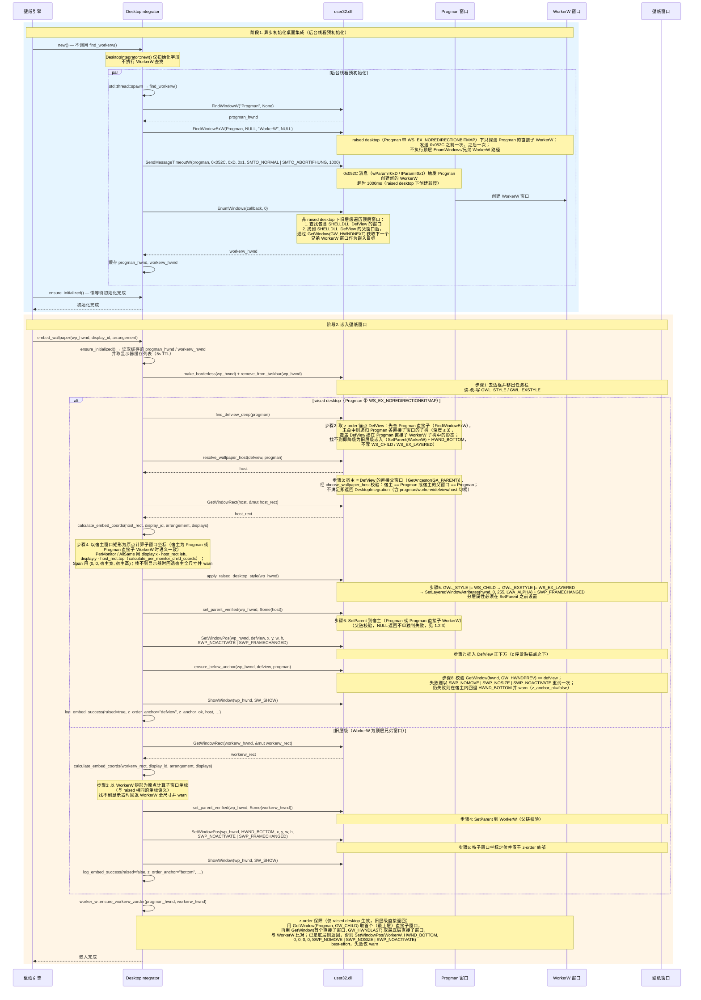
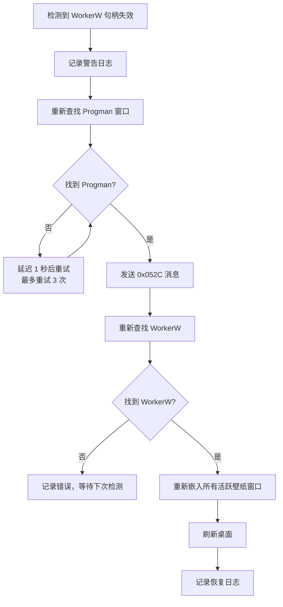
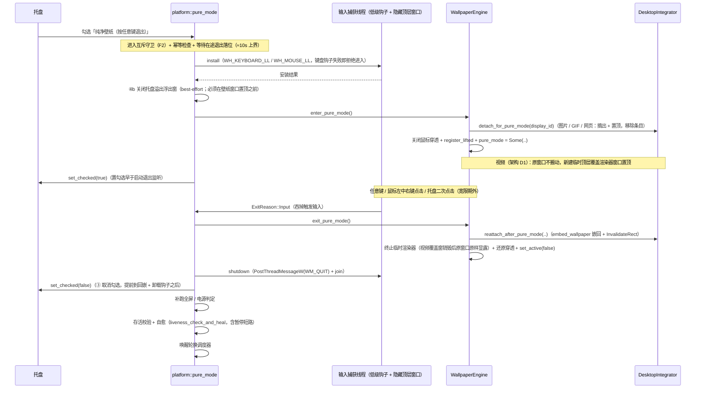

[← 返回文档索引](../index.md) > 架构与技术栈 > 桌面集成与 Windows 系统 API

# MirrorStar Wallpaper（镜星壁纸）— 桌面集成与 Windows 系统 API

| 项目   | 内容                        |
| ---- | ------------------------- |
| 项目名称 | MirrorStar Wallpaper（镜星壁纸） |
| 文档版本 | v3.0                      |
| 更新日期 | 2026-10-11                |
| 文档状态 | 已实现（已按真实代码合并重组，2026-10）        |

> 本文由原《桌面集成》与《Windows 系统 API》合并去重而成。**Native/WorkerW 渲染路径的选择与对比**统一收敛至[壁纸渲染](./05-壁纸渲染-Wallpaper-Rendering.md)，本文不再重复展开，仅保留桌面集成与系统 API 的机制细节。

---

## 1. 桌面集成详细设计

桌面集成模块负责：WorkerW 窗口查找与嵌入、窗口样式修改、多显示器定位、DPI 感知、Explorer 重启检测与重建、纯净壁纸模式（窗口层级临时提升）以及鼠标输入处理。

> **渲染路径说明**：静态图片（JPG/JPEG/PNG/BMP/TIF/TIFF/DIB）使用 Windows 原生壁纸 API（`SystemParametersInfoW` + 注册表）实现零资源占用，其余格式走 WorkerW 嵌入。两条路径的选择规则、对比表与原生 API 实现详见[壁纸渲染](./05-壁纸渲染-Wallpaper-Rendering.md)。

### 1.1 WorkerW 嵌入完整流程



#### 1.1.1 raised desktop 兼容分支（Windows 11 24H2/25H2）

Windows 11 24H2/25H2 启用 raised desktop 后，桌面层级发生变化：`Progman` 带 `WS_EX_NOREDIRECTIONBITMAP` 扩展样式，承载壁纸的 `WorkerW` 变为 `Progman` 的**直接子窗口**，不再存在旧层级的顶层兄弟 `WorkerW`。若沿用旧查找逻辑会找不到 WorkerW 或嵌错层，因此实现中增加了以下兼容分支：

- **特性检测（不判断系统版本号）**：`progman_is_raised_desktop(progman)` 读取 `GetWindowLongPtrW(Progman, GWL_EXSTYLE) & WS_EX_NOREDIRECTIONBITMAP`；`is_raised_desktop()` 在内部查找 Progman 后调用前者。以此识别层级形态，避免因系统 build 号差异误判。
- **查找顺序（按层级分流）**：
  - **非 raised desktop**：保持旧层级顺序不变——`SHELLDLL_DefView` 父窗口为 WorkerW → `Progman` 顶层兄弟 WorkerW → `EnumWindows` → 发送 `0x052C` → 再次 `EnumWindows` → fallback。
  - **raised desktop**：只探测 `FindWindowExW(Progman, NULL, "WorkerW", NULL)` 得到的 Progman 直接子 WorkerW，由 `find_progman_child_workerw` 用 `is_workerw_class` 校验类名；发送 `0x052C` **之前**探测一次、**之后**探测一次，未命中即返回 `WorkerWNotFound`；**不执行**顶层兄弟 WorkerW 查找与任何顶层 `EnumWindows`（含 Step 2/4/5），避免误选第三方应用的顶层 WorkerW。
- **嵌入模型（Lively/Microsoft raised desktop 模型）**：raised desktop 下壁纸窗口为 **`SHELLDLL_DefView` 的直接父窗口**（下称宿主；可为 `Progman`，也可为 Progman 的直接子 `WorkerW`）的 `WS_CHILD` + `WS_EX_LAYERED`（alpha=255）子窗口，`SetWindowPos` 以 `SHELLDLL_DefView` 为 `hWndInsertAfter`（z 序插入 DefView 正下方，壁纸位于图标层之下）；宿主不再固定为 Progman，也不使用 `HWND_BOTTOM`（仅 z 序校验失败时的兜底分支例外）。旧层级（非 raised）行为不变：`SetParent(WorkerW)` + `HWND_BOTTOM`，不改 `WS_CHILD` / `WS_EX_LAYERED`。
- **raised 嵌入时序**：`make_borderless` + `remove_from_taskbar` → `find_defview_deep`（Progman 直查，未命中则递归 Progman 直接子窗口子树，深度 ≤ 3）→ 宿主 = DefView 的直接父窗口 + 父链校验（`resolve_wallpaper_host` / `choose_wallpaper_host`：宿主 == Progman 或宿主的父窗口 == Progman）→ `apply_raised_desktop_style`（`WS_CHILD` → `WS_EX_LAYERED` + `SetLayeredWindowAttributes(0, 255, LWA_ALPHA)`，**必须先于 `SetParent`**）→ `set_parent_verified(wp_hwnd, Some(host))` → 按**宿主矩形**计算坐标并 `SetWindowPos(wp_hwnd, defview, x, y, w, h, SWP_NOACTIVATE | SWP_FRAMECHANGED)` → `ensure_below_anchor`（z 序校验 → 重试一次 → `HWND_BOTTOM` 兜底）→ `ShowWindow(SW_SHOW)` → `ensure_workerw_zorder`。路径选择由纯函数 `choose_embed_path(raised, defview)` 决定：`SHELLDLL_DefView` 找不到（如用户关闭"显示桌面图标"）或句柄无效时返回 `EmbedPath::LegacyWorkerW`，**降级为旧层级嵌入**（`SetParent(WorkerW)` + `HWND_BOTTOM`，不写 `WS_CHILD` / `WS_EX_LAYERED`），仅记 `warn`（提示检查"桌面右键 → 查看 → 显示桌面图标"），壁纸仍显示、不再整体失败；降级日志可用 `defview=0` + `z_order_anchor="bottom"` + `raised=true` 辨识。宿主父链校验失败（DefView 存在但 `resolve_wallpaper_host` 返回 `None`）时仍返回 `DesktopIntegration`（含 Progman/WorkerW/DefView/宿主句柄），不做降级。
- **z-order 保障**：`DesktopIntegrator::embed_wallpaper` 在 `worker_w::embed_wallpaper` 成功后调用 `ensure_workerw_zorder(progman_hwnd, workerw_hwnd)`：判定只考察 `Progman` 的直接子窗口——用 `GetWindow(Progman, GW_CHILD)` 取首个（最上层）直接子窗口、再以 `GetWindow(首个直接子窗口, GW_HWNDLAST)` 取最底层直接子窗口（不递归枚举子孙窗口），仅当该窗口不是 WorkerW 时才执行 `SetWindowPos(WorkerW, HWND_BOTTOM, 0, 0, 0, 0, SWP_NOMOVE | SWP_NOSIZE | SWP_NOACTIVATE)` 置底。宿主为 Progman 时置底 WorkerW 使其位于 DefView 之下；宿主恰为该 WorkerW 时，置底只改变它与 Progman 其它直接子窗口的先后，不影响其内部 DefView 与壁纸窗口的相对 z 序——两种情况均无需跳过。该函数仅对 raised desktop 生效（旧层级直接返回），best-effort，失败仅 `warn`。
- **桌面附着判定**：`DesktopIntegrator::is_attached_to_wallpaper_layer(hwnd)` 用 `GetAncestor(GA_PARENT)` 接受三种情况：父窗口为缓存的 `workerw_hwnd`（旧层级）、父窗口为缓存的 `progman_hwnd`（raised desktop 下 DefView 直接挂 Progman）、或父窗口的父窗口为缓存的 `progman_hwnd`（宿主为 Progman 直接子 WorkerW）；且 `IsWindow(hwnd)` 为真。供原子交换 `commit_atomic_swap` 的 commit 前校验与纯净模式半摘出恢复使用。缓存句柄或窗口失效时返回 `false`，调用方放弃新窗并由自愈流程重新初始化、重嵌。
- **SPI 早退**：raised desktop 下 `SPI_SETDESKWALLPAPER` 会销毁承载动态壁纸的 WorkerW（参考 Lively Wallpaper 的 `RefreshDesktop` 早退实现），因此 `refresh_desktop()` 在 raised desktop 下直接返回并记 debug 日志；`clear_native_wallpaper()` 同样记 debug 后返回 `Ok(())`（保持调用方既有语义，注册表原值保留不影响后续静态壁纸覆盖）。
- **失效自愈**：`is_workerw_valid` / `check_and_reinitialize`（单行委托 `ensure_workerw_ready`）仍负责**桌面句柄层**的失效检测与重初始化——raised desktop 下句柄失效后重新查找会经上述子窗口探测得到新的 Progman 子 WorkerW，并重嵌其 `active_wallpapers` 登记的窗口，重嵌走本节的 layered/宿主路径，每次嵌入后重新调用 `ensure_workerw_zorder` 保证 WorkerW 仍在 Progman 子窗口最底层。但"仅重初始化"无法复活已销毁的渲染器窗口，故引擎层在其之上新增统一入口 `WallpaperEngine::heal_desktop_layer`：重初始化后再逐屏重嵌存活窗口、并对已销毁窗口重建渲染器（见 1.6.4）。
- **视频壁纸：宿主窗口 + mpv `--wid`**：`VideoRenderer::play` 先创建隐藏宿主 `MirrorStarVideoHost`（`WS_EX_TOOLWINDOW | WS_EX_NOACTIVATE`、无 `WS_VISIBLE`），mpv 以 `--wid=<宿主 HWND>` 只创建 `WS_CHILD` vo 子窗口；`renderer.hwnd()` 返回宿主，桌面嵌入、raised/旧层级样式、摘出/重嵌均作用于宿主。宿主线程运行消息循环，`WM_SIZE`/`WM_SHOWWINDOW` 时把 mpv 子窗口拉伸到宿主客户区。mpv 不创建任何顶层窗口 → 任务栏/Alt+Tab 不会出现 mpv，也不存在把 mpv 顶层窗口 `SetParent` 的二义性。
- **mpv 24H2 对齐 / 任务栏参数**：`--border=no`（Lively issue #2415 / commit 7cc4116，避免嵌入后屏幕顶部/右侧不刷新）；`--show-in-taskbar=no` 仅作降级防御——随包 mpv 0.41 在窗口创建期不应用该选项（实测 exstyle 与未设置时一致），真正的任务栏防护是宿主 + `--wid` 不产生顶层窗口。

**raised desktop 层级结构**（`SHELLDLL_DefView` 可能直接挂在 Progman 下，也可能挂在 Progman 直接子 WorkerW 的子树里；两种形态均需支持）：

```text
形态 A：SHELLDLL_DefView 直接挂在 Progman 下
Progman（WS_EX_NOREDIRECTIONBITMAP，覆盖虚拟桌面）
├─ SHELLDLL_DefView（WS_EX_LAYERED，桌面图标层）
├─ 壁纸窗口（WS_CHILD + WS_EX_LAYERED，alpha=255；视频为 MirrorStarVideoHost 宿主） ← 插入 DefView 正下方
└─ WorkerW（Progman 的最后一个/最底层子窗口）

形态 B：SHELLDLL_DefView 挂在 Progman 直接子 WorkerW 的子树里
Progman（WS_EX_NOREDIRECTIONBITMAP，覆盖虚拟桌面）
└─ WorkerW（壁纸窗口的宿主，也是图标层的祖先）
   ├─ SHELLDLL_DefView（WS_EX_LAYERED，桌面图标层）
   └─ 壁纸窗口（WS_CHILD + WS_EX_LAYERED，alpha=255） ← 插入 DefView 正下方
```

两种形态下壁纸窗口都紧贴 `SHELLDLL_DefView` 下方，因此桌面图标与文字保持可见、可点击。形态 B 中 `SHELLDLL_DefView` 与缓存的 `workerw_hwnd` 不在同一层级，`ensure_workerw_zorder` 仍只按 Progman 的直接子窗口链判定。

> 该分支只影响 WorkerW 嵌入路径的查找与层级保持；Native 静态图片路径（`SystemParametersInfoW` + 注册表）与旧层级桌面行为不变。

#### 1.1.2 z 序校验与兜底 / 图标层归属诊断

`SetParent` 会把重定父的窗口放到新兄弟 z 序顶部，因此 raised desktop 下 `SetWindowPos(hwnd, defview, …)` 的锚点插入必须显式校验，否则壁纸可能停留在 DefView 之上遮挡图标。

- **校验与兜底（`worker_w.rs::ensure_below_anchor`）**：`GetWindow(hwnd, GW_HWNDPREV)` 必须等于 `defview`（纯判定 `is_below_anchor`）；不满足则用 `SetWindowPos(hwnd, defview, 0, 0, 0, 0, SWP_NOMOVE | SWP_NOSIZE | SWP_NOACTIVATE)` 重试一次；仍不满足则在宿主内改为 `HWND_BOTTOM`（附加 `SWP_FRAMECHANGED`）并记录 `warn`，保证壁纸不会停留在兄弟 z 序顶部。校验结果写入日志字段 `z_anchor_ok`，函数不返回 `Err`——兜底后嵌入流程照常完成，问题由日志暴露。

- **图标层归属诊断**：日志 `壁纸窗口嵌入完成` 在 raised 路径新增以下字段（旧层级不做这些探测，固定为 `false` / 空列表）：

| 字段 | 含义 | 判定用途 |
|---|---|---|
| `host` / `host_class` | 实际使用的宿主句柄与类名（`Progman` / `WorkerW`） | 确认走了哪种层级形态 |
| `z_anchor_ok` | `GW_HWNDPREV == defview` 是否成立（含重试后） | `false` 表示锚点插入未生效、已回退宿主最底层，壁纸可能覆盖图标 |
| `defview_has_icon_list` | DefView 子树（深度 ≤ 3）是否含 `SysListView32` | `false` 表示该 DefView 不是图标承载层 |
| `workerw_has_defview` / `workerw_has_icon_list` | 缓存的 `workerw_hwnd` 子树是否含 `SHELLDLL_DefView` / `SysListView32` | 判定图标层在 Progman 子级还是 WorkerW 子树 |
| `sibling_chain` | Progman 直接子窗口链摘要（`类名#vis=0/1#0x句柄`，`GW_CHILD` → `GW_HWNDNEXT`，上限 64 项） | 核对兄弟顺序与实际 z 序 |

真机日志据此可区分两类失效：`z_anchor_ok=false` 属锚点插入未生效；`defview_has_icon_list=false` 且 `workerw_has_icon_list=true` 属图标层归属判错（壁纸插在该 DefView 之下仍处于图标层之上）。

### 1.2 窗口样式修改

壁纸窗口嵌入桌面壁纸层（旧层级 WorkerW / raised desktop 的宿主——Progman 或其直接子 WorkerW）前需要修改窗口样式，去除边框和任务栏显示：

#### 1.2.1 去除边框（Borderless Window）

```rust
fn make_borderless(hwnd: HWND) -> Result<()> {
    unsafe {
        // 移除标准窗口样式中的标题栏、边框、系统菜单等
        let style = GetWindowLongPtrW(hwnd, GWL_STYLE) as u32;
        let new_style = WINDOW_STYLE(style)
            & !(WS_CAPTION | WS_THICKFRAME | WS_SYSMENU | WS_MAXIMIZEBOX | WS_MINIMIZEBOX);
        let _ = SetWindowLongPtrW(hwnd, GWL_STYLE, new_style.0 as isize);

        // 移除扩展样式中的对话框边框、窗口边缘等
        let ex_style = GetWindowLongPtrW(hwnd, GWL_EXSTYLE) as u32;
        let new_ex_style = WINDOW_EX_STYLE(ex_style)
            & !(WS_EX_DLGMODALFRAME | WS_EX_COMPOSITED | WS_EX_WINDOWEDGE
                | WS_EX_CLIENTEDGE | WS_EX_STATICEDGE
                | WS_EX_TOOLWINDOW | WS_EX_APPWINDOW);
        let _ = SetWindowLongPtrW(hwnd, GWL_EXSTYLE, new_ex_style.0 as isize);
    }
    Ok(())
}
```

#### 1.2.2 从任务栏移除

```rust
fn remove_from_taskbar(hwnd: HWND) {
    unsafe {
        // 读-改-写模式：保留必要样式，添加 TOOLWINDOW 和 NOACTIVATE
        let ex_style = GetWindowLongPtrW(hwnd, GWL_EXSTYLE);
        let new_ex_style = (ex_style as usize)
            & !(WS_EX_APPWINDOW.0 as usize)   // 移除任务栏显示标志
            | (WS_EX_TOOLWINDOW.0 as usize)    // 添加工具窗口标志（不在任务栏显示）
            | (WS_EX_NOACTIVATE.0 as usize);   // 添加不激活标志
        let _ = SetWindowLongPtrW(hwnd, GWL_EXSTYLE, new_ex_style as isize);

        // 需要调用 SetWindowPos 刷新窗口样式
        let _ = SetWindowPos(hwnd, HWND::default(), 0, 0, 0, 0,
            SWP_NOMOVE | SWP_NOSIZE | SWP_NOZORDER | SWP_FRAMECHANGED);
    }
}
```

#### 1.2.3 `SetParent` 返回值二义性与父链校验

Win32 `SetParent` 成功时返回**前一个父窗口**；顶层窗口的前父可能是 `HWND_DESKTOP`，也可能是 `NULL`，因此 NULL 返回本身不能判为失败。`windows` 0.58 的绑定把 NULL 一律转换为失败（`Error::from_win32`），当 `GetLastError` 恰为 `ERROR_SUCCESS` 时会产生"操作成功完成 (0x00000000)"的伪失败——Win11 raised desktop 下 mpv 窗口嵌入即由该路径触发回滚，表现为任务栏图标闪现后消失。

实现以 `crates/mirrorstar-core/src/desktop/window.rs::set_parent_verified` 统一封装（raised/legacy 嵌入、`remove_wallpaper` 分离、`lift_wallpaper_window` 摘出、`recover_half_detached_window` 恢复均使用）：

```rust
SetLastError(WIN32_ERROR(0));                            // 调用前清零，避免 stale last-error
let result = SetParent(child, new_parent.as_ref());   // None = 脱离父窗口
let last_error = GetLastError();
let actual = GetAncestor(child, GA_PARENT);
// 判定（classify_set_parent_result）：
//   父链 == 期望父窗口（None 时期望 GetDesktopWindow()）→ 成功
//     返回 NULL → AmbiguousSuccess（记 info 日志 setparent_ambiguous_success，继续流程）
//     返回非 NULL → Success
//   父链不符且 last_error != 0 → DesktopIntegration（含 GetLastError 错误码）
//   父链不符且 last_error == 0 → DesktopIntegration（"未生效且无错误码"）
```

`GetParent()` 不能替代 `GetAncestor(GA_PARENT)`：mpv 等弹出式窗口重定父后 `GetParent()` 仍返回 0，只有 `GetAncestor` 能反映真实父链。

#### 1.2.4 raised desktop 样式套用与摘出恢复

`apply_raised_desktop_style(hwnd)`（嵌入前调用）：`GWL_STYLE |= WS_CHILD` → `GWL_EXSTYLE |= WS_EX_LAYERED` → `SetLayeredWindowAttributes(hwnd, 0, 255, LWA_ALPHA)` → `SetWindowPos(SWP_FRAMECHANGED)`。分层属性必须在 `SetParent` 之前设置，否则重定父后窗口缺少分层属性，桌面不合成、画面不可见；任一步失败返回 `DesktopIntegration`，由调用方回滚渲染器。

`restore_top_level_style(hwnd)`（摘出 / 移除时调用）：清除 `WS_CHILD` 并以 `SWP_FRAMECHANGED` 刷新框架，**保留 `WS_EX_LAYERED` 与 alpha=255**（仍是合法的分层顶层窗口；只清样式位而不清分层属性会进入"分层但无分层属性"的冻结态）。重嵌时由 `embed_wallpaper` 重新套用 raised 样式。

### 1.3 多显示器定位详解

多显示器环境下，每个显示器的壁纸窗口需要精确定位到对应的屏幕区域。关键挑战是 Windows 的多显示器坐标系——副显示器的坐标可能为负值（在主显示器左侧）或大于主显示器分辨率（在右侧/下方）。

> 下列代码为旧层级坐标换算的**示意**（`MapWindowPoints` 描述通用换算思路）；当前实现见 1.1 时序图步骤 3：`calculate_embed_coords` 直接以宿主（WorkerW / Progman）窗口矩形做差值，`SetParent` 一律经 `set_parent_verified`（见 1.2.3）。

```rust
impl DesktopIntegrator {
    /// 将壁纸窗口嵌入到指定显示器
    fn embed_to_display(&self, hwnd: HWND, display_id: &str) -> Result<()> {
        // 1. 获取目标显示器的边界
        let monitor = self.get_monitor_info(display_id)?;
        let bounds = monitor.monitor;

        // 2. 将壁纸窗口定位到屏幕绝对坐标
        unsafe {
            SetWindowPos(
                hwnd,
                HWND_BOTTOM,
                bounds.left,
                bounds.top,
                bounds.right - bounds.left,
                bounds.bottom - bounds.top,
                SWP_NOACTIVATE | SWP_FRAMECHANGED,
            )?;
        }

        // 3. 坐标转换：绝对坐标 → 相对于 WorkerW 的坐标
        let mut rect = RECT {
            left: bounds.left,
            top: bounds.top,
            right: bounds.right,
            bottom: bounds.bottom,
        };
        unsafe {
            // HWND::default() (NULL) 作为 hwndFrom 表示源坐标是屏幕绝对坐标
            MapWindowPoints(HWND::default(), self.workerw, &mut rect as *mut _ as *mut POINT, 2)?;
        }

        // 4. 设为 WorkerW 子窗口（经 set_parent_verified 校验父链）
        unsafe {
            set_parent_verified(hwnd, Some(self.workerw))?;
        }

        // 5. 设置相对坐标
        unsafe {
            SetWindowPos(
                hwnd,
                HWND_BOTTOM,
                rect.left,
                rect.top,
                bounds.right - bounds.left,
                bounds.bottom - bounds.top,
                SWP_NOACTIVATE | SWP_FRAMECHANGED,
            )?;
        }

        Ok(())
    }
}
```

> **已知限制（PerMonitor 多显示器坐标）**：raised desktop 下子窗口坐标以 **宿主窗口矩形**为原点（宿主为 Progman 或其直接子 WorkerW；`display.x - host_rect.left`、`display.y - host_rect.top`），旧层级以 WorkerW 矩形为原点；实现未使用 `MapWindowPoints`。当前优先单屏验证；若真机发现宿主窗口矩形不覆盖整个虚拟桌面（例如只覆盖主屏），则需改为 `MapWindowPoints(HWND_DESKTOP, host, …)` 做坐标转换。

### 1.4 跨显示器拉伸模式

当壁纸排列方式为 `span` 时，单个壁纸窗口覆盖所有显示器：

```rust
fn span_all_displays(&self, hwnd: HWND) -> Result<()> {
    // 获取 WorkerW 的完整区域
    let mut workerw_rect = RECT::default();
    unsafe {
        GetWindowRect(self.workerw, &mut workerw_rect)?;
    }

    // 设为 WorkerW 子窗口（经 set_parent_verified 校验父链）
    unsafe {
        set_parent_verified(hwnd, Some(self.workerw))?;
    }

    // 填充整个 WorkerW 区域
    unsafe {
        SetWindowPos(
            hwnd,
            HWND_BOTTOM,
            0,
            0,
            workerw_rect.right - workerw_rect.left,
            workerw_rect.bottom - workerw_rect.top,
            SWP_NOACTIVATE | SWP_FRAMECHANGED,
        )?;
    }

    Ok(())
}
```

### 1.5 DPI 感知处理

MirrorStar 声明为 Per-Monitor DPI Aware V2 应用，确保在不同 DPI 缩放比例的显示器上正确显示壁纸。

#### 1.5.1 DPI 感知声明

在应用程序 manifest 中声明 Per-Monitor DPI Aware V2：

```xml
<application xmlns="urn:schemas-microsoft-com:asm.v3">
  <windowsSettings>
    <dpiAwareness xmlns="http://schemas.microsoft.com/SMI/2016/WindowsSettings">PerMonitorV2</dpiAwareness>
    <dpiAware xmlns="http://schemas.microsoft.com/SMI/2005/WindowsSettings">true/pm</dpiAware>
  </windowsSettings>
</application>
```

#### 1.5.2 DPI 缩放处理策略

| 场景 | 处理方式 |
|------|----------|
| 壁纸窗口定位 | 使用物理像素坐标（GetMonitorInfo 返回的 rcMonitor 已是物理像素） |
| 壁纸窗口尺寸 | 使用物理像素尺寸，与显示器实际分辨率匹配 |
| DPI 变更 | 监听 WM_DPICHANGED 消息，重新计算壁纸窗口位置和尺寸 |
| 多显示器不同 DPI | 每个显示器的壁纸窗口独立处理，使用该显示器的 DPI 值 |

#### 1.5.3 WM_DPICHANGED 处理

```rust
/// 处理 DPI 变更消息
fn on_dpi_changed(hwnd: HWND, new_rect: &RECT) {
    unsafe {
        // 按系统建议的新矩形调整窗口大小
        let _ = SetWindowPos(
            hwnd,
            HWND::default(),
            new_rect.left,
            new_rect.top,
            new_rect.right - new_rect.left,
            new_rect.bottom - new_rect.top,
            SWP_NOZORDER | SWP_NOACTIVATE,
        );
    }
}
```

### 1.6 Explorer 重启检测与 WorkerW 重新嵌入

Windows Explorer（explorer.exe）可能在运行期间重启（如用户通过任务管理器重启、系统更新等），导致 WorkerW 窗口句柄失效。MirrorStar 需要检测 Explorer 重启并重新嵌入壁纸窗口。

#### 1.6.1 检测方案

事件驱动由 `start_explorer_restart_monitor()`（`src-tauri/src/platform/explorer.rs`）承担：一个**隐藏的顶层窗口**（`WS_EX_TOOLWINDOW | WS_POPUP`，从不 `ShowWindow`；**刻意不用 `HWND_MESSAGE`**——消息专用窗口不接收 `HWND_BROADCAST` 广播，`TaskbarCreated` / `WM_POWERBROADCAST` 会永远收不到）监听 `TaskbarCreated`、`WorkerW`/`Progman` 销毁（`EVENT_OBJECT_DESTROY`）、会话解锁与睡眠恢复四类事件，经 `trigger_heal_desktop_layer` 调用 `state::try_heal_desktop_layer()` → `WallpaperEngine::heal_desktop_layer()`（销毁事件走 1s 去抖，其余事件直接触发；详见 1.6.4）。

`start_workerw_check()`（`src-tauri/src/platform/workerw_check.rs`）只是兜底：`tokio interval(300s)` + `Notify`，tick 时持有 engine 锁调用**同一个** `heal_desktop_layer()`，语义与事件路径一致（重初始化桌面句柄 → 重嵌存活窗口 → 重建已销毁渲染器）。桌面句柄层的实际重初始化仍由 `DesktopIntegrator::check_and_reinitialize()`（单行委托 `ensure_workerw_ready`）完成：

```rust
impl DesktopIntegrator {
    /// 检测 Explorer 重启并重新初始化（返回是否实际重初始化）
    fn check_and_reinitialize(&mut self) -> Result<bool, MirrorStarError> {
        self.ensure_workerw_ready()
    }

    /// 未初始化则首次查找；此前已初始化但句柄失效则重新查找并重嵌 active_wallpapers
    fn ensure_workerw_ready(&mut self) -> Result<bool, MirrorStarError> {
        // 验证缓存的 Progman / WorkerW 句柄是否仍然有效
        if self.is_workerw_valid() {
            return Ok(false);
        }
        let was_initialized = self.workerw_hwnd.is_some();
        if was_initialized {
            tracing::warn!("WorkerW 句柄失效，可能是 Explorer 重启，正在重新初始化...");
        }

        // 重新查找 WorkerW（内部发送 0x052C 触发创建）
        let (progman_hwnd, workerw_hwnd) = worker_w::find_workerw_no_retry()?;
        self.progman_hwnd = Some(progman_hwnd);
        self.workerw_hwnd = Some(workerw_hwnd);

        if was_initialized {
            // 重新嵌入 active_wallpapers 登记的所有壁纸（失败条目移除，避免残留无效句柄）
            let display_ids: Vec<String> = self.active_wallpapers.keys().cloned().collect();
            let displays: Vec<DisplayInfo> = self.get_cached_displays().to_vec();
            for display_id in display_ids {
                if let Some(&(hwnd, arrangement)) = self.active_wallpapers.get(&display_id) {
                    if let Err(e) = worker_w::embed_wallpaper(
                        hwnd, progman_hwnd, workerw_hwnd, &display_id, arrangement, &displays,
                    ) {
                        tracing::error!(display_id, error = %e, "重新嵌入壁纸失败，移除该活跃壁纸条目");
                        self.active_wallpapers.remove(&display_id);
                    }
                }
            }
            worker_w::ensure_workerw_zorder(progman_hwnd, workerw_hwnd);
            tracing::info!("WorkerW 重新初始化完成，壁纸已重新嵌入");
        }

        Ok(true)
    }

    /// 验证 Progman / WorkerW 句柄是否都有效（两者任一失效即返回 false）
    fn is_workerw_valid(&self) -> bool {
        self.progman_hwnd
            .is_some_and(|h| unsafe { IsWindow(h).as_bool() })
            && self
                .workerw_hwnd
                .is_some_and(|h| unsafe { IsWindow(h).as_bool() })
    }
}
```

#### 1.6.2 检测触发方式

| 方式 | 优点 | 缺点 |
|------|------|------|
| TaskbarCreated 消息（事件驱动） | 精确，Explorer 重启时系统必定广播此消息 | 需要注册消息接收 |
| EVENT_OBJECT_DESTROY（SetWinEventHook） | 直接感知 `WorkerW` / `Progman` 销毁（Explorer 重启、Win+Tab 抬起/放下桌面等） | 需在回调内做类名过滤，且 Explorer 重启时会连发多条（由 1s 去抖合并） |
| 会话解锁 / 睡眠恢复（WM_WTSSESSION_CHANGE / WM_POWERBROADCAST） | 覆盖锁屏、睡眠唤醒导致的桌面层重建 | 需 WTSRegisterSessionNotification、需消息窗口接收广播 |
| 5 分钟（300 秒）定时兜底 | 简单可靠 | 有延迟（最多 5 分钟） |
| 监听 Progman 窗口重建 | 精确 | 已由 `EVENT_OBJECT_DESTROY` + 类名过滤覆盖 |
| SetWinEventHook 监听 | 事件驱动，即时响应 | Explorer 重启不一定触发（作为补充事件源使用） |

**推荐方案**：以事件驱动为主——四类事件（`TaskbarCreated`、`EVENT_OBJECT_DESTROY`、会话解锁、睡眠恢复）统一经 1s 去抖调用 `state::try_heal_desktop_layer()` → `WallpaperEngine::heal_desktop_layer()`；辅以 `start_workerw_check()`（tokio interval 300 秒 + Notify，持 engine 锁调用同一 `heal_desktop_layer()`）作为事件全部遗漏时的兜底。事件与兜底都不再只做"重初始化"，而是同时重嵌存活窗口、重建已销毁渲染器（见 1.6.4）。

#### 1.6.3 重嵌入流程



> 上述流程图描述**桌面句柄层**（`check_and_reinitialize` / `ensure_workerw_ready`）的重初始化路径；`refresh_desktop` 在 raised desktop 下会早退（见 1.1.1）。引擎层的 `heal_desktop_layer` 在其之后还会逐屏重嵌存活窗口，并对已销毁的渲染器走 `terminate` + `revive_terminated` 重建（见 1.6.4）。

#### 1.6.4 桌面层事件源与自愈

Explorer 重启只是桌面层失效的一种来源：Win+Tab 抬起/放下桌面、锁屏-解锁、睡眠/休眠恢复同样会销毁或重建 `Progman` / `WorkerW`。壁纸窗口是它们的子窗口，会一并被销毁——仅"重初始化 + 重嵌存活窗口"无法让已销毁的渲染器复活，表现为壁纸永久消失。因此事件源与处置统一收敛到 `WallpaperEngine::heal_desktop_layer`（`crates/mirrorstar-core/src/wallpaper/manager.rs`）。

**事件源**（`src-tauri/src/platform/explorer.rs`）：

| 事件 | 捕获方式 | 语义 |
|---|---|---|
| `TaskbarCreated` | `RegisterWindowMessageW("TaskbarCreated")`，Explorer 重启时系统向所有顶层窗口广播 | Explorer 重启 |
| `EVENT_OBJECT_DESTROY` | `SetWinEventHook(EVENT_OBJECT_DESTROY, EVENT_OBJECT_DESTROY, None, Some(cb), 0, 0, WINEVENT_OUTOFCONTEXT \| WINEVENT_SKIPOWNPROCESS)` | `WorkerW` / `Progman` 被销毁 |
| `WM_WTSSESSION_CHANGE`（`WTS_SESSION_UNLOCK`） | `WTSRegisterSessionNotification(hwnd, NOTIFY_FOR_THIS_SESSION)` | 会话解锁（锁屏期间桌面层可能被重建） |
| `WM_POWERBROADCAST`（`PBT_APMRESUMEAUTOMATIC` / `PBT_APMRESUMESUSPEND`） | 隐藏顶层窗口接收电源广播 | 睡眠/休眠恢复（DWM 重置使桌面句柄与呈现失效） |

`WTS_SESSION_UNLOCK` 在 windows crate 中未导出，代码按 `wtsapi32.h` 定义本地常量 `0x8`。

`desktop_layer_destroy_callback` 只做两件事：`GetClassNameW` 过滤 `WorkerW` / `Progman` 类名，命中则 `PostMessageW(监控窗口, WM_APP_DESKTOP_LAYER_CHANGED)`（`WM_APP + 0x4D1`）。回调经 `WINEVENT_OUTOFCONTEXT` 投递、运行在监控线程的消息分发上下文，故**不在回调内加锁或执行 `SetParent` / 嵌入等重操作**，重活统一转交窗口过程，避免阻塞 `TaskbarCreated` / 电源 / 会话事件的分发。

**统一入口（去抖 → 守卫 → 引擎）**：

1. `trigger_heal_desktop_layer(reason, debounce)`：**只有 `WM_APP_DESKTOP_LAYER_CHANGED`（销毁事件）传 `debounce=true`**，用 `DESKTOP_LAYER_HEAL_LAST_MS`（`AtomicU64`，相对 `DESKTOP_LAYER_HEAL_EPOCH` 的毫秒时间戳）做 1s 去抖（`heal_debounce_ok`，时间戳回绕按未满间隔拒绝）——Explorer 重启会连续销毁多个 `WorkerW` / `Progman`，同批事件只需自愈一次。`TaskbarCreated`、会话解锁、睡眠恢复**不去抖**：`TaskbarCreated` 是新 shell 就绪的权威信号，且常在首波销毁事件后不足 1s 到达（此时首次自愈多半因 Progman 未重建而失败），若被去抖吃掉就只能等 300s 兜底。时间戳只在自愈**实际执行**（`try_heal_desktop_layer` 返回 `Some`）后写入，锁忙 / 守卫跳过的同批后续事件仍可立即重试。
2. `state::try_heal_desktop_layer()`：先过 `pure_mode::is_active()` 守卫（模式内临时覆盖窗是顶层窗口、不挂桌面层，重嵌反而破坏模式）与 `atomic_swap_in_progress()` 守卫（轮换换槽期间避免争用 WorkerW），再 `SHARED_ENGINE.try_lock()`（Win32 回调上下文不可阻塞消息循环，锁忙即跳过）。返回 `Option<bool>`：`None` 表示未设置 / 锁忙 / 守卫命中 / 自愈失败，调用方不更新任何状态，由下一次事件或 300s 轮询兜底；`Some(did_reinit)` 表示已执行。
3. `WallpaperEngine::heal_desktop_layer()`（同步方法，调用方持有 engine 锁）。

**heal 时序**：

1. `pure_mode` 活跃早退，返回 `Ok(false)`；
2. `desktop.check_and_reinitialize()` 重初始化桌面句柄，返回值即 `did_reinit`。该调用放在独立作用域，取到返回值后**立即释放 desktop 锁**；
3. 读 `pause_reasons`（读锁失败按"暂停中"保守处理），克隆 `wallpapers` 的 display_id 列表；
4. 逐屏按 `classify_renderer_health(hwnd_present, is_window)` 分流：
   - `Attached`（`hwnd()` 有值且 `IsWindow` 为真）：**只有 `is_attached_to_wallpaper_layer` 为假（已脱离桌面层）时才** `desktop.embed_wallpaper(hwnd, display_id, arrangement)` 重嵌；仍正确挂载则跳过（`skipped`）。不做无谓重嵌有两个原因：句柄失效路径中 `check_and_reinitialize` 已重嵌过存活窗口（重复 `SetParent` 会把窗口抬到兄弟顶部再做锚点修复）；300s 轮询每次都会走 heal，无条件重嵌等于每 5 分钟制造一次 z 序/合成抖动（视频宿主可能闪一帧）；
   - `Dead`（句柄缺失或已销毁）：`pause_reasons` 为空时 `rebuild_renderer`（`terminate` → `revive_terminated`；与 `heal_stalled_renderer` 同一套原语，**不触碰** `pause_reasons`）；暂停中仅记 `debug` 跳过，保持全屏 / 电池暂停语义；
5. 单屏失败仅 `error!`（含 `display_id`）并继续（best-effort），汇总 `did_reinit` / `healed` / `skipped` / `failed` 后返回 `did_reinit`；不修改 `wallpaper_mode` / `wallpaper_sources` / `pause_reasons` / `wallpaper_scaling_modes`。

**已知取舍**：事件路径在监控线程内同步执行 heal（本意是让锁语义简单、复用 `try_lock` 约定）；若某屏需要重建视频渲染器（mpv 冷启动若干秒），该线程在此期间不派发其他桌面层事件——同批事件由去抖合并，后续事件排队等待，300s 兜底轮询在 tokio 任务内执行不受影响。

**300s 兜底**：`start_workerw_check`（`src-tauri/src/platform/workerw_check.rs`）改为持 engine 锁调用**同一入口**——`engine.lock().await` → `heal_desktop_layer()`，与事件路径语义完全一致，仅兜底"事件全部遗漏"；`desktop-status-changed` 的 emit 语义不变（`Ok(true)` → `{ok:true}`；`Ok(false)` 不 emit；`Err` → `{ok:false,error}`）。

**锁顺序（重要）**：统一遵循 **engine → desktop**。`check_and_reinitialize` 与本地重嵌都在 `self.desktop` 锁内执行，而重建路径会经 `revive_terminated` → `reembed_and_register_renderer` **再次获取同一把 desktop 锁**；因此"重初始化"与"逐屏重建"必须处于**不同的 desktop 锁作用域**——否则 `std::sync::Mutex` 不可重入会自死锁。事件回调与 300s 任务均不直接持有 desktop 锁。

### 1.7 纯净壁纸模式：窗口层级临时提升

正常模式下壁纸窗口被 `SetParent` 挂到 WorkerW 层（raised desktop 下为宿主——Progman 或其直接子 WorkerW——的 `WS_CHILD` + `WS_EX_LAYERED` 子窗口），其 Z 序位于**桌面图标之下**，因此无法覆盖任何应用窗口。纯净壁纸模式通过"临时把壁纸窗口提升为顶层置顶窗口"实现全屏纯壁纸沉浸态（唯一入口：托盘勾选项「纯净壁纸（按任意键退出）」），退出后再用 `embed_wallpaper` 嵌回。

#### 1.7.1 层级对比

| 状态 | Z 序（自顶向下） | 说明 |
|------|------------------|------|
| 正常模式（旧层级） | 应用窗口 > 桌面图标（`SHELLDLL_DefView`）> 壁纸窗口（WorkerW 子窗口）> Progman | 壁纸位于图标层下方，桌面交互（右键菜单、图标点击）不受影响 |
| 正常模式（raised desktop） | 应用窗口 > 桌面图标（`SHELLDLL_DefView`，`WS_EX_LAYERED`）> 壁纸窗口（宿主——Progman 或其直接子 WorkerW——的 `WS_CHILD` + `WS_EX_LAYERED` 子窗口）> Progman | 壁纸位于图标层之下，桌面交互不受影响 |
| 纯净壁纸模式 | 壁纸窗口（`HWND_TOPMOST`）> 其他顶层窗口 + 任务栏 > Progman | 壁纸窗口置顶覆盖全部（含桌面图标、应用窗口与任务栏） |

**图片 / GIF / 网页**路径的置顶实现（`crates/mirrorstar-core/src/pure_mode/mod.rs::lift_wallpaper_window`）：

```text
GetWindowRect(hwnd) → (x, y, w, h)                                    // ① 先读当前屏幕矩形
set_parent_verified(hwnd, None)                                        // ② 从 WorkerW/Progman 摘出（父链校验）
restore_top_level_style(hwnd)                                          // ③ 清 WS_CHILD，保留 WS_EX_LAYERED/alpha=255
SetWindowPos(hwnd, HWND_TOPMOST, x, y, w, h,
             SWP_NOACTIVATE | SWP_SHOWWINDOW | SWP_FRAMECHANGED)       // ④ 原矩形置顶
InvalidateRect(hwnd, None, false)                                      // ⑤ GDI 渲染器保险重绘
```

**视频**路径（**架构 D1，例外**）：视频壁纸**原窗口留在 WorkerW 全程不搬动**（不 `detach_for_pure_mode`），改为**新建临时顶层覆盖渲染器窗口**并置顶到同一屏幕矩形——`construct_renderer` 新建 `VideoRenderer`（配置快照复用无副作用的 `renderer_config()`）→ `make_borderless`（失败仅 `warn`）+ `remove_from_taskbar` → `VideoRenderer::disable_auto_window_resize()`（IPC best-effort，须早于置顶 / `loadfile`）→ `lift_window_to_rect` 置顶全屏 → `after_embed()` 从头 `loadfile`；**退出时销毁该临时窗，原窗口原样显露**（原 mpv 从不重启）。任一步失败即 best-effort `terminate()` 该临时渲染器并放弃本显示器覆盖，不回滚整体进入。措辞与契约详见 [`04-wallpaper模块.md`](../04-优化文档/04-wallpaper模块.md) 的「四类呈现路径（D3 / D4 / D8，视频为架构 D1）」与 [`03-desktop模块.md`](../04-优化文档/03-desktop模块.md) 的「退出回嵌的防呈现冻结契约（架构 D1）」。

Native 静态图片没有窗口，改为创建临时 `ImageRenderer` 窗口后用 `lift_window_to_rect`（**不做**重定父级）置顶到同一矩形。

#### 1.7.2 关键约束

- **双路径呈现（架构 D1）**：**图片 / GIF / 网页**路径为「摘出 WorkerW + 原窗口置顶」；**视频**路径为「原窗口留在 WorkerW 不搬动 + 新建临时顶层覆盖渲染器置顶」（退出仅销毁覆盖窗、原窗口原样显露）。二者并非所有类型都搬动原窗口——勿据单一描述推断。
- **保持当前屏幕矩形，零 resize**：摘出 / 置顶复用第 ① 步读到的矩形，宽度高度不做任何调整。mpv 的 D3D11 输出在"窗口重父化 + resize"时会重配置（项目已用 `--d3d11-flip=no` 做双保险），零尺寸变化是规避该路径的核心降险手段。
- **不抢前台**：置顶只做"重定父级 + 设置 `HWND_TOPMOST`"，全程带 `SWP_NOACTIVATE`；窗口在嵌入阶段已由 `remove_from_taskbar` 设置 `WS_EX_NOACTIVATE | WS_EX_TOOLWINDOW`（`make_borderless` 不会清除），因此置顶后不会成为前台窗口、不进 Alt+Tab，从根上避免触发全屏检测。
- **鼠标穿透在模式内强制关闭**（D2）：置顶窗若保持 `WS_EX_TRANSPARENT`，点击会穿透到下层桌面图标。进入时对每个置顶窗 `set_mouse_passthrough(false)`（旧层级下仅去 `WS_EX_TRANSPARENT`，并幂等清除旧版本可能遗留的 `WS_EX_LAYERED`；raised desktop 下保留 `WS_EX_LAYERED` 并重设 `SetLayeredWindowAttributes(alpha=255)`。该函数绝不写入 `WS_EX_LAYERED`，避免旧层级壁纸窗口进入「分层但无分层属性」的非合成态导致呈现停止），退出时按 `interaction_mode` 还原（`set_mouse_passthrough(!interaction_mode)`）。
- **摘出即从 `active_wallpapers` 移除条目**：避免 Explorer 重启 / `workerw_check` 的重新初始化把已摘出的窗口又嵌回桌面（契约详见 [`03-desktop模块.md`](../04-优化文档/03-desktop模块.md) 第 5 节）。
- **退出回嵌**：`DesktopIntegrator::reattach_after_pure_mode` 委托既有 `embed_wallpaper`，零新增几何算法，自动使用 Explorer 重启后的新 WorkerW；raised desktop 下重新套用 raised 样式（`WS_CHILD` + `WS_EX_LAYERED` alpha=255、宿主父级、DefView z-order 与校验）；**并在 `embed_wallpaper` 成功之后追加一次 `InvalidateRect(hwnd, None, false)` 保险重绘**（失败仅 `warn`），与进入路径 `pure_mode::lift_wallpaper_window` 末尾的保险重绘同源。该顺序契约由 `crates/mirrorstar-core/src/desktop/mod.rs` 的契约测试 `reattach_after_pure_mode_invalidates_after_embed` 守护。
- **退出方式**：模式内**任意键** / **鼠标左、中、右键点击**（宽限期外）/（任务栏可达时）**托盘二次点击**均触发退出。**Win+L 不锁屏**：模式内任意键（含 Win 组合键）先退出模式，键盘钩子在 LWIN 按下即吞掉整段按键序列，系统锁定热键不生效——如需锁屏请在模式外执行，或使用不受低级钩子影响的 SAS 路径（Ctrl+Alt+Del，锁屏期间模式保持、解锁后任意键退出）。

#### 1.7.3 进入 / 退出时序（简化）



> 退出时**必须先恢复桌面（`exit_pure_mode` 回嵌）再卸载输入钩子**，否则钩子卸载后到回嵌完成之间，用户输入会落到仍处于置顶全屏状态的壁纸窗口上。退出编排完整的 ①-⑥ 步骤表（含 ③ 取消勾选**提前**、⑤ 存活校验/自愈的位置与顺序理由）见 [`03-desktop模块.md`](../04-优化文档/03-desktop模块.md) §5.4。

> 进入侧 **④b 关闭托盘溢出浮出窗必须在壁纸窗口置顶（`enter_pure_mode`）之前**：进入编排刻意不抢前台，浮出窗收不到"失去激活"关闭信号，若在置顶之后才关闭会被置顶窗覆盖而无法再关闭。

***

### 1.8 壁纸缩放模式设计

FR-034 定义了五种壁纸缩放模式，各模式渲染逻辑如下：

| 模式 | 说明 | 视频实现 | GIF/图片实现 | 网页实现 | 原生壁纸实现 |
|------|------|----------|-------------|----------|-------------|
| Fill | 填满屏幕，保持比例，裁剪溢出 | mpv --panscan=1.0 | GDI 双缓冲缩放+裁剪 | CSS object-fit: cover | 注册表 WallPaperStyle=10, TileWallpaper=0 |
| Fit | 适配屏幕，保持比例，留黑边 | mpv --keepaspect | GDI 双缓冲缩放+居中 | CSS object-fit: contain | 注册表 WallPaperStyle=6, TileWallpaper=0 |
| Stretch | 拉伸填满，不保持比例 | mpv --no-keepaspect | GDI 双缓冲拉伸 | CSS object-fit: fill | 注册表 WallPaperStyle=2, TileWallpaper=0 |
| Center | 原始大小居中，超出裁剪 | mpv --no-keepaspect --panscan=0 | GDI 双缓冲居中+裁剪 | CSS object-fit: none | 注册表 WallPaperStyle=0, TileWallpaper=0 |
| Original | 原始大小，左上角对齐 | mpv 默认 | GDI 双缓冲原始大小 | CSS 无缩放 | 注册表 WallPaperStyle=0, TileWallpaper=0 |

缩放模式通过 IPC `set_scaling_mode` 命令传递给子进程，子进程的 WallpaperRenderer 实现类根据模式调整渲染参数。对于原生壁纸模式（jpg/jpeg/png/bmp/tif/tiff/dib），缩放模式通过注册表 `WallPaperStyle` 和 `TileWallpaper` 值控制。

### 1.9 鼠标输入处理设计

FR-031（鼠标穿透）和 FR-033（鼠标交互模式）的实现机制：

#### 1.9.1 鼠标穿透模式（FR-031）

通过 `WS_EX_TRANSPARENT` 扩展窗口样式实现鼠标点击穿透：

```rust
fn set_mouse_passthrough(hwnd: HWND, enabled: bool) {
    unsafe {
        let ex_style = GetWindowLongPtrW(hwnd, GWL_EXSTYLE);
        // 旧层级：关闭穿透时额外幂等清除遗留的 WS_EX_LAYERED
        // raised desktop：保留 WS_EX_LAYERED（壁纸依赖分层合成）
        let preserve_layered = !enabled && is_raised_desktop();
        let new_style = if enabled {
            ex_style | WS_EX_TRANSPARENT.0 as isize
        } else if preserve_layered {
            ex_style & !(WS_EX_TRANSPARENT.0 as isize)
        } else {
            ex_style & !((WS_EX_TRANSPARENT.0 | WS_EX_LAYERED.0) as isize)
        };
        let _ = SetWindowLongPtrW(hwnd, GWL_EXSTYLE, new_style);
        // 刷新窗口框架，使 WS_EX_TRANSPARENT 立即生效
        SetWindowPos(hwnd, HWND::default(), 0, 0, 0, 0,
            SWP_NOMOVE | SWP_NOSIZE | SWP_NOZORDER | SWP_FRAMECHANGED);
        if preserve_layered {
            // raised desktop：样式刷新后重设 alpha=255，避免"分层但无分层属性"冻结画面
            let _ = SetLayeredWindowAttributes(hwnd, COLORREF(0), 255, LWA_ALPHA);
        }
    }
}
```

启用 `WS_EX_TRANSPARENT` 后，鼠标事件会穿透壁纸窗口到达下方的桌面图标。raised desktop 下壁纸窗口本身依赖 `WS_EX_LAYERED` 合成，关闭穿透时仅清除 `WS_EX_TRANSPARENT` 并重设 alpha=255；旧层级关闭穿透时同时幂等清除遗留的 `WS_EX_LAYERED`（该函数本身绝不写入 `WS_EX_LAYERED`）。

#### 1.9.2 鼠标交互模式（FR-033）

交互模式用于网页壁纸，允许用户直接与网页内容交互（如点击链接）：
- 交互模式开启：壁纸窗口正常接收鼠标消息，WebView2 处理输入
- 交互模式关闭：同鼠标穿透模式，使用 `WS_EX_TRANSPARENT`

两种模式通过 IPC `set_mouse_passthrough` 和 `set_interaction_mode` 命令控制，互为补充。

***

### 1.10 WorkerW 异步初始化

`DesktopIntegrator::new()` 不再同步调用 `find_workerw()`，而是通过后台线程预初始化，避免阻塞壳进程启动。

```rust
impl DesktopIntegrator {
    /// 创建 DesktopIntegrator 实例（不执行 WorkerW 查找）
    pub fn new() -> Self {
        let initialized = Arc::new(AtomicBool::new(false));
        let workerw = Arc::new(Mutex::new(None));

        // 后台线程预初始化
        let init_flag = initialized.clone();
        let workerw_handle = workerw.clone();
        std::thread::spawn(move || {
            if let Ok((progman, wkw)) = Self::find_workerw() {
                *workerw_handle.lock().unwrap() = Some((progman, wkw));
                init_flag.store(true, Ordering::Release);
            }
        });

        Self {
            progman: None,
            workerw: None,
            initialized,
            workerw_handle: workerw,
        }
    }

    /// 懒等待初始化完成（首次设置壁纸时调用）
    pub fn ensure_initialized(&self) -> Result<()> {
        if self.initialized.load(Ordering::Acquire) {
            return Ok(());
        }
        // 后台线程仍在初始化中，由调用方按需重试或等待
        Ok(())
    }
}
```

**关键变更：**

| 项目 | 旧方案 | 新方案 |
|------|--------|--------|
| `new()` 行为 | 同步调用 `find_workerw()` | 仅初始化字段，后台线程预初始化 |
| 初始化时机 | 构造时阻塞 | 后台线程异步，`ensure_initialized()` 懒等待 |
| `SendMessageTimeoutW` 超时 | 500ms | 1000ms（`WM_SPAWN_WORK_TIMEOUT_MS`，raised desktop 下创建较慢） |
| 壳进程启动影响 | 阻塞直到 WorkerW 查找完成 | 不阻塞，启动更快 |

***

### 1.11 包结构规模参考

- `desktop` 模块：`mod.rs` / `native_wallpaper.rs` / `window.rs` / `worker_w.rs`（行数以实测为准）
- 全屏检测：`fullscreen.rs`，纯 `SetWinEventHook(EVENT_SYSTEM_FOREGROUND)` 事件驱动，失败仅记录并退出监控线程（无轮询回退）

***

## 2. Windows 系统 API

### 2.1 选择：windows-rs 0.58

**选择理由：**

- **微软官方维护**：由 Microsoft Windows 开发团队维护，API 覆盖全
- **惯用 Rust 风格**：COM 接口自动生成 Rust trait，错误处理使用 `windows::core::Result`
- **零成本**：编译时生成绑定，无运行时开销
- **活跃更新**：随 Windows SDK 同步更新（workspace 锁定 `0.58`）

### 2.2 workspace windows-rs 实际 features

以下为 workspace `Cargo.toml` 中 `windows = "0.58"` 实际启用的 feature 清单，与代码一致：

```toml
windows = { version = "0.58", features = [
    "Win32_Foundation",                 # HWND, RECT, BOOL, LPARAM, WPARAM 等基础类型
    "Win32_Graphics_Gdi",               # MonitorFromWindow, GetMonitorInfoW 等 GDI 查询
    "Win32_Media_Audio",                # IMMDevice, IAudioSessionManager2, ISimpleAudioVolume (WASAPI)
    "Win32_Media_Audio_Endpoints",      # 音频端点枚举
    "Win32_Security",                   # 安全/SDDL 相关
    "Win32_Security_Authorization",     # 授权/令牌相关
    "Win32_Storage_FileSystem",         # 文件系统操作
    "Win32_System_Com",                 # CoInitializeEx, COM 接口
    "Win32_System_Diagnostics_ToolHelp",# 进程快照/线程枚举 (ToolHelp32)
    "Win32_System_ProcessStatus",       # GetModuleBaseName 等进程状态
    "Win32_System_JobObjects",          # 作业对象 (Job Object) 子进程管理
    "Win32_System_IO",                  # IO 相关
    "Win32_System_LibraryLoader",       # GetModuleHandle 等加载
    "Win32_System_Memory",              # 内存相关 API
    "Win32_System_Pipes",               # CreateNamedPipeW, ConnectNamedPipe (命名管道 IPC)
    "Win32_System_Power",               # 电源状态/电池事件
    "Win32_System_RemoteDesktop",       # WTSRegisterSessionNotification（会话解锁通知）
    "Win32_System_SystemInformation",   # GetSystemInfo 等
    "Win32_System_Threading",           # CreateProcessW 等进程/线程管理
    "Win32_UI_Accessibility",           # SetWinEventHook (前台/窗口事件监控)
    "Win32_UI_HiDpi",                   # 高 DPI 支持
    "Win32_UI_WindowsAndMessaging",     # FindWindowW, SetParent, SetWindowPos, EnumWindows, SystemParametersInfoW 等
] }
```

> 说明：早期文档中列出的 `Win32_System_Registry`、`Win32_System_Ole`、`Win32_UI_Input_KeyboardAndMouse` 等 feature 未在 workspace 实际启用。注册表操作由 `winreg 0.55` 承担，不通过 windows-rs 原始 `RegSetValueExW` 调用。

### 2.3 关键能力与 API

#### 桌面集成（WorkerW 嵌入）

位于 `crates/mirrorstar-core/src/desktop/`，使用：

- `FindWindowW` — 定位桌面窗口（Progman）
- `SendMessageTimeoutW` — 触发 WorkerW 创建
- `EnumWindows` / `FindWindowExW` — 查找 Shell DefView / WorkerW（raised desktop 下用 `FindWindowExW(Progman, …)` 探测 Progman 的直接子 WorkerW；`SHELLDLL_DefView` 先查 Progman 直接子，未命中再递归 Progman 直接子窗口子树）
- `SetLayeredWindowAttributes` — raised desktop 下把壁纸窗口设为 `WS_EX_LAYERED` + alpha=255，参与桌面合成
- 支持多显示器、DPI 感知，桌面/Explorer 重启后重新嵌入（Explorer 重启监控）

#### 原生壁纸 API

- `SystemParametersInfoW(SPI_SETDESKWALLPAPER)` — 设置桌面壁纸（需要与 `SPIF_UPDATEINIFILE | SPIF_SENDCHANGE` 配合持久化）
- `SystemParametersInfoW(SPI_GETDESKWALLPAPER)` — 读取当前壁纸路径
- 用于静态图片壁纸的 Native 路径，零运行时资源占用（实现细节见[壁纸渲染](./05-壁纸渲染-Wallpaper-Rendering.md)）

#### 窗口管理与嵌入

- `SetParent` / `SetWindowPos` — 将壁纸窗口设为 WorkerW（旧层级）或宿主（raised desktop：`SHELLDLL_DefView` 的直接父窗口，Progman 或 Progman 直接子 WorkerW）的子窗口并控制位置、层级；`SetParent` 统一经 `set_parent_verified` 以 `GetAncestor(GA_PARENT)` 校验父链，NULL 返回不单独判失败（见 1.2.3）
- raised desktop 下 `SetWindowPos` 以 `SHELLDLL_DefView` 为 `hWndInsertAfter`（插入 DefView 正下方），随后经 `ensure_below_anchor` 校验 `GW_HWNDPREV == defview`、必要时重试或回退宿主 `HWND_BOTTOM`；旧层级仍直接用 `HWND_BOTTOM`
- `SetWindowPos` 驱动 mpv / WebView2 窗口尺寸与位置同步

#### 事件驱动监控

- `SetWinEventHook(EVENT_SYSTEM_FOREGROUND, ...)` — 全屏应用检测（替代轮询）
- `SetWinEventHook(EVENT_OBJECT_DESTROY, ...)`（`WINEVENT_OUTOFCONTEXT | WINEVENT_SKIPOWNPROCESS`）— `WorkerW` / `Progman` 销毁感知（桌面层自愈，见 1.6.4）
- `WTSRegisterSessionNotification` / `WM_WTSSESSION_CHANGE`（`WTS_SESSION_UNLOCK`）— 会话解锁后桌面层重建感知

#### 进程与作业管理

- `CreateProcessW` — 启动子进程（mpv.exe / 壳进程 `--wp-proc` 模式实例）
- 作业对象（`Win32_System_JobObjects`）— 约束子进程
- `OpenProcess` / `GetWindowThreadProcessId` — PID 校验、窗口归属校验

> 说明：MirrorStar 采用**逻辑暂停**（`PauseSender` 发暂停命令，子进程自行停止渲染/解码），不使用 `SuspendThread` / `ResumeThread` 线程挂起方案。

#### 注册表操作（使用 winreg）

`winreg 0.55` 提供类型安全的注册表读写：

- **开机自启**：写入启动项
- **壁纸缩放模式**：`HKEY_CURRENT_USER\Control Panel\Desktop` 下的 `WallPaperStyle` / `TileWallpaper`（REG_SZ），先写注册表再调用 `SystemParametersInfoW(SPI_SETDESKWALLPAPER)` 使设置生效

#### Core Audio API（音量控制）

位于 `crates/mirrorstar-core/src/audio/volume.rs`，基于 WASAPI：

- `IMMDevice` — 获取音频端点设备
- `IAudioSessionManager2` — 管理音频会话
- `ISimpleAudioVolume` — 按 PID 精确控制壁纸子进程（mpv）的音量
- 无音频设备时优雅降级为 no-op（`VolumeControl::new_disabled`）

#### COM 初始化

壳进程在启动阶段显式初始化 COM（单线程单元 STA，`CoInitializeEx(COINIT_APARTMENTTHREADED)`），并随 `run()` 返回时 `CoUninitialize`。WASAPI 相关线程按需在线程内完成 COM 初始化（如暂停线程使用 `COINIT_MULTITHREADED`）。WebView2 环境在 wp-proc 子进程内创建。详见[进程架构与 IPC](./03-进程架构与IPC-Process-Architecture-and-IPC.md) 的 COM 初始化策略。

### 2.4 关键 Windows API 速查表

| API                                           | 用途              | 模块   |
| --------------------------------------------- | --------------- | ---- |
| `FindWindowW("Progman", None)`                | 查找桌面管理器窗口       | 桌面集成 |
| `SendMessageTimeoutW(0x052C)`                 | 触发创建 WorkerW（wParam=0xD / lParam=0x1，超时 1000ms） | 桌面集成 |
| `EnumWindows`                                 | 遍历查找 WorkerW    | 桌面集成 |
| `SetParent`                                   | 嵌入壁纸窗口到 WorkerW（旧层级）或 raised desktop 的宿主（DefView 的直接父窗口：Progman 或 Progman 直接子 WorkerW）；经 `set_parent_verified` 以 `GetAncestor(GA_PARENT)` 校验父链，NULL 返回可能是合法成功，不单独判失败 | 桌面集成 |
| `SetWinEventHook(EVENT_SYSTEM_FOREGROUND)`    | 监听前台窗口切换        | 进程监控 |
| `IsZoomed`                                    | 检查窗口是否最大化       | 进程监控 |
| `MonitorFromWindow`                           | 获取窗口所在显示器       | 全屏检测 |
| `GetSystemPowerStatus`                        | 获取电源状态（ACLineStatus） | 电池监测 |
| `IMMDeviceEnumerator`                         | 获取音频设备          | 音频控制 |
| `ISimpleAudioVolume::SetMute`                 | 设置进程静音          | 音频控制 |
| `SystemParametersInfoW(SPI_SETDESKWALLPAPER)` | 设置静态壁纸 / 刷新桌面；`refresh_desktop` 与 `clear_native_wallpaper` 在 raised desktop 下跳过（避免销毁 WorkerW），`set_wallpaper_image` 设置静态图仍使用 | 桌面集成 |

***

**相关文档：**

- [架构与技术栈总览](./01-架构与技术栈总览-Architecture-and-Tech-Stack-Overview.md)
- [模块设计](./02-模块设计-Module-Design.md)
- [进程架构与 IPC](./03-进程架构与IPC-Process-Architecture-and-IPC.md)
- [壁纸渲染](./05-壁纸渲染-Wallpaper-Rendering.md)
- [暂停恢复机制](./06-暂停恢复机制-Pause-Resume.md)
- [性能优化](./09-性能优化-Performance.md)