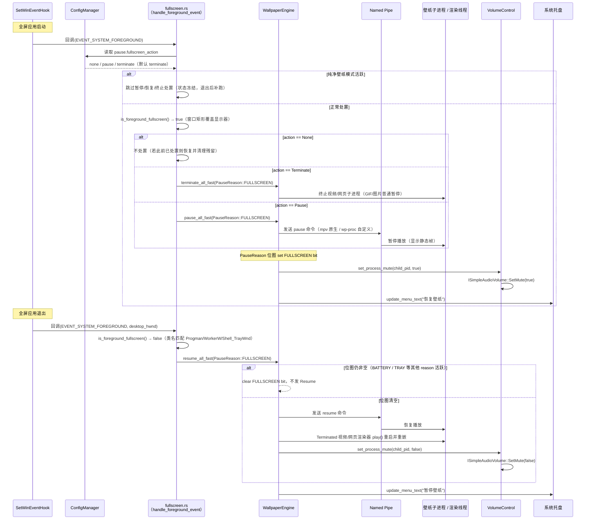

[← 返回文档索引](../index.md) > 架构与技术栈 > 暂停恢复机制

# MirrorStar Wallpaper（镜星壁纸）— 暂停/恢复机制详细设计

| 项目   | 内容                        |
| ---- | ------------------------- |
| 项目名称 | MirrorStar Wallpaper（镜星壁纸） |
| 文档版本 | v3.0                      |
| 更新日期 | 2026-10-11                |
| 文档状态 | 已实现（已按真实代码合并重组，2026-10）        |

***

## 1. 事件驱动方案详解

### 1.1 SetWinEventHook 注册

实际实现**不使用** `ProcessMonitor` 结构体，而是通过全局 `OnceLock` / `AtomicBool` 共享状态 + 独立的 `extern "system"` 回调函数实现。共享状态定义在 `src-tauri/src/state.rs:109-114`：

- `SHARED_ENGINE`：`OnceLock<Arc<tokio::sync::Mutex<WallpaperEngine>>>`，全屏检测/电源监控共享的引擎引用
- `SHARED_CONFIG`：`OnceLock<Arc<ConfigManager>>`，全屏检测/电源监控共享的配置管理器引用
- `FULLSCREEN_WAS`：`AtomicBool`（非 OnceLock），跟踪全屏事件状态（true=当前有全屏窗口），仅作事件状态标志；暂停协调由 `PauseReason` 位图负责

```rust
// 全局共享状态（src-tauri/src/state.rs:109-114）
pub(crate) static SHARED_ENGINE: OnceLock<Arc<tokio::sync::Mutex<WallpaperEngine>>> = OnceLock::new();
pub(crate) static SHARED_CONFIG: OnceLock<Arc<ConfigManager>> = OnceLock::new();
pub(crate) static FULLSCREEN_WAS: AtomicBool = AtomicBool::new(false);

/// 启动全屏应用检测线程（事件驱动，使用 SetWinEventHook）
/// src-tauri/src/platform/fullscreen.rs:139
/// 在 lib.rs 启动时调用
pub(crate) fn start_fullscreen_monitor(
    engine: Arc<tokio::sync::Mutex<WallpaperEngine>>,
    config_manager: Arc<ConfigManager>,
) {
    // 初始化全局 OnceLock 状态（OnceLock 二次 set 失败不影响正确性，Arc 引用同一资源）
    let _ = SHARED_ENGINE.set(engine);
    let _ = SHARED_CONFIG.set(config_manager);

    std::thread::Builder::new()
        .name("mirrorstar-fullscreen-monitor".to_string())
        .spawn(move || {
            // 设置事件钩子：监听前台窗口切换事件
            let hook = unsafe {
                SetWinEventHook(
                    EVENT_SYSTEM_FOREGROUND,        // 事件最小值
                    EVENT_SYSTEM_FOREGROUND,        // 事件最大值
                    None,                           // 模块句柄（自有模块）
                    Some(foreground_event_callback), // 回调函数（extern "system" 独立函数，非方法）
                    0,                              // 所有进程
                    0,                              // 所有线程
                    WINEVENT_OUTOFCONTEXT,          // 回调在调用线程的消息循环中执行
                )
            };
            // 消息循环：GetMessageW / TranslateMessage / DispatchMessageW
            // ...
        })
        .ok();
}
```

> **注意**：纯 `SetWinEventHook(EVENT_SYSTEM_FOREGROUND)` 事件驱动，无任何轮询回退。`SetWinEventHook` 失败时仅记录错误并退出全屏监控线程（详见《07-错误处理-Error-Handling.md》§3）。

```rust
/// WinEvent 回调函数（独立的 extern "system" 函数，非 ProcessMonitor 方法）
/// src-tauri/src/platform/fullscreen.rs:15
unsafe extern "system" fn foreground_event_callback(
    _hook: HWINEVENTHOOK,
    _event: u32,
    _hwnd: HWND,                     // 注意：实际通过 GetForegroundWindow() 重新获取前台窗口
    _id_object: i32,
    _id_child: i32,
    _id_event_thread: u32,
    _dwms_event_time: u32,
) {
    // 通过全局 OnceLock 获取共享状态（克隆 Arc，避免持有全局锁）
    let engine = match SHARED_ENGINE.get() {
        Some(e) => e.clone(),
        None => return,
    };
    let config = match SHARED_CONFIG.get() {
        Some(c) => c.clone(),
        None => return,
    };

    // 按配置选择全屏处置策略：none / pause / terminate（默认 terminate）
    let action = config.get_config().pause.fullscreen_action;
    // none：不做处置；若此前已处置过（运行中切换到 none），恢复壁纸并清理残留
    if action == FullscreenAction::None {
        if FULLSCREEN_WAS.load(Ordering::Acquire) {
            let failed = {
                let mut engine = match engine.try_lock() {
                    Ok(e) => e,
                    Err(_) => return,
                };
                engine
                    .resume_all_fast(PauseReason::FULLSCREEN)
                    .unwrap_or_default()
            };
            if failed.is_empty() {
                FULLSCREEN_WAS.store(false, Ordering::Release);
            }
        }
        return;
    }

    // 判断前台窗口是否全屏（is_foreground_fullscreen 内部已排除自身/桌面/任务栏窗口）
    let is_fullscreen = is_foreground_fullscreen();
    let was_fullscreen = FULLSCREEN_WAS.load(Ordering::Acquire);

    if is_fullscreen && !was_fullscreen {
        // 进入全屏 → 按 action 暂停或终止所有壁纸（实例方法，返回失败 display_id 列表）
        let failed = {
            let mut engine = match engine.try_lock() {
                Ok(e) => e,
                Err(_) => return, // engine 锁忙，跳过本次事件（WM 会重复触发，可容忍偶发跳过）
            };
            match action {
                FullscreenAction::Terminate => engine
                    .terminate_all_fast(PauseReason::FULLSCREEN)
                    .unwrap_or_default(),
                FullscreenAction::Pause => engine
                    .pause_all_fast(PauseReason::FULLSCREEN)
                    .unwrap_or_default(),
                FullscreenAction::None => unreachable!(),
            }
        };
        if failed.is_empty() {
            FULLSCREEN_WAS.store(true, Ordering::Release);
        }
    } else if !is_fullscreen && was_fullscreen {
        // 退出全屏 → 恢复壁纸（实例方法）
        let failed = {
            let mut engine = match engine.try_lock() {
                Ok(e) => e,
                Err(_) => return,
            };
            engine.resume_all_fast(PauseReason::FULLSCREEN).unwrap_or_default()
        };
        if failed.is_empty() {
            FULLSCREEN_WAS.store(false, Ordering::Release);
        }
    }

    // Bug #4 修复：通过 SHARED_APP_HANDLE 发射 wallpaper-state-changed 事件，通知前端刷新按钮状态
}
```

### 1.2 前台窗口切换处理

实际实现中，前台窗口切换处理逻辑已内联在 `foreground_event_callback`（见 §1.1）中，**不使用** `ProcessMonitor::on_foreground_changed` 方法。全屏判断与特殊窗口排除合并到单一辅助函数 `is_foreground_fullscreen`（直接调用 `GetForegroundWindow()` 获取前台窗口，不依赖回调传入的 `hwnd` 参数），暂停/恢复/终止通过 `WallpaperEngine` 的实例方法实现：

```rust
/// 检测前台窗口是否全屏 — 独立函数，非 ProcessMonitor 方法
/// src-tauri/src/platform/fullscreen.rs:250
fn is_foreground_fullscreen() -> bool {
    unsafe {
        let foreground = GetForegroundWindow();
        if foreground.is_invalid() {
            return false;
        }

        // 跳过我们自己的窗口（同时匹配中文标题"镜星壁纸"和英文标题"MirrorStar"）
        let mut title = [0u16; 256];
        let title_len = GetWindowTextW(foreground, &mut title);
        if title_len > 0 {
            let title_str = String::from_utf16_lossy(&title[..title_len as usize]);
            if title_str.contains("MirrorStar") || title_str.contains("镜星壁纸") {
                return false;
            }
        }

        // 排除桌面/壁纸层/任务栏窗口（Bug #2 修复）：
        // SetForegroundWindow(progman) 会使 Progman 成为前台窗口，其矩形覆盖全屏，
        // 通过类名排除 Progman / WorkerW / Shell_TrayWnd 等系统桌面组件。
        let mut class_name = [0u16; 256];
        let class_len = GetClassNameW(foreground, &mut class_name);
        if class_len > 0 {
            let class_str = String::from_utf16_lossy(&class_name[..class_len as usize]);
            if class_str == "Progman" || class_str == "WorkerW" || class_str == "Shell_TrayWnd" {
                return false;
            }
        }

        // 获取窗口矩形和显示器矩形
        let mut window_rect = RECT::default();
        if GetWindowRect(foreground, &mut window_rect).is_err() {
            return false;
        }
        let monitor = MonitorFromWindow(foreground, MONITOR_DEFAULTTONEAREST);
        let mut monitor_info = MONITORINFO { cbSize: std::mem::size_of::<MONITORINFO>() as u32, ..Default::default() };
        if GetMonitorInfoW(monitor, &mut monitor_info).as_bool() {
            let monitor_rect = monitor_info.rcMonitor;

            // 判定：窗口矩形完全覆盖显示器矩形（left/top ≤ monitor，right/bottom ≥ monitor）
            // 不使用 IsZoomed + 95% 面积判定，避免遗漏游戏窗口化全屏（无最大化标志）
            // 或误判接近全屏的普通窗口
            return window_rect.left <= monitor_rect.left
                && window_rect.top <= monitor_rect.top
                && window_rect.right >= monitor_rect.right
                && window_rect.bottom >= monitor_rect.bottom;
        }
        false
    }
}

// WallpaperEngine 上的实例方法（fast_path.rs）：
// - pause_all_fast(reason: PauseReason) -> Result<Vec<String>, MirrorStarError>
//     全局暂停所有壁纸，通过 PauseSender 快速通道经 mpsc 直接投递命令；
//     reason 协调：若已有其他 reason 暂停过，仅 set bit 不重复发 Pause 命令。
// - resume_all_fast(reason: PauseReason) -> Result<Vec<String>, MirrorStarError>
//     全局恢复所有壁纸，仅 clear 指定 reason 的 bit；若其他 reason 仍活跃则不发 Resume。
// - terminate_all_fast(reason: PauseReason) -> Result<Vec<String>, MirrorStarError>
//     全屏激进处置：视频/网页渲染器终止子进程，GIF/图片普通暂停；
//     同样先 set reason bit，退出全屏后由 resume_all_fast 对 Terminated 渲染器 play() 重启。
```

***

## 2. 暂停状态跟踪（PauseReason 位图）

MirrorStar 使用 `PauseReason(pub u8)` 位图协调多个暂停来源（`crates/mirrorstar-core/src/wallpaper/mod.rs`）：

| 常量 | 位值 | 场景 |
|------|------|------|
| `PauseReason::FULLSCREEN` | `0b0001` | 全屏 / 最大化自动处置 |
| `PauseReason::BATTERY` | `0b0010` | 电池供电自动处置 |
| `PauseReason::TRAY` | `0b0100` | 托盘手动暂停 |

- **`pause_all_fast(reason)`**：锁内先 `*reasons |= reason`（set bit，关闭 TOCTOU 窗口）。仅当位图**此前为空**时才向所有 `PauseSender` 发送 `PauseCommand::Pause`；已有其他 reason 时只 set bit，不重复发 Pause。
- **`resume_all_fast(reason)`**：仅 `*reasons &= !reason`（clear 指定 bit）。若其他 reason 仍活跃（位图非空），不发 Resume；**位图清空才发送 `Resume`**。清空时对 `Terminated` 的视频/网页渲染器走 `play()` 完整重启。
- **部分失败不回滚 bit**：保证已成功暂停的渲染器仍能被 `resume_all_fast` 恢复。
- `FULLSCREEN_WAS` / `POWER_WAS_ON_BATTERY` 只是**事件状态标志**（防重复触发、记录"此前是否已处置过"），**不替代 PauseReason 位图**；暂停/恢复的协调语义以位图为准。

### 2.1 电池供电监测

电池供电监测采用 **`WM_POWERBROADCAST` 事件驱动**方式（`handle_power_status_change` 函数，由 `PBT_APMPOWERSTATUSCHANGE` 触发），而非 5 秒轮询 `GetSystemPowerStatus`。开关 `pause.pause_on_battery` 默认 **false**（需用户在设置面板启用）：

```rust
/// 处理电源状态变化（由 WM_POWERBROADCAST / PBT_APMPOWERSTATUSCHANGE 触发）
/// src-tauri/src/platform/power.rs:12
pub(crate) fn handle_power_status_change() {
    // 检查配置是否启用电池供电暂停
    let config = match SHARED_CONFIG.get() {
        Some(c) => c,
        None => return,
    };
    if !config.get_config().pause.pause_on_battery {
        // 若此前因电池暂停过，恢复壁纸并重置 POWER_WAS_ON_BATTERY
        return;
    }

    // 获取系统电源状态
    let mut status = SYSTEM_POWER_STATUS::default();
    if unsafe { GetSystemPowerStatus(&mut status) }.is_err() {
        return;
    }

    // ACLineStatus: 0 = 电池供电, 1 = 交流供电, 255 = 未知（保持当前策略，跳过本次处理）
    let on_battery = match status.ACLineStatus {
        0 => true,
        1 => false,
        _ => return, // 未知状态，不触发暂停/恢复
    };
    let was_on_battery = POWER_WAS_ON_BATTERY.load(Ordering::SeqCst);

    if on_battery && !was_on_battery {
        // 交流 → 电池：暂停（实例方法 + BATTERY reason，try_lock 避免阻塞 explorer 消息循环）
        let failed = /* engine.try_lock()?.pause_all_fast(PauseReason::BATTERY) */;
        if failed.is_empty() {
            POWER_WAS_ON_BATTERY.store(true, Ordering::SeqCst);
        }
    } else if !on_battery && was_on_battery {
        // 电池 → 交流：恢复
        let failed = /* engine.try_lock()?.resume_all_fast(PauseReason::BATTERY) */;
        if failed.is_empty() {
            POWER_WAS_ON_BATTERY.store(false, Ordering::SeqCst);
        }
    }
}
```

> **注意**：电池暂停开关 `pause.pause_on_battery` 默认 **false**（不因电池供电暂停），需用户显式启用。使用 `WM_POWERBROADCAST` / `PBT_APMPOWERSTATUSCHANGE` 事件驱动，仅电源状态变化时触发检测，CPU 开销接近零。回调内通过 `SHARED_ENGINE` + `try_lock()` 获取 engine 锁（运行于 `explorer_monitor_wndproc` 窗口过程上下文，不可长时间阻塞，否则会延迟 `TaskbarCreated` 等 Explorer 事件处理），锁忙时跳过本次事件（`WM_POWERBROADCAST` 会重复触发，可容忍偶发跳过）。`ACLineStatus=255`（未知）显式保持当前策略，避免在状态不确定时误切换壁纸。

***

## 3. PauseSender 快速通道

暂停/恢复/音量/静音操作在命令层短暂获取 engine 锁定位 `PauseSender` 后，通过 `tokio::sync::mpsc::UnboundedSender<PauseCommand>` 直接投递到渲染器线程；不等待渲染器处理或 IPC 往返（并非完全绕过 engine 锁）。

### 3.1 PauseCommand 枚举

```rust
/// 暂停命令枚举
#[derive(Debug, Clone)]
pub enum PauseCommand {
    /// 暂停渲染
    Pause,
    /// 恢复渲染
    Resume,
    /// 设置音量 (0.0~1.0)
    SetVolume(f32),
    /// 切换静音
    ToggleMute,
}
```

### 3.2 PauseSender 注册与使用

```rust
/// 暂停发送器注册表（存储在 WallpaperEngine 中）
pause_senders: Arc<std::sync::RwLock<HashMap<String, PauseSender>>>
```

**通信路径对比：**

| 操作 | 旧路径（经 Mutex） | 新路径（PauseSender） |
|------|-------------------|---------------------|
| 暂停/恢复 | `Mutex<WallpaperEngine>` → 渲染器 | `UnboundedSender` → 渲染器线程 |
| 音量/静音 | `Mutex<WallpaperEngine>` → 渲染器 | `UnboundedSender` → 渲染器线程 |
| 设置壁纸 | `Mutex<WallpaperEngine>` | 仍经 Mutex |
| 关闭壁纸 | `Mutex<WallpaperEngine>` | 仍经 Mutex |

**响应时间（量级目标，待真机复测）：**

| 壁纸类型 | 暂停响应目标 | 说明 |
|----------|--------------|------|
| GIF / 图片（WorkerW） | < 10ms | PauseSender 直达渲染线程，逻辑暂停 |
| 视频（mpv.exe） | < 50ms | 含命名管道 IPC 往返与 mpv 自身命令处理 |
| 网页（wp-proc） | < 50ms | 含命名管道 IPC 往返与子进程处理 |

> 上表为端到端量级目标（含命名管道 IPC 往返与渲染器处理），需在各机型真机复测后固化。

***

## 4. GIF 暂停内存优化

GIF 渲染器暂停时按 `GifMemoryStrategy` 管理帧数据（默认 `Balanced`，保留当前帧附近 10 帧），仅 `Aggressive` 需要恢复时重新解码。帧像素预算从 200MB 降至 40MB（配置 `gif.max_memory_mb`）。

| 策略 | 暂停行为 | 恢复行为 |
|------|----------|----------|
| `Aggressive` | 释放到仅当前帧（`frames_loaded=false`） | 从文件重新解码并应用流式窗口 |
| `Balanced`（默认） | 保留当前帧附近 `balanced_keep_frames`（默认 10）帧 | 直接恢复，无需解码 |
| `Performance` | 保留所有帧 | 直接恢复 |
| `Adaptive` | 内存充足则全保留；紧张则按可用内存计算保留帧数 | 按实际保留情况直接恢复 |

```rust
/// GIF 渲染状态
pub struct GifRenderState {
    /// 壁纸文件路径（Aggressive 恢复时重新解码用）
    pub image_path: String,
    /// 解码后的帧数据
    pub frames: Vec<GifFrame>,
    /// 当前播放帧索引
    pub current_frame: usize,
    /// 帧是否已全量加载（Aggressive 暂停后为 false）
    pub frames_loaded: bool,
    /// 暂停时保存的帧索引（恢复时从该帧继续）
    pub saved_frame_index: Option<usize>,
    /// 内存管理策略（默认 Balanced）
    pub memory_strategy: GifMemoryStrategy,
    /// 平衡模式保留帧数（默认 10）
    pub balanced_keep_frames: usize,
    /// 最大内存预算（MB，默认 40）
    pub max_memory_mb: usize,
}

impl GifRenderer {
    /// 暂停：按策略保留/释放帧
    fn pause(&mut self) {
        match self.memory_strategy {
            GifMemoryStrategy::Aggressive => {
                // 仅保留当前帧，恢复时重新解码
                let current = self.current_frame;
                self.frames.drain(..current);
                self.frames.truncate(1);
                self.current_frame = 0;
                self.frames_loaded = false;
                self.saved_frame_index = Some(current);
            }
            GifMemoryStrategy::Balanced => {
                // 保留当前帧附近 balanced_keep_frames 帧（默认 10）
                let keep = self.balanced_keep_frames.max(1);
                // ... 计算窗口并 drain 窗口外帧 ...
                self.saved_frame_index = Some(self.current_frame);
            }
            GifMemoryStrategy::Performance => {
                // 保留所有帧
                self.saved_frame_index = Some(self.current_frame);
            }
            GifMemoryStrategy::Adaptive => {
                // 内存充足：保留所有帧；紧张：按自适应保留帧数裁剪
            }
        }
    }

    /// 恢复：仅 Aggressive 需要重新解码
    fn resume(&mut self) -> Result<(), MirrorStarError> {
        if !self.frames_loaded {
            let saved_index = self.saved_frame_index.unwrap_or(0);
            self.frames = decode_gif_streaming(&self.image_path, self.max_memory_mb, saved_index)?;
            self.frames_loaded = true;
            self.current_frame = saved_index.min(self.frames.len().saturating_sub(1));
        }
        self.saved_frame_index = None;
        Ok(())
    }
}
```

**内存影响：**

| 状态 | 旧方案（200MB 预算） | 新方案（40MB 预算） |
|------|---------------------|---------------------|
| 播放中 | 最高 200MB | 最高 40MB |
| 暂停中（Balanced 默认） | 保留所有帧，仍占 200MB | 保留约 10 帧，显著低于预算上限 |

***

## 5. 图片暂停像素释放

静态图片渲染器（WorkerW 模式）暂停时释放像素数据，恢复时从文件重新加载。

```rust
/// 图片渲染器
pub struct ImageRenderer {
    /// 壁纸文件路径（恢复时重新加载用）
    pub image_path: String,
    /// 像素数据
    pub pixels: Vec<u8>,
    /// 是否暂停
    pub paused: bool,
    // ... 其他字段
}

impl ImageRenderer {
    /// 暂停：释放像素数据
    fn pause(&mut self) -> Result<()> {
        self.pixels = Vec::new();  // 释放像素内存
        self.paused = true;
        Ok(())
    }

    /// 恢复：从文件重新加载
    fn resume(&mut self) -> Result<()> {
        if self.paused {
            self.pixels = load_and_downsample_image(&self.image_path)?;
            self.paused = false;
        }
        Ok(())
    }
}
```

> **注意**：原生壁纸模式（JPG/JPEG/PNG/BMP/TIF/TIFF/DIB）的暂停/恢复为空操作（no-op），因为壁纸由系统直接渲染，无需额外控制。

***

## 6. 暂停机制（逻辑暂停，非线程挂起）

MirrorStar 使用**逻辑暂停**（PauseSender 快速通道），**不使用** `SuspendThread`/`ResumeThread`。

`SuspendThread` 通过挂起外部进程的所有线程实现暂停，这是一种不安全且可能造成风险的操作——若线程在持有锁时被挂起，可能导致死锁。MirrorStar 主动放弃该方案，改为在各渲染器内实现协作式的逻辑暂停。

MirrorStar 的暂停通过以下方式实现：

| 壁纸类型 | 暂停方式 | 说明 |
|----------|----------|------|
| 视频（mpv.exe） | MpvIpcClient 发送 pause 命令 | mpv 原生 JSON IPC，mpv 自行暂停解码 |
| 网页（壳 `--wp-proc` 模式） | WpProcIpcClient 发送 pause 命令 | wp-proc 自定义协议，子进程暂停渲染 |
| GIF | PauseSender → 渲染线程停止 WM_TIMER | 主进程内线程，按 `GifMemoryStrategy` 保留/释放帧（默认 Balanced 保留 10 帧） |
| 图片（WorkerW） | PauseSender → 渲染线程停止 | 主进程内线程，释放像素数据 |
| 图片（Native） | 空操作（no-op） | 系统直接渲染，无需控制 |

> **关键区别**：MirrorStar 采用逻辑暂停（PauseSender 快速通道经 mpsc 直接投递暂停/恢复命令，不等待渲染器处理），而非线程挂起方式，因此更安全且响应更快。

***

## 7. 暂停/恢复完整流程



***

## 8. 纯净壁纸模式守卫

纯净壁纸模式（`mirrorstar_core::pure_mode::is_active()`）运行期间，壁纸窗口被摘出桌面层并置顶，任何自动处置都会破坏沉浸画面。守卫规则：

| 路径 | 守卫行为 |
|------|----------|
| `state.rs::try_pause_all_fast` / `try_resume_all_fast` / `try_terminate_all_fast` / `resume_all_fast_blocking` | 首部检查 `pure_mode::is_active()`，命中则直接返回 `None`，跳过暂停/恢复/终止处置；调用方不更新 `FULLSCREEN_WAS` / `POWER_WAS_ON_BATTERY`，状态冻结 |
| `state.rs::try_heal_desktop_layer` | 模式内临时覆盖窗是顶层窗口、不挂在桌面层下，跳过桌面层自愈（返回 `None`） |
| 轮换调度器（`scheduler.rs`） | 定时轮换与手动"下一张"均跳过（`pure_mode::is_active() || pause_reasons 非空` 即抑制）；退出时 `wake` 重算 deadline |

- 纯净模式自身**不占用 `PauseReason` 位**：该位图对非空原因统一发 `PauseCommand::Pause`，而模式的目标是"抑制轮换/处置但不停播"，塞入位图会污染语义。
- **退出后补跑**：`fullscreen::reevaluate_now()` 复用 `handle_foreground_event` 补跑一次前台全屏判定；`power::reevaluate_now()` 复用 `handle_power_status_change` 补跑一次电源判定，纠正模式期间冻结的状态漂移。

***

**相关文档：**

- [01-架构与技术栈总览](./01-架构与技术栈总览-Architecture-and-Tech-Stack-Overview.md)
- [02-模块设计](./02-模块设计-Module-Design.md)
- [03-进程架构与IPC](./03-进程架构与IPC-Process-Architecture-and-IPC.md)
- [04-桌面集成与Windows系统API](./04-桌面集成与Windows系统API-Desktop-Integration-and-Windows-API.md)
- [05-壁纸渲染](./05-壁纸渲染-Wallpaper-Rendering.md)
- [07-错误处理](./07-错误处理-Error-Handling.md)
- [09-性能优化](./09-性能优化-Performance.md)