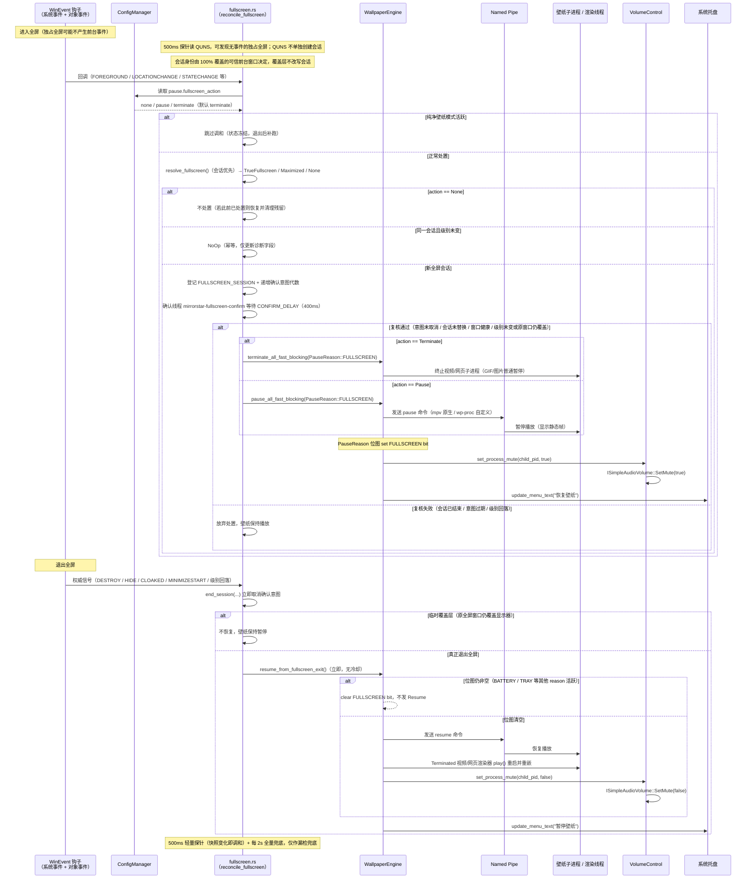

[← 返回文档索引](../index.md) > 架构与技术栈 > 暂停恢复机制

# MirrorStar Wallpaper（镜星壁纸）— 暂停/恢复机制详细设计

| 项目   | 内容                        |
| ---- | ------------------------- |
| 项目名称 | MirrorStar Wallpaper（镜星壁纸） |
| 文档版本 | v3.0                      |
| 更新日期 | 2026-10-11                |
| 文档状态 | 已实现（已按真实代码合并重组，2026-10）        |

***

## 1. 事件驱动方案详解

### 1.1 SetWinEventHook 注册

实际实现**不使用** `ProcessMonitor` 结构体，而是通过全局 `OnceLock` / `AtomicBool` 共享状态 + 独立的 `extern "system"` 回调函数实现。共享状态定义在 `src-tauri/src/state.rs:109-114`：

- `SHARED_ENGINE`：`OnceLock<Arc<tokio::sync::Mutex<WallpaperEngine>>>`，全屏检测/电源监控共享的引擎引用
- `SHARED_CONFIG`：`OnceLock<Arc<ConfigManager>>`，全屏检测/电源监控共享的配置管理器引用
- `FULLSCREEN_WAS`：`AtomicBool`（非 OnceLock），跟踪全屏事件状态（true=当前有全屏窗口），仅作事件状态标志；暂停协调由 `PauseReason` 位图负责

```rust
// 全局共享状态（src-tauri/src/state.rs:109-114）
pub(crate) static SHARED_ENGINE: OnceLock<Arc<tokio::sync::Mutex<WallpaperEngine>>> = OnceLock::new();
pub(crate) static SHARED_CONFIG: OnceLock<Arc<ConfigManager>> = OnceLock::new();
pub(crate) static FULLSCREEN_WAS: AtomicBool = AtomicBool::new(false);

/// 启动全屏应用检测线程（事件驱动，使用 SetWinEventHook）
/// src-tauri/src/platform/fullscreen.rs:139
/// 在 lib.rs 启动时调用
pub(crate) fn start_fullscreen_monitor(
    engine: Arc<tokio::sync::Mutex<WallpaperEngine>>,
    config_manager: Arc<ConfigManager>,
) {
    // 初始化全局 OnceLock 状态（OnceLock 二次 set 失败不影响正确性，Arc 引用同一资源）
    let _ = SHARED_ENGINE.set(engine);
    let _ = SHARED_CONFIG.set(config_manager);

    std::thread::Builder::new()
        .name("mirrorstar-fullscreen-monitor".to_string())
        .spawn(move || {
            // 设置事件钩子：监听前台窗口切换事件
            let hook = unsafe {
                SetWinEventHook(
                    EVENT_SYSTEM_FOREGROUND,        // 事件最小值
                    EVENT_SYSTEM_FOREGROUND,        // 事件最大值
                    None,                           // 模块句柄（自有模块）
                    Some(foreground_event_callback), // 回调函数（extern "system" 独立函数，非方法）
                    0,                              // 所有进程
                    0,                              // 所有线程
                    WINEVENT_OUTOFCONTEXT,          // 回调在调用线程的消息循环中执行
                )
            };
            // 消息循环：GetMessageW / TranslateMessage / DispatchMessageW
            // ...
        })
        .ok();
}
```

> **注意**：上方代码仅示意系统事件钩子。实际实现为**两个钩子**（系统事件 `EVENT_SYSTEM_FOREGROUND..EVENT_SYSTEM_MINIMIZEEND` + 对象事件 `EVENT_OBJECT_DESTROY..EVENT_OBJECT_UNCLOAKED`），统一回调为 `win_event_callback`，详见 §1.3。主检测为事件快路径；另有 500ms 轻量探针（QUNS + 前台根快照）与每 2s 全量兜底调和（`mirrorstar-fullscreen-probe`）作为漏检兜底。系统事件钩子安装失败时记录错误并退出全屏监控线程，对象事件钩子失败时仅告警并继续（详见《07-错误处理-Error-Handling.md》§3）。

```rust
/// WinEvent 回调函数（独立的 extern "system" 函数，非 ProcessMonitor 方法）
/// src-tauri/src/platform/fullscreen.rs:15
unsafe extern "system" fn foreground_event_callback(
    _hook: HWINEVENTHOOK,
    _event: u32,
    _hwnd: HWND,                     // 注意：实际通过 GetForegroundWindow() 重新获取前台窗口
    _id_object: i32,
    _id_child: i32,
    _id_event_thread: u32,
    _dwms_event_time: u32,
) {
    // 通过全局 OnceLock 获取共享状态（克隆 Arc，避免持有全局锁）
    let engine = match SHARED_ENGINE.get() {
        Some(e) => e.clone(),
        None => return,
    };
    let config = match SHARED_CONFIG.get() {
        Some(c) => c.clone(),
        None => return,
    };

    // 按配置选择全屏处置策略：none / pause / terminate（默认 terminate）
    let action = config.get_config().pause.fullscreen_action;
    // none：不做处置；若此前已处置过（运行中切换到 none），恢复壁纸并清理残留
    if action == FullscreenAction::None {
        if FULLSCREEN_WAS.load(Ordering::Acquire) {
            let failed = {
                let mut engine = match engine.try_lock() {
                    Ok(e) => e,
                    Err(_) => return,
                };
                engine
                    .resume_all_fast(PauseReason::FULLSCREEN)
                    .unwrap_or_default()
            };
            if failed.is_empty() {
                FULLSCREEN_WAS.store(false, Ordering::Release);
            }
        }
        return;
    }

    // 判断前台窗口是否全屏（is_foreground_fullscreen 内部已排除自身/桌面/任务栏窗口）
    let is_fullscreen = is_foreground_fullscreen();
    let was_fullscreen = FULLSCREEN_WAS.load(Ordering::Acquire);

    if is_fullscreen && !was_fullscreen {
        // 进入全屏 → 按 action 暂停或终止所有壁纸（实例方法，返回失败 display_id 列表）
        let failed = {
            let mut engine = match engine.try_lock() {
                Ok(e) => e,
                Err(_) => return, // engine 锁忙，跳过本次事件（WM 会重复触发，可容忍偶发跳过）
            };
            match action {
                FullscreenAction::Terminate => engine
                    .terminate_all_fast(PauseReason::FULLSCREEN)
                    .unwrap_or_default(),
                FullscreenAction::Pause => engine
                    .pause_all_fast(PauseReason::FULLSCREEN)
                    .unwrap_or_default(),
                FullscreenAction::None => unreachable!(),
            }
        };
        if failed.is_empty() {
            FULLSCREEN_WAS.store(true, Ordering::Release);
        }
    } else if !is_fullscreen && was_fullscreen {
        // 退出全屏 → 恢复壁纸（实例方法）
        let failed = {
            let mut engine = match engine.try_lock() {
                Ok(e) => e,
                Err(_) => return,
            };
            engine.resume_all_fast(PauseReason::FULLSCREEN).unwrap_or_default()
        };
        if failed.is_empty() {
            FULLSCREEN_WAS.store(false, Ordering::Release);
        }
    }

    // Bug #4 修复：通过 SHARED_APP_HANDLE 发射 wallpaper-state-changed 事件，通知前端刷新按钮状态
}
```

### 1.2 前台窗口切换处理

实际实现中，前台窗口切换处理逻辑已内联在 `foreground_event_callback`（见 §1.1）中，**不使用** `ProcessMonitor::on_foreground_changed` 方法。全屏判断与特殊窗口排除合并到单一辅助函数 `is_foreground_fullscreen`（直接调用 `GetForegroundWindow()` 获取前台窗口，不依赖回调传入的 `hwnd` 参数），暂停/恢复/终止通过 `WallpaperEngine` 的实例方法实现：

```rust
/// 检测前台窗口是否全屏 — 独立函数，非 ProcessMonitor 方法
/// src-tauri/src/platform/fullscreen.rs:250
fn is_foreground_fullscreen() -> bool {
    unsafe {
        let foreground = GetForegroundWindow();
        if foreground.is_invalid() {
            return false;
        }

        // 跳过我们自己的窗口（同时匹配中文标题"镜星壁纸"和英文标题"MirrorStar"）
        let mut title = [0u16; 256];
        let title_len = GetWindowTextW(foreground, &mut title);
        if title_len > 0 {
            let title_str = String::from_utf16_lossy(&title[..title_len as usize]);
            if title_str.contains("MirrorStar") || title_str.contains("镜星壁纸") {
                return false;
            }
        }

        // 排除桌面/壁纸层/任务栏窗口（Bug #2 修复）：
        // SetForegroundWindow(progman) 会使 Progman 成为前台窗口，其矩形覆盖全屏，
        // 通过类名排除 Progman / WorkerW / Shell_TrayWnd 等系统桌面组件。
        let mut class_name = [0u16; 256];
        let class_len = GetClassNameW(foreground, &mut class_name);
        if class_len > 0 {
            let class_str = String::from_utf16_lossy(&class_name[..class_len as usize]);
            if class_str == "Progman" || class_str == "WorkerW" || class_str == "Shell_TrayWnd" {
                return false;
            }
        }

        // 获取窗口矩形和显示器矩形
        let mut window_rect = RECT::default();
        if GetWindowRect(foreground, &mut window_rect).is_err() {
            return false;
        }
        let monitor = MonitorFromWindow(foreground, MONITOR_DEFAULTTONEAREST);
        let mut monitor_info = MONITORINFO { cbSize: std::mem::size_of::<MONITORINFO>() as u32, ..Default::default() };
        if GetMonitorInfoW(monitor, &mut monitor_info).as_bool() {
            let monitor_rect = monitor_info.rcMonitor;

            // 判定：窗口矩形完全覆盖显示器矩形（left/top ≤ monitor，right/bottom ≥ monitor）
            // 不使用 IsZoomed + 95% 面积判定，避免遗漏游戏窗口化全屏（无最大化标志）
            // 或误判接近全屏的普通窗口
            return window_rect.left <= monitor_rect.left
                && window_rect.top <= monitor_rect.top
                && window_rect.right >= monitor_rect.right
                && window_rect.bottom >= monitor_rect.bottom;
        }
        false
    }
}

// WallpaperEngine 上的实例方法（fast_path.rs）：
// - pause_all_fast(reason: PauseReason) -> Result<Vec<String>, MirrorStarError>
//     全局暂停所有壁纸，通过 PauseSender 快速通道经 mpsc 直接投递命令；
//     reason 协调：若已有其他 reason 暂停过，仅 set bit 不重复发 Pause 命令。
// - resume_all_fast(reason: PauseReason) -> Result<Vec<String>, MirrorStarError>
//     全局恢复所有壁纸，仅 clear 指定 reason 的 bit；若其他 reason 仍活跃则不发 Resume。
// - terminate_all_fast(reason: PauseReason) -> Result<Vec<String>, MirrorStarError>
//     全屏激进处置：视频/网页渲染器终止子进程，GIF/图片普通暂停；
//     同样先 set reason bit，退出全屏后由 resume_all_fast 对 Terminated 渲染器 play() 重启。
```

***

### 1.3 全屏状态调和（事件驱动，2026-11-04 真机修复）

#### 1.3.1 根因：只监听前台事件会漏检"进入独占全屏"

旧实现只注册 `EVENT_SYSTEM_FOREGROUND`，把"前台窗口变化"当作唯一的全屏状态输入。
但**独占全屏（D3D `ChangeDisplaySettings` / borderless→exclusive）是在同一个前台窗口
内部切换**：窗口句柄与前台窗口都不变，因此**不会产生任何前台事件**。

真机日志 `mirrorstar.log.2026-11-04` 印证了这一顺序错误：

| 时间 | 现象 |
|------|------|
| 13:53:10 | `MEM-ATTRIB` 显示 mpv 仍在运行（全屏游戏期间壁纸内存始终未释放） |
| 13:53:33.640 | **首次**"检测到真全屏"并执行终止（进入全屏的整段时间都没有被感知） |
| 13:53:33.640 + 14µs | 紧接着进入退出分支并恢复壁纸 |
| ~13:53:34.561 | 桌面闪现原始静态壁纸约 0.9~1.0s（终止 + 500ms 恢复冷却 + 2s 复查 + mpv 冷启动叠加） |

即：直到用户**退出**全屏的瞬间才第一次检测到"真全屏"并终止，随后立即恢复，形成
"全屏期间不省内存、退出时反而闪一下静态壁纸"的错误顺序。

#### 1.3.2 两个 WinEvent 钩子

| 钩子 | 事件范围 | 标志 | 安装失败处理 |
|------|----------|------|--------------|
| 系统事件 | `EVENT_SYSTEM_FOREGROUND .. EVENT_SYSTEM_MINIMIZEEND` | `WINEVENT_OUTOFCONTEXT` | 记录 `error` 并**停止全屏监控线程**（置 `FULLSCREEN_MONITOR_RUNNING=false`） |
| 对象事件 | `EVENT_OBJECT_DESTROY .. EVENT_OBJECT_UNCLOAKED`（0x8001..0x8015） | `WINEVENT_OUTOFCONTEXT \| WINEVENT_SKIPOWNPROCESS` | 记录 `warn` 并**继续运行**：前台事件 + 500ms 轻量探针 + 2s 全量兜底仍生效，但独占全屏的发现时延会上升 |

两个钩子句柄统一存入 `WIN_EVENT_HOOKS: Mutex<Vec<SendWinEventHook>>`（`state.rs`），
退出/重启时全部 `UnhookWinEvent`（谁先取到列表谁负责注销，幂等安全）。

#### 1.3.3 事件路由与过滤

`win_event_callback` 只做"事件类型过滤 + 根祖先比较 + 节流判定 + 调和"，
不在回调节点加锁执行重活：

| 事件 | 过滤条件 | 动作 |
|------|----------|------|
| `EVENT_SYSTEM_FOREGROUND` | 无（先于 HWND 判空处理） | `reconcile_fullscreen("foreground")` |
| `EVENT_SYSTEM_MINIMIZESTART` | 根祖先 == 会话 HWND | `end_session("minimize")` + 调和 |
| `EVENT_SYSTEM_MINIMIZEEND` | 根祖先 == 会话 HWND | 调和（`"restore"`） |
| `EVENT_OBJECT_DESTROY` | 原始 HWND == 会话 HWND | `end_session("session_destroyed")` + 调和 |
| `EVENT_OBJECT_HIDE` | 原始 HWND == 会话 HWND | `end_session("session_hidden")` + 调和 |
| `EVENT_OBJECT_CLOAKED` | 原始 HWND == 会话 HWND | `end_session("session_cloaked")` + 调和 |
| `EVENT_OBJECT_UNCLOAKED` | 原始/根 HWND == 会话 HWND | 调和（`"uncloak"`） |
| `EVENT_OBJECT_LOCATIONCHANGE` / `STATECHANGE` | 根祖先 == 会话 HWND **或** 根祖先 == 当前前台根；且通过 **≥100ms** 节流 | 调和（`"window_state"`） |
| 其它事件 / 其它窗口 | — | 直接忽略 |

- `DESTROY`/`HIDE`/`CLOAKED` 直接用**原始 HWND** 比较（窗口销毁后 `GetAncestor` 不可靠）；
  其余统一用 `GetAncestor(GA_ROOT)` 换算根祖先（纯 Win32 封装，回调内不加锁）。
- `LOCATIONCHANGE`/`STATECHANGE` 是发现"同一前台窗口内部切到独占全屏"的关键信号；
  `WINDOW_STATE_THROTTLE_MS=100` 节流保证普通窗口拖动/缩放不会高频进入状态机。

#### 1.3.4 全屏会话与 400ms 确认

`FULLSCREEN_SESSION`（会话根 HWND + 登记级别 + 诊断用 `display_id`）取代原来的"宽限期"定时器：

| 步骤 | 行为 |
|------|------|
| 1. 统一入口 | 前台事件、生命周期事件、500ms 探针、2s 全量兜底、启动初始化、纯净模式退出补跑都调用 `reconcile_fullscreen(reason)`；内部用 `RECONCILE_GUARD.try_lock()` 串行化（拿不到锁直接跳过）；纯净模式活跃时直接返回（状态冻结） |
| 2. 幂等短路 | 同一会话（前台根相同）且级别未变 → 只更新诊断字段，不重复处置（NoOp） |
| 3. 登记会话 | 新会话写入 `FULLSCREEN_SESSION`（`hwnd` / `level` / `display_id`）、置 `FULLSCREEN_WAS=true`、递增 `PENDING_ACTION_GENERATION`，spawn 独立线程 `mirrorstar-fullscreen-confirm` |
| 4. 400ms 复核 | 等待 `CONFIRM_DELAY=400ms` 后判定：意图代数未变、会话未被替换（`SessionIdentity { hwnd, level }`）、会话窗口 `IsWindow && IsWindowVisible && !IsIconic` 且未被 DWM Cloak（`DWMWA_CLOAKED`）；`level_now` 由**同一观测 + `resolve_fullscreen`** 得出，与登记级别一致**或**原全屏窗口仍覆盖显示器（任务管理器/Alt-Tab 覆盖层）**或** QUNS 仍明确为全屏 |
| 5. 执行 | 复核通过才调用 `pause_all_fast_blocking` / `terminate_all_fast_blocking`（阻塞式，仅运行在独立线程，不阻塞 WinEvent 回调）；两者在**取得 engine 锁之后、执行处置之前**再做一次 `still_valid` 最终校验（见 §1.3.8），`false` 则记录 `info`「等待 engine 锁期间会话已结束，取消全屏终止/暂停」并返回 `None`；终止成功后 `record_terminate_time()` + 递增 `TERMINATION_GENERATION` |
| 6. 取消 | 会话销毁/隐藏/Cloak/最小化、级别变化、策略切 `none` → **立即**递增意图代数并清空会话，确认线程醒来判定过期后直接返回，**mpv 与壁纸窗口保持存活** |

> 400ms 只用于过滤"刚进入全屏就被销毁/隐藏"的瞬态窗口；真正的取消由窗口生命周期事件
> 完成，不再依赖"等了多久"的猜测。`TERMINATE_COOLDOWN=1000ms` 终止防抖仍保留。
> 由于复核改走"同一观测 + `resolve_fullscreen`"，**覆盖层场景仍然有效**：任务管理器 /
> Alt-Tab 出现在前台不会把 `level_now` 拉回覆盖层窗口，确认不会被误取消。
>
> **确认线程存在两级校验**：400ms 复核（意图代数 / 会话身份 / 窗口健康 / 级别）决定"是否还要处置"，
> 取得 engine 锁后的 `still_valid` 最终校验决定"此刻是否仍然值得处置"。后者失败会记录
> `info`「等待 engine 锁期间会话已结束，取消全屏终止/暂停」，与前者记录的"确认取消"日志可区分，
> 便于按日志判断取消发生在复核阶段还是锁等待阶段（仍无法撤销已发出的 mpv quit，见 §1.3.8）。

#### 1.3.5 权威退出立即恢复（无冷却、无等待）

| 权威退出信号 | 处理 |
|--------------|------|
| 会话窗口 `DESTROY` / `HIDE` / `CLOAKED` | 结束会话 → `resume_from_fullscreen_exit()` |
| 会话窗口最小化（`MINIMIZESTART`） | 结束会话 → 恢复；会话因最小化而**不活跃**（`alive=false`），**即使 QUNS 仍滞留为全屏也不会新建会话**，直接立即恢复 |
| 前台级别回落（`TrueFullscreen → None`） | 结束会话 → 立即恢复 |
| 前台窗口被 DWM Cloak（`DWMWA_CLOAKED` 非零 → 不可信） | `resolve_fullscreen` 级别判为 `None`（UWP 挂起/切后台后桌面已暴露）→ 结束会话 → 立即恢复 |
| `TrueFullscreen` 降为 `Maximized` | 会话级别降级，**不恢复**（桌面仍被覆盖） |
| 临时覆盖层（原全屏窗口仍覆盖显示器） | **不恢复**、不结束会话 |

- 退出判定不再依赖"QUNS 回落"：QUNS 可能因覆盖层/锁屏而滞留为全屏，只要会话不活跃
  （销毁/隐藏/Cloak/最小化）或前台不再 100% 覆盖，级别即为 `None` 并立即恢复；
  反之，QUNS 单独存在不会创建新会话（见 §1.3.7）。
- 已删除 `RESUME_COOLDOWN`（500ms）、`in_resume_cooldown*`、`remaining_resume_cooldown*`、
  `schedule_resume_after_cooldown` 与 `mirrorstar-fullscreen-resume-delay` 线程；
  退出全屏（级别回落 / 会话销毁/隐藏/Cloak/最小化）直接调用 `resume_from_fullscreen_exit()`。
- 保留 `RESUME_IN_PROGRESS` 去重（同一时刻仅一个后台恢复线程）与终止代数比对
  （`TERMINATION_GENERATION`，防止慢跑的旧恢复覆盖后续新终止）。

#### 1.3.6 兜底与启动初始化

| 路径 | 行为 |
|------|------|
| 500ms 轻量探针 + 2s 全量兜底（`mirrorstar-fullscreen-probe`） | 每 `PROBE_INTERVAL=500ms` 采集一次快照（`quns` / `foreground_root` / `iconic` / `cloaked`）；快照变化 → `reconcile_fullscreen("probe")`；每 4 个 tick（`FULL_RECONCILE_EVERY_TICKS`，≈2s）→ `reconcile_fullscreen("watchdog")` 全量调和，同时兜底漏检的**进入**与**退出**（对象钩子失效、无前台切换、独占 D3D 全屏、最小化/Cloak 等），不再只在 `FULLSCREEN_WAS=true` 时检查。探针不进入 engine 锁、不执行处置 |
| 监控线程启动 | 安装钩子后、进入消息循环前调用 `reconcile_fullscreen("startup")`，识别"应用启动时已处于全屏"的前台窗口 |
| 纯净壁纸模式 | `reconcile_fullscreen` 直接返回、`state.rs` 共享 helper 首部守卫同样返回 `None`，`FULLSCREEN_LEVEL` / `FULLSCREEN_SESSION` / `FULLSCREEN_WAS` 保持冻结；退出后 `reevaluate_now()` 以 `"pure_mode_exit"` 补跑一次 |

> 确认线程允许使用 `blocking_lock`（不运行于 WinEvent 回调线程），因此不会因 engine
> 锁忙而丢弃处置；WinEvent 回调线程本身仍只做 lightweight 判定与登记。

> 兜底路径的 `reason`：`probe`（探针快照变化）、`watchdog`（每 2s 全量）、`startup`（启动初始化）、`pure_mode_exit`（纯净模式退出补跑）；事件路径与完整 reason 列表见 §1.3.7。

#### 1.3.7 会话优先的全屏判定与 500ms 探针（对齐主流实现，2026-11-06 修订）

对象事件是"尽力而为"的变更通知：独占 D3D 全屏（游戏 / 播放器调用 `ChangeDisplaySettings`）**不保证**发出 `EVENT_OBJECT_LOCATIONCHANGE` / `STATECHANGE`，仅靠钩子仍可能整段漏检。微软官方对 `SHQueryUserNotificationState` 的 Remarks 亦明确：**全屏应用启动 / 停止不会发送 WM 通知，调用方必须轮询**——因此 500ms 轻量探针是必要组件，而不是可选的兜底。

**会话身份与权威信号解耦**：

- **QUNS 只负责"触发 / 维持 / 确认"**：探针据此发现状态变化、维持已有全屏会话、为 400ms 复核提供"系统仍全屏"的证据；
- **窗口矩形负责"身份"**：谁能成为全屏会话的锚定窗口，由前台窗口的可信度 + DWM 可见边界 **100% 覆盖**决定；
- **会话负责"事实"**：会话一旦登记，级别与身份优先沿用；覆盖层（任务管理器 / Alt-Tab 等不覆盖前台）不得改写会话与 `LAST_FULLSCREEN`；
- **QUNS 不单独创建 `TrueFullscreen` 会话**：若 QUNS 报告全屏但前台是不可信 / 不覆盖窗口，级别仍为 `None`，避免把覆盖层当成全屏应用身份（旧的"由 QUNS 直接决定前台级别"会导致此类误判）。

**一次观测 + 纯函数解析**（`observe_fullscreen` / `resolve_fullscreen`）：

- `FullscreenObservation`：一次采集 `quns`、`quns_verdict`、前台根 HWND `fg_root`、`fg_credible`（排除自身窗口 / 系统桌面组件 / 自家渲染器 / Cloak / 最小化）、`fg_covers`（DWM 可见边界 100% 覆盖）、`fg_maximized`（`IsZoomed` 或 ≥95%）、`fg_iconic`、`fg_cloaked`、`display_id`（`MONITORINFOEXW.szDevice`）；一次调和与一次会话复核**各只读一次 QUNS**；
- `SessionProbe { hwnd, level, alive, covers, cloaked }`：当前会话的健康快照；`ObservedForeground { root, credible, covers, maximized }`：前台几何 / 可信度；
- `resolve_fullscreen(session, quns_fullscreen, fg) -> Resolution { level, anchor, switch_to }`：纯函数（便于单元测试）；`switch_to` 仅表示"全屏应用切换，只更新会话身份，不重复暂停 / 终止"。

**QUNS 映射**（`SHQueryUserNotificationState`，`Win32::UI::Shell`；仅作维持 / 确认证据）：

| QUNS 状态 | 值 | 作用（不再直接决定前台级别） |
|-----------|----|------|
| `QUNS_NOT_PRESENT`（锁屏 / 屏保） | 1 | 不提供全屏证据（`NotFullscreen`）；会话维持仅依赖窗口覆盖 |
| `QUNS_BUSY`（全屏应用 / 全屏优化） | 2 | 全屏证据：触发探针、维持已有会话、支撑确认复核 |
| `QUNS_RUNNING_D3D_FULL_SCREEN`（D3D 独占全屏） | 3 | 全屏证据（同上） |
| `QUNS_PRESENTATION_MODE`（演示模式） | 4 | 全屏证据（同上） |
| `QUNS_ACCEPTS_NOTIFICATIONS` / `QUNS_QUIET_TIME` / `QUNS_APP` | 5 / 6 / 7 | 无证据（`Fallback`），只依赖前台覆盖 / 最大化判定 |
| 调用失败（HRESULT 错误） | — | `debug` 记录，按无证据处理；仍可由前台覆盖 + 会话优先解析得出结果 |

> `QUNS_RUNNING_D3D_FULL_SCREEN` 是 Lively Wallpaper 等主流实现识别独占全屏的官方信号；对 `ChangeDisplaySettings` 型全屏，QUNS 是可靠的"系统仍在全屏"证据，但**全屏应用身份仍必须由 100% 覆盖的前台窗口给出**。Windows 的全屏优化（fullscreen optimizations）可能让全屏应用报为 `QUNS_BUSY` 而非 `QUNS_RUNNING_D3D_FULL_SCREEN`，映射表已一并覆盖。

**DWM 精化**：

- `DwmGetWindowAttribute(DWMWA_EXTENDED_FRAME_BOUNDS)` 取**可见窗口边界**（不含 Win10/11 的不可见 resize 边框），失败或返回空矩形时回退 `GetWindowRect`；
- `DwmGetWindowAttribute(DWMWA_CLOAKED)` 非零 → 该窗口**不可信**（UWP 挂起 / 切后台时窗口不可见）：作为前台时级别判为 `None`；作为会话时判定为不活跃，结束会话后立即恢复；
- 依赖 features：workspace `Cargo.toml` 的 `windows` 新增 `Win32_Graphics_Dwm`、`Win32_UI_Shell`（QUNS 与 DWM API 的编译期门控）。

**会话新增 `display_id`**：会话登记时记录 `MONITORINFOEXW.szDevice`（如 `\\.\DISPLAY1`）。当前仅用于调和 / 会话日志诊断，并为后续"按显示器分别处置"预留；处置仍是全局的（任一显示器真全屏即按配置暂停 / 终止全部壁纸）。

**级别计算优先级**（`resolve_fullscreen`，会话优先）：

| 顺序 | 判据 | 结果 |
|------|------|------|
| 1 | 存在**活跃会话**（会话存在、窗口存活、未 Cloak，且会话窗口仍 100% 覆盖显示器 **或** QUNS 仍为全屏） | 沿用会话级别与身份；若此时出现新的"可信且 100% 覆盖"前台窗口（HWND 与会话不同），仅以 `switch_to` 更新会话身份，级别仍为 `TrueFullscreen`，不重复暂停 / 终止 |
| 2 | 无活跃会话，且前台可信并 **100% 覆盖**显示器 | `TrueFullscreen`（新会话） |
| 3 | 无活跃会话，且前台可信并最大化（`IsZoomed` 或 ≥95%） | `Maximized` |
| 4 | 其余（含 QUNS 单独为全屏、前台为不覆盖的覆盖层或不可信窗口） | `None` |

> 覆盖层（任务管理器 / Alt-Tab）在前台时，只要会话仍存活且覆盖，级别保持 `TrueFullscreen`，会话与 `LAST_FULLSCREEN` 均不被改写；只有"可信且 100% 覆盖"的前台窗口才能改写身份。

**500ms 轻量探针 + 2s 全量兜底**（线程 `mirrorstar-fullscreen-probe`）：

- 每 `PROBE_INTERVAL=500ms` 采集 `ProbeSnapshot`：`quns`（原始值，失败为 `None`）、`foreground_root`（前台根 HWND）、`iconic`（`IsIconic`）、`cloaked`（`DWMWA_CLOAKED`）；
- 快照与上次不同 → `reconcile_fullscreen("probe")`；每 4 个 tick（`FULL_RECONCILE_EVERY_TICKS`，≈2s）→ `reconcile_fullscreen("watchdog")` 全量兜底；
- **探针不进入 engine 锁、不执行处置**：只做只读查询与状态登记，暂停/终止仍由 400ms 确认线程统一执行；
- 效果：无事件的独占全屏发现时延 ≤1s，事件快路径仍保持前台切换的近实时响应。

**会话确认（`ConfirmCheck`）与调和共用同一观测**：

- 复核不再单独重算"前台级别"，而是用同一 `FullscreenObservation` + `resolve_fullscreen` 得到 `level_now`，因此覆盖层场景不会被误判为退出；
- `ConfirmCheck.session_now` 为 `SessionIdentity { hwnd, level }`（复核只关心身份与级别，不搬运 `display_id`）；
- 会话窗口被 DWM Cloak → 复核失败，取消暂停/终止（壁纸保持播放）；
- `level_now` 与登记级别一致 → 继续执行；`TrueFullscreen` 会话即使 `level_now` 回落，只要原全屏窗口仍覆盖显示器 **或** QUNS 仍明确为全屏（任务管理器 / Alt-Tab 覆盖层）→ 仍继续执行；
- QUNS 回落（不再明确为全屏）且原全屏窗口不再覆盖显示器 → 取消暂停/终止。

**主流实现对比**：

| 实现 | 检测机制 | 权威信号 | 处置策略 |
|------|----------|----------|----------|
| Lively Wallpaper | 500ms 定时器；foreground / all / grid / gamemode 多种检测模式 | GameMode 使用 `SHQueryUserNotificationState`（QUNS 2/3/4） | 暂停 / 停止壁纸播放 |
| Wallpaper Engine（WPE） | 公开文档：应用规则（按进程）+ 性能规则 | 内部检测未公开 | 按规则暂停 / 停止（释放内存）/ 保持运行 |
| 本项目 MirrorStar | WinEvent 事件快路径 + 500ms QUNS / 前台根轻量探针 + 每 2s 全量兜底 | QUNS 触发 / 维持 + 前台 100% 覆盖身份 + 会话优先 | 默认 `terminate`（销毁子进程），另有 `pause` / `none` |

> 调和 debug 日志新增 `quns` / `fg_root` / `fg_credible` / `fg_covers` / `fg_maximized` / `fg_iconic` / `fg_cloaked` / `session`（含 `display_id`）字段；`reason` 可能为 `foreground` / `window_state` / `minimize` / `session_destroyed` / `session_hidden` / `session_cloaked` / `uncloak` / `probe` / `watchdog` / `startup` / `pure_mode_exit`。

#### 1.3.8 Win11 壁纸消失问题覆盖矩阵（审查结论）

针对「Win11 下全屏应用期间壁纸消失 / 退出后桌面短暂露出原生壁纸」的专项审查（change-id `audit-win11-flash-coverage`），逐项给出「已修复 / 固有残差 / 未覆盖」判定。

**已修复（6 项）**

| # | 问题 | 处置（对应代码） |
|---|------|------------------|
| 1 | 退出瞬间的旧前台事件误终止 mpv | 会话确认 + 生命周期取消：会话销毁/隐藏/Cloak/最小化立即递增意图代数，确认线程判定过期直接返回（§1.3.4 / §1.3.5） |
| 2 | 覆盖层（任务管理器 / Alt-Tab）改写会话身份导致确认取消 | 会话优先解析 + 覆盖层免疫：级别沿用活跃会话，只有「可信且 100% 覆盖」的前台窗口才能 `switch_to` 改写身份（§1.3.7） |
| 3 | 恢复依赖 500ms 冷却 + 2s 轮询（慢） | 权威退出立即恢复：删除 `RESUME_COOLDOWN` 与延迟恢复线程，级别回落 / 会话结束直接 `resume_from_fullscreen_exit()`（§1.3.5） |
| 4 | 独占 D3D 全屏不产生前台 / 对象事件（漏检） | 500ms QUNS 轻量探针 + 每 2s 全量兜底，无事件也能在 ≤1s 内发现进入与退出（§1.3.6 / §1.3.7） |
| 5 | Win10/11 不可见边框误判与 UWP Cloak | `DWMWA_EXTENDED_FRAME_BOUNDS` 取可见边界；`DWMWA_CLOAKED` 非零视为不可信（前台判 `None`、会话判不活跃）（§1.3.7） |
| 6 | 全屏应用最小化后 QUNS 滞留导致壁纸持续终止 | QUNS 不单独创建会话：QUNS 仅作触发 / 维持 / 确认证据，会话身份由可信且 100% 覆盖的前台窗口决定（§1.3.7） |

> 本次加固补充：`state.rs` 的 `pause_all_fast_blocking(reason, still_valid)` / `terminate_all_fast_blocking(reason, still_valid)` 接收 `still_valid: impl FnOnce() -> bool`，在**成功取得 engine 锁之后、执行处置之前**再校验一次；`false` → 记录 `info`「等待 engine 锁期间会话已结束，取消全屏终止/暂停」并返回 `None`。调用侧由 `mirrorstar-fullscreen-confirm` 线程传入 `|| generation_still_valid(expected, PENDING_ACTION_GENERATION.load(...))`（`expected == current` 即仍有效）。这关闭的是「400ms 复核已通过、但等待 engine 锁期间应用关闭」的窗口。

**固有残差（接受）**

| 残差 | 说明 |
|------|------|
| `terminate` 策略下的 mpv 冷启动窗口 | 真实退出全屏后需重新拉起 `mpv.exe`，原生壁纸窗口约 **0.35–0.5s**，属策略代价而非检测缺陷 |
| 处置执行开始后应用恰好关闭 | 终止过程本身约 **128ms**，其间若应用关闭仍可能闪现；`still_valid` 最终校验只能关闭「等待 engine 锁」这一段，**无法撤销已发出的 mpv quit** |

> **零闪烁请使用 `fullscreen_action = pause`**：进程驻留、仅发 IPC `pause`，退出全屏秒级恢复、无冷启动窗口；代价是全屏期间保留 mpv 内存（视频/网页子进程不释放，见《09-性能优化》§22.3 情形 #15 / #18 / #31）。

**未覆盖 / 待办**

| 项 | 状态 |
|----|------|
| 启动后 **18.2s** 才出现视频壁纸 | 已补 boot 日志（`PERF-BOOT` 阶段耗时 + `boot_wallpaper_applied`），根因待下次真机日志确认 |
| Explorer 重启 / WorkerW 重建导致的桌面层空窗 | 既有自愈路径（WorkerW 周期检查 + 桌面层自愈）存在，未纳入本次审查范围 |
| 按显示器暂停、按 exe 应用规则 | 产品能力缺失（当前处置为全局、`display_id` 仅诊断用），非检测正确性问题 |

***

## 2. 暂停状态跟踪（PauseReason 位图）

MirrorStar 使用 `PauseReason(pub u8)` 位图协调多个暂停来源（`crates/mirrorstar-core/src/wallpaper/mod.rs`）：

| 常量 | 位值 | 场景 |
|------|------|------|
| `PauseReason::FULLSCREEN` | `0b0001` | 全屏 / 最大化自动处置 |
| `PauseReason::BATTERY` | `0b0010` | 电池供电自动处置 |
| `PauseReason::TRAY` | `0b0100` | 托盘手动暂停 |

- **`pause_all_fast(reason)`**：锁内先 `*reasons |= reason`（set bit，关闭 TOCTOU 窗口）。仅当位图**此前为空**时才向所有 `PauseSender` 发送 `PauseCommand::Pause`；已有其他 reason 时只 set bit，不重复发 Pause。
- **`resume_all_fast(reason)`**：仅 `*reasons &= !reason`（clear 指定 bit）。若其他 reason 仍活跃（位图非空），不发 Resume；**位图清空才发送 `Resume`**。清空时对 `Terminated` 的视频/网页渲染器走 `play()` 完整重启。
- **部分失败不回滚 bit**：保证已成功暂停的渲染器仍能被 `resume_all_fast` 恢复。
- `FULLSCREEN_WAS` / `POWER_WAS_ON_BATTERY` 只是**事件状态标志**（防重复触发、记录"此前是否已处置过"），**不替代 PauseReason 位图**；暂停/恢复的协调语义以位图为准。

### 2.1 电池供电监测

电池供电监测采用 **`WM_POWERBROADCAST` 事件驱动**方式（`handle_power_status_change` 函数，由 `PBT_APMPOWERSTATUSCHANGE` 触发），而非 5 秒轮询 `GetSystemPowerStatus`。开关 `pause.pause_on_battery` 默认 **false**（需用户在设置面板启用）：

```rust
/// 处理电源状态变化（由 WM_POWERBROADCAST / PBT_APMPOWERSTATUSCHANGE 触发）
/// src-tauri/src/platform/power.rs:12
pub(crate) fn handle_power_status_change() {
    // 检查配置是否启用电池供电暂停
    let config = match SHARED_CONFIG.get() {
        Some(c) => c,
        None => return,
    };
    if !config.get_config().pause.pause_on_battery {
        // 若此前因电池暂停过，恢复壁纸并重置 POWER_WAS_ON_BATTERY
        return;
    }

    // 获取系统电源状态
    let mut status = SYSTEM_POWER_STATUS::default();
    if unsafe { GetSystemPowerStatus(&mut status) }.is_err() {
        return;
    }

    // ACLineStatus: 0 = 电池供电, 1 = 交流供电, 255 = 未知（保持当前策略，跳过本次处理）
    let on_battery = match status.ACLineStatus {
        0 => true,
        1 => false,
        _ => return, // 未知状态，不触发暂停/恢复
    };
    let was_on_battery = POWER_WAS_ON_BATTERY.load(Ordering::SeqCst);

    if on_battery && !was_on_battery {
        // 交流 → 电池：暂停（实例方法 + BATTERY reason，try_lock 避免阻塞 explorer 消息循环）
        let failed = /* engine.try_lock()?.pause_all_fast(PauseReason::BATTERY) */;
        if failed.is_empty() {
            POWER_WAS_ON_BATTERY.store(true, Ordering::SeqCst);
        }
    } else if !on_battery && was_on_battery {
        // 电池 → 交流：恢复
        let failed = /* engine.try_lock()?.resume_all_fast(PauseReason::BATTERY) */;
        if failed.is_empty() {
            POWER_WAS_ON_BATTERY.store(false, Ordering::SeqCst);
        }
    }
}
```

> **注意**：电池暂停开关 `pause.pause_on_battery` 默认 **false**（不因电池供电暂停），需用户显式启用。使用 `WM_POWERBROADCAST` / `PBT_APMPOWERSTATUSCHANGE` 事件驱动，仅电源状态变化时触发检测，CPU 开销接近零。回调内通过 `SHARED_ENGINE` + `try_lock()` 获取 engine 锁（运行于 `explorer_monitor_wndproc` 窗口过程上下文，不可长时间阻塞，否则会延迟 `TaskbarCreated` 等 Explorer 事件处理），锁忙时跳过本次事件（`WM_POWERBROADCAST` 会重复触发，可容忍偶发跳过）。`ACLineStatus=255`（未知）显式保持当前策略，避免在状态不确定时误切换壁纸。

***

## 3. PauseSender 快速通道

暂停/恢复/音量/静音操作在命令层短暂获取 engine 锁定位 `PauseSender` 后，通过 `tokio::sync::mpsc::UnboundedSender<PauseCommand>` 直接投递到渲染器线程；不等待渲染器处理或 IPC 往返（并非完全绕过 engine 锁）。

### 3.1 PauseCommand 枚举

```rust
/// 暂停命令枚举
#[derive(Debug, Clone)]
pub enum PauseCommand {
    /// 暂停渲染
    Pause,
    /// 恢复渲染
    Resume,
    /// 设置音量 (0.0~1.0)
    SetVolume(f32),
    /// 切换静音
    ToggleMute,
}
```

### 3.2 PauseSender 注册与使用

```rust
/// 暂停发送器注册表（存储在 WallpaperEngine 中）
pause_senders: Arc<std::sync::RwLock<HashMap<String, PauseSender>>>
```

**通信路径对比：**

| 操作 | 旧路径（经 Mutex） | 新路径（PauseSender） |
|------|-------------------|---------------------|
| 暂停/恢复 | `Mutex<WallpaperEngine>` → 渲染器 | `UnboundedSender` → 渲染器线程 |
| 音量/静音 | `Mutex<WallpaperEngine>` → 渲染器 | `UnboundedSender` → 渲染器线程 |
| 设置壁纸 | `Mutex<WallpaperEngine>` | 仍经 Mutex |
| 关闭壁纸 | `Mutex<WallpaperEngine>` | 仍经 Mutex |

**响应时间（量级目标，待真机复测）：**

| 壁纸类型 | 暂停响应目标 | 说明 |
|----------|--------------|------|
| GIF / 图片（WorkerW） | < 10ms | PauseSender 直达渲染线程，逻辑暂停 |
| 视频（mpv.exe） | < 50ms | 含命名管道 IPC 往返与 mpv 自身命令处理 |
| 网页（wp-proc） | < 50ms | 含命名管道 IPC 往返与子进程处理 |

> 上表为端到端量级目标（含命名管道 IPC 往返与渲染器处理），需在各机型真机复测后固化。

***

## 4. GIF 暂停内存优化

GIF 渲染器暂停时按 `GifMemoryStrategy` 管理帧数据（默认 `Balanced`，保留当前帧附近 10 帧），仅 `Aggressive` 需要恢复时重新解码。帧像素预算从 200MB 降至 40MB（配置 `gif.max_memory_mb`）。

| 策略 | 暂停行为 | 恢复行为 |
|------|----------|----------|
| `Aggressive` | 释放到仅当前帧（`frames_loaded=false`） | 从文件重新解码并应用流式窗口 |
| `Balanced`（默认） | 保留当前帧附近 `balanced_keep_frames`（默认 10）帧 | 直接恢复，无需解码 |
| `Performance` | 保留所有帧 | 直接恢复 |
| `Adaptive` | 内存充足则全保留；紧张则按可用内存计算保留帧数 | 按实际保留情况直接恢复 |

```rust
/// GIF 渲染状态
pub struct GifRenderState {
    /// 壁纸文件路径（Aggressive 恢复时重新解码用）
    pub image_path: String,
    /// 解码后的帧数据
    pub frames: Vec<GifFrame>,
    /// 当前播放帧索引
    pub current_frame: usize,
    /// 帧是否已全量加载（Aggressive 暂停后为 false）
    pub frames_loaded: bool,
    /// 暂停时保存的帧索引（恢复时从该帧继续）
    pub saved_frame_index: Option<usize>,
    /// 内存管理策略（默认 Balanced）
    pub memory_strategy: GifMemoryStrategy,
    /// 平衡模式保留帧数（默认 10）
    pub balanced_keep_frames: usize,
    /// 最大内存预算（MB，默认 40）
    pub max_memory_mb: usize,
}

impl GifRenderer {
    /// 暂停：按策略保留/释放帧
    fn pause(&mut self) {
        match self.memory_strategy {
            GifMemoryStrategy::Aggressive => {
                // 仅保留当前帧，恢复时重新解码
                let current = self.current_frame;
                self.frames.drain(..current);
                self.frames.truncate(1);
                self.current_frame = 0;
                self.frames_loaded = false;
                self.saved_frame_index = Some(current);
            }
            GifMemoryStrategy::Balanced => {
                // 保留当前帧附近 balanced_keep_frames 帧（默认 10）
                let keep = self.balanced_keep_frames.max(1);
                // ... 计算窗口并 drain 窗口外帧 ...
                self.saved_frame_index = Some(self.current_frame);
            }
            GifMemoryStrategy::Performance => {
                // 保留所有帧
                self.saved_frame_index = Some(self.current_frame);
            }
            GifMemoryStrategy::Adaptive => {
                // 内存充足：保留所有帧；紧张：按自适应保留帧数裁剪
            }
        }
    }

    /// 恢复：仅 Aggressive 需要重新解码
    fn resume(&mut self) -> Result<(), MirrorStarError> {
        if !self.frames_loaded {
            let saved_index = self.saved_frame_index.unwrap_or(0);
            self.frames = decode_gif_streaming(&self.image_path, self.max_memory_mb, saved_index)?;
            self.frames_loaded = true;
            self.current_frame = saved_index.min(self.frames.len().saturating_sub(1));
        }
        self.saved_frame_index = None;
        Ok(())
    }
}
```

**内存影响：**

| 状态 | 旧方案（200MB 预算） | 新方案（40MB 预算） |
|------|---------------------|---------------------|
| 播放中 | 最高 200MB | 最高 40MB |
| 暂停中（Balanced 默认） | 保留所有帧，仍占 200MB | 保留约 10 帧，显著低于预算上限 |

***

## 5. 图片暂停像素释放

静态图片渲染器（WorkerW 模式）暂停时释放像素数据，恢复时从文件重新加载。

```rust
/// 图片渲染器
pub struct ImageRenderer {
    /// 壁纸文件路径（恢复时重新加载用）
    pub image_path: String,
    /// 像素数据
    pub pixels: Vec<u8>,
    /// 是否暂停
    pub paused: bool,
    // ... 其他字段
}

impl ImageRenderer {
    /// 暂停：释放像素数据
    fn pause(&mut self) -> Result<()> {
        self.pixels = Vec::new();  // 释放像素内存
        self.paused = true;
        Ok(())
    }

    /// 恢复：从文件重新加载
    fn resume(&mut self) -> Result<()> {
        if self.paused {
            self.pixels = load_and_downsample_image(&self.image_path)?;
            self.paused = false;
        }
        Ok(())
    }
}
```

> **注意**：原生壁纸模式（JPG/JPEG/PNG/BMP/TIF/TIFF/DIB）的暂停/恢复为空操作（no-op），因为壁纸由系统直接渲染，无需额外控制。

***

## 6. 暂停机制（逻辑暂停，非线程挂起）

MirrorStar 使用**逻辑暂停**（PauseSender 快速通道），**不使用** `SuspendThread`/`ResumeThread`。

`SuspendThread` 通过挂起外部进程的所有线程实现暂停，这是一种不安全且可能造成风险的操作——若线程在持有锁时被挂起，可能导致死锁。MirrorStar 主动放弃该方案，改为在各渲染器内实现协作式的逻辑暂停。

MirrorStar 的暂停通过以下方式实现：

| 壁纸类型 | 暂停方式 | 说明 |
|----------|----------|------|
| 视频（mpv.exe） | MpvIpcClient 发送 pause 命令 | mpv 原生 JSON IPC，mpv 自行暂停解码 |
| 网页（壳 `--wp-proc` 模式） | WpProcIpcClient 发送 pause 命令 | wp-proc 自定义协议，子进程暂停渲染 |
| GIF | PauseSender → 渲染线程停止 WM_TIMER | 主进程内线程，按 `GifMemoryStrategy` 保留/释放帧（默认 Balanced 保留 10 帧） |
| 图片（WorkerW） | PauseSender → 渲染线程停止 | 主进程内线程，释放像素数据 |
| 图片（Native） | 空操作（no-op） | 系统直接渲染，无需控制 |

> **关键区别**：MirrorStar 采用逻辑暂停（PauseSender 快速通道经 mpsc 直接投递暂停/恢复命令，不等待渲染器处理），而非线程挂起方式，因此更安全且响应更快。

***

## 7. 暂停/恢复完整流程



***

## 8. 纯净壁纸模式守卫

纯净壁纸模式（`mirrorstar_core::pure_mode::is_active()`）运行期间，壁纸窗口被摘出桌面层并置顶，任何自动处置都会破坏沉浸画面。守卫规则：

| 路径 | 守卫行为 |
|------|----------|
| `state.rs::try_pause_all_fast` / `try_resume_all_fast` / `pause_all_fast_blocking` / `terminate_all_fast_blocking` / `resume_all_fast_blocking` | 首部检查 `pure_mode::is_active()`，命中则直接返回 `None`，跳过暂停/恢复/终止处置；调用方不更新 `FULLSCREEN_WAS` / `POWER_WAS_ON_BATTERY`，状态冻结 |
| `state.rs::try_heal_desktop_layer` | 模式内临时覆盖窗是顶层窗口、不挂在桌面层下，跳过桌面层自愈（返回 `None`） |
| 轮换调度器（`scheduler.rs`） | 定时轮换与手动"下一张"均跳过（`pure_mode::is_active() || pause_reasons 非空` 即抑制）；退出时 `wake` 重算 deadline |

- 纯净模式自身**不占用 `PauseReason` 位**：该位图对非空原因统一发 `PauseCommand::Pause`，而模式的目标是"抑制轮换/处置但不停播"，塞入位图会污染语义。
- **退出后补跑**：`fullscreen::reevaluate_now()` 调用 `reconcile_fullscreen("pure_mode_exit")` 补跑一次全屏状态调和；`power::reevaluate_now()` 复用 `handle_power_status_change` 补跑一次电源判定，纠正模式期间冻结的状态漂移。

***

**相关文档：**

- [01-架构与技术栈总览](./01-架构与技术栈总览-Architecture-and-Tech-Stack-Overview.md)
- [02-模块设计](./02-模块设计-Module-Design.md)
- [03-进程架构与IPC](./03-进程架构与IPC-Process-Architecture-and-IPC.md)
- [04-桌面集成与Windows系统API](./04-桌面集成与Windows系统API-Desktop-Integration-and-Windows-API.md)
- [05-壁纸渲染](./05-壁纸渲染-Wallpaper-Rendering.md)
- [07-错误处理](./07-错误处理-Error-Handling.md)
- [09-性能优化](./09-性能优化-Performance.md)