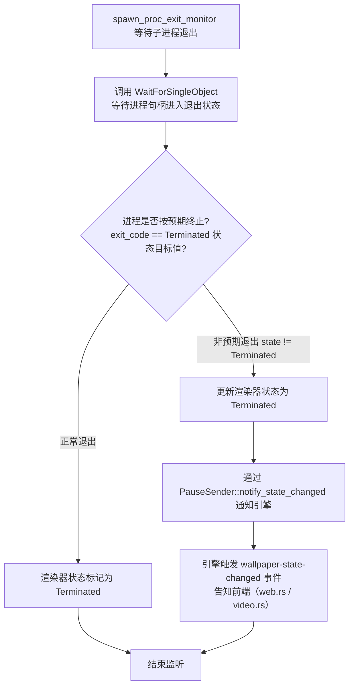

[← 返回文档索引](../index.md) > 架构与技术栈 > 错误处理

# MirrorStar Wallpaper（镜星壁纸）— 错误处理策略

| 项目   | 内容                        |
| ---- | ------------------------- |
| 项目名称 | MirrorStar Wallpaper（镜星壁纸） |
| 文档版本 | v3.0                      |
| 更新日期 | 2026-10-11                |
| 文档状态 | 已实现（已按真实代码合并重组，2026-10）        |

***

## 1. 错误库选择

### 选择：thiserror 2（库级）

workspace 使用 `thiserror = "2"`，**未引入 anyhow**（早期文档中的 anyhow 为虚构依赖）。

- **`mirrorstar-core`**：定义具体错误类型 `MirrorStarError`（`#[derive(thiserror::Error)]`），覆盖桌面集成、WorkerW 查找、子进程启动、IPC、音频控制、配置文件解析/写入、图片解码、文件监视、Win32、IO 等类别；`pub type Result<T> = std::result::Result<T, MirrorStarError>;`
- **应用层（`src-tauri` / `mirrorstar-ui` / `mirrorstar-wp-proc`）**：Tauri 命令边界将 `MirrorStarError` 序列化为 `{ code, message }` 结构返回前端，保持前端可判定的稳定错误码。

***

## 2. Rust Result-based 错误传播

MirrorStar 使用 Rust 的 `Result<T, E>` 类型系统进行错误处理，避免异常和 panic。

### 2.1 错误类型层次（实测自 `mirrorstar-core/src/lib.rs`）

```rust
/// MirrorStar 全局错误类型
#[derive(Debug, thiserror::Error)]
pub enum MirrorStarError {
    // ── 桌面集成 / 进程 / IPC ──
    #[error("桌面集成失败: {0}")]
    DesktopIntegration(String),
    #[error("未找到 WorkerW 窗口")]
    WorkerWNotFound,
    #[error("子进程启动失败: {0}")]
    ProcessSpawnFailed(String),
    #[error("IPC 通信失败: {0}")]
    IpcError(String),

    // ── 音频控制 ──
    #[error("音频控制失败: {0}")]
    AudioControl(String),
    #[error("未找到进程 {pid} 的音频会话")]
    AudioSessionNotFound { pid: u32 },

    // ── 配置 ──
    #[error("配置文件解析失败: {0}")]
    ConfigParse(String),
    #[error("配置文件写入失败: {0}")]
    ConfigWrite(String),

    // ── 图片 / 文件监视 ──
    #[error("图片解码失败: {0}")]
    ImageDecode(String),
    #[error("文件监视器失败: {0}")]
    FileWatcher(String),

    // ── 并发原语 ──
    #[error("锁中毒: {0}")]
    LockPoisoned(String),
    #[error("任务 join 失败: {0}")]
    TaskJoin(String),

    // ── IPC 细分 ──
    #[error("IPC 超时: {0}")]
    IpcTimeout(String),
    #[error("IPC 连接断开: {0}")]
    IpcDisconnected(String),
    #[error("IPC 未连接: {0}")]
    IpcNotConnected(String),

    // ── 底层 From 转换 ──
    #[error("Win32 错误: {0}")]
    Win32(#[from] windows::core::Error),
    #[error("IO 错误: {0}")]
    Io(#[from] std::io::Error),

    // ── 安全校验（SEC-001/002/004）与参数校验（N-009） ──
    #[error("无效的壁纸文件路径: {reason}")]
    InvalidPath { reason: String },
    #[error("无效的配置字段: {reason}")]
    InvalidConfig { reason: String },
    #[error("无效的 URL 协议: {scheme}")]
    InvalidUrl { scheme: String },
    #[error("无效参数: {reason}")]
    InvalidArgument { reason: String },

    // ── WebView2 ──
    #[error("WebView2 操作超时: {0}")]
    WebView2Timeout(String),
}

pub type Result<T> = std::result::Result<T, MirrorStarError>;
```

`MirrorStarError` 实现了 `serde::Serialize`，序列化输出 `{ "code": "<枚举变体名>", "message": "<Display 文本>" }`，供 Tauri 命令边界透传给前端。同时实现了若干 `From` 转换（`serde_json::Error` / `toml::de::Error` / `toml::ser::Error` → `ConfigParse` / `ConfigWrite`，`image::ImageError` → `ImageDecode`，`notify::Error` → `FileWatcher`）。

### 2.2 错误处理原则

| 原则          | 说明                 | 示例                               |
| ----------- | ------------------ | -------------------------------- |
| **不 panic** | 所有可恢复错误使用 `Result` | 文件不存在返回 `Err`，不 `unwrap`         |
| **尽早返回**    | 使用 `?` 运算符传播错误     | `let hwnd = find_window()?;`     |
| **上下文丰富**   | 错误消息包含足够诊断信息       | `"未找到进程 1234 的音频会话"`    |
| **降级处理**    | 非关键错误不阻断主流程        | 配置热重载失败保留旧配置                     |
| **日志记录**    | 错误发生时记录完整上下文       | `tracing::error!(pid, "子进程崩溃");` |

***

## 3. 进程崩溃恢复

### 3.1 子进程退出监听

MirrorStar **不实现**子进程/渲染线程的自动重启（respawn）。当前只有单一的退出监听器：

- 实现位置：`crates/mirrorstar-core/src/wallpaper/mod.rs` 中的 `spawn_proc_exit_monitor`（L155-186）。
- 工作方式：通过 `WaitForSingleObject` 等待子进程句柄进入退出状态，获取退出码。

### 3.2 退出处理流程



上图的判断要点：

- `spawn_proc_exit_monitor`（wallpaper/mod.rs L155-186）是**唯一**的退出监听器，无 watchdogs、无重试循环。
- 当子进程**异常退出**（即以非 `Terminated` 状态退出）时，将渲染器状态更新为 `Terminated`，并通过 `PauseSender::notify_state_changed` 通知引擎。
- 引擎据此触发 `wallpaper-state-changed` 事件，通知前端（web.rs / video.rs）刷新状态。

### 3.3 恢复策略现状

> **重要说明**：自动重启（respawn）**未实现**，处于观察中。不存在"重新 spawn 子进程 3 次""重启 GIF 渲染线程 3 次""连续崩溃(3 次/分钟)放弃恢复并切换静态壁纸"等自动重启/重试流程。

| 场景        | 现状                          | 后续方向      |
| ---------- | --------------------------- | --------- |
| 子进程异常退出  | 仅监听并更新状态为 Terminated，通知前端    | 自动重启（respawn）待评估，处于观察中 |
| 主进程崩溃    | 操作系统自动回收子进程（父子进程关系），不需要独立看门狗进程；Web 子进程崩溃可通过 IPC 管道断开检测 | -         |

***

## 4. 优雅降级

| 故障场景               | 降级方案                              |
| ------------------ | --------------------------------- |
| WorkerW 未找到        | Native 模式下不影响静态图片壁纸；WorkerW 模式下回退到 SetWindowPos 底层窗口模式（高对比度模式未处理） |
| WebView2 不可用       | 网页壁纸功能不可用，提示用户安装 WebView2 Runtime |
| mpv.exe 缺失/启动失败   | 视频壁纸不可用，提示用户检查 mpv.exe（随程序分发或 PATH 查找）         |
| 配置文件损坏             | 使用默认配置启动，记录警告日志                   |
| 音频控制失败             | 壁纸正常播放，仅音频控制不可用                   |
| SetWinEventHook 失败 | 仅记录错误并退出全屏监控线程（**无 2 秒轮询回退**） |
| Native 壁纸 API 失败  | 回退到 WorkerW 嵌入模式，记录警告日志           |

> **SetWinEventHook 降级说明**：全屏检测为纯事件驱动（`SetWinEventHook(EVENT_SYSTEM_FOREGROUND)`）。当钩子设置失败（返回 `nullptr`）时，实现仅在 fullscreen.rs 中记录错误并退出全屏监控线程，**不存在**"回退到低频轮询（2 秒间隔）"的兜底逻辑。

***

**相关文档：**

- [01-架构与技术栈总览](./01-架构与技术栈总览-Architecture-and-Tech-Stack-Overview.md)
- [02-模块设计](./02-模块设计-Module-Design.md)
- [03-进程架构与IPC](./03-进程架构与IPC-Process-Architecture-and-IPC.md)
- [06-暂停恢复机制](./06-暂停恢复机制-Pause-Resume.md)
- [08-依赖与数据流](./08-依赖与数据流-Dependency-and-Data-Flow.md)
- [09-性能优化](./09-性能优化-Performance.md)