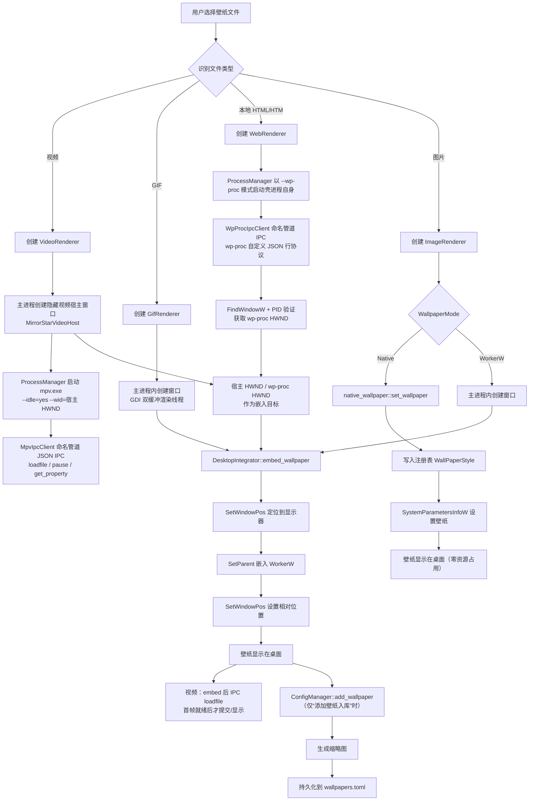
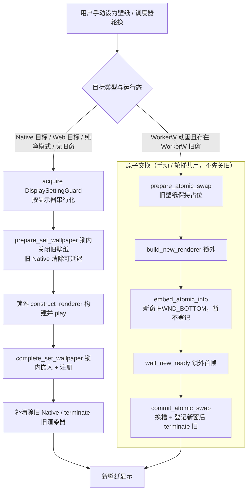
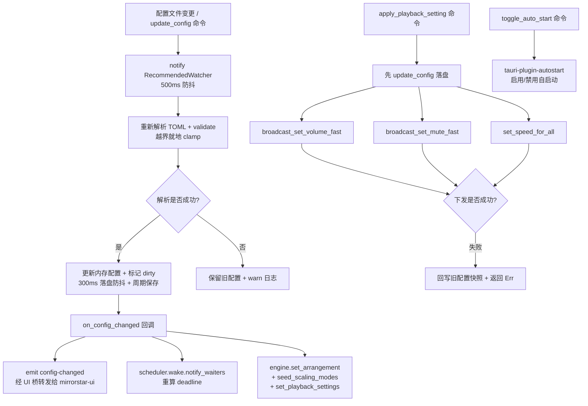

[← 返回文档索引](../index.md) > 架构与技术栈 > 依赖与数据流

# MirrorStar Wallpaper（镜星壁纸）— 依赖图与数据流

| 项目   | 内容                        |
| ---- | ------------------------- |
| 项目名称 | MirrorStar Wallpaper（镜星壁纸） |
| 文档版本 | v3.0                      |
| 更新日期 | 2026-11-24                |
| 文档状态 | 已实现（已按真实代码合并重组，2026-10；2026-11-24 按当前实现校准）        |

***

## 1. 模块依赖图

当前 workspace 为四成员：`src-tauri`（壳 / 托盘 / 调度器运行时）、`crates/mirrorstar-core`（12 个 `pub mod`：audio / config / desktop / ipc / layout / log_retention / perf / process / pure_mode / scheduler / ui_proto / wallpaper）、`crates/mirrorstar-wp-proc`（网页壁纸子进程，实际由壳 exe `--wp-proc` 双入口运行）、`crates/mirrorstar-ui`（Slint 原生 UI 子进程 `mirrorstar-ui.exe`）。

```mermaid
graph LR
    Engine["壁纸引擎<br/>WallpaperEngine"]
    Renderer["渲染器<br/>Image / GIF / Video / Web"]
    Desktop["桌面集成<br/>DesktopIntegrator"]
    Native["原生壁纸<br/>native_wallpaper"]
    ProcMgr["进程管理<br/>ProcessManager"]
    Config["配置管理<br/>ConfigManager"]
    Audio["音频控制<br/>VolumeControl"]
    Sched["轮换调度器<br/>scheduler.rs（单 tokio 任务）"]
    Layout["布局域<br/>layout::plan（纯函数）"]
    Tray["系统托盘<br/>（lib.rs setup + state.rs）"]
    UiBridge["壳↔UI 桥<br/>ui_process::bridge"]
    UiProc["原生 UI 子进程<br/>mirrorstar-ui.exe（Slint）"]
    IPC["IPC 通信<br/>MpvIpcClient / WpProcIpcClient / ui_proto"]

    Engine --> Desktop : 嵌入壁纸窗口<br/>（WorkerW 模式）
    Engine --> Native : 设置原生壁纸<br/>（Native 模式）
    Engine --> ProcMgr : 创建/终止子进程
    Engine --> Config : 读取壁纸配置
    Engine --> Audio : 控制音频
    Engine --> Renderer : 创建 / 嵌入 / 暂停

    Renderer --> ProcMgr : 视频 mpv / 网页 wp-proc
    Renderer --> IPC : mpv JSON IPC /<br/>wp-proc 命名管道

    Sched --> Layout : 计算单元与主屏
    Sched --> Engine : 轮换 apply<br/>（原子交换 / 回退）
    Sched --> Config : 读 rotation / 池；<br/>写 playback.toml

    Native --> winreg["winreg crate<br/>注册表操作"]
    Native --> SPI["windows::Win32::UI::<br/>WindowsAndMessaging<br/>SystemParametersInfoW"]

    ProcMgr --> IPC : 与子进程通信<br/>（mpv + wp-proc 命名管道）

    Tray --> Sched : next_wallpaper<br/>（manual_tx）
    Tray --> Engine : 暂停/恢复；纯模式

    Config -.-> Sched : 热重载 / 配置命令<br/>→ wake.notify_waiters()

    Engine -.-> UiBridge : wallpaper-state-changed
    Sched -.-> UiBridge : wallpaper-rotated
    UiBridge <--> UiProc : ui_proto NDJSON over stdio
    UiProc --> IPC : 预览自建 mpv / wp-proc

    style Engine fill:#81C784,stroke:#388E3C,color:#000
    style Renderer fill:#81C784,stroke:#388E3C,color:#000
    style Desktop fill:#FFB74D,stroke:#F57C00,color:#000
    style Native fill:#FFB74D,stroke:#F57C00,color:#000
    style winreg fill:#E0E0E0,stroke:#9E9E9E,color:#000
    style SPI fill:#E0E0E0,stroke:#9E9E9E,color:#000
    style ProcMgr fill:#81C784,stroke:#388E3C,color:#000
    style Config fill:#81C784,stroke:#388E3C,color:#000
    style Audio fill:#81C784,stroke:#388E3C,color:#000
    style Sched fill:#81C784,stroke:#388E3C,color:#000
    style Layout fill:#E0E0E0,stroke:#9E9E9E,color:#000
    style Tray fill:#4FC3F7,stroke:#0288D1,color:#000
    style UiBridge fill:#CE93D8,stroke:#7B1FA2,color:#000
    style UiProc fill:#4FC3F7,stroke:#0288D1,color:#000
    style IPC fill:#CE93D8,stroke:#7B1FA2,color:#000
```

### 依赖关系说明

| 依赖          | 方向 | 说明                      |
| ----------- | -- | ----------------------- |
| 壁纸引擎 → 桌面集成 | 单向 | 引擎调用桌面集成将壁纸窗口嵌入 WorkerW（仅 WorkerW 模式，Native 模式不依赖桌面集成） |
| 壁纸引擎 → 原生壁纸 | 单向 | 引擎调用 native_wallpaper 模块通过 Windows 原生 API 设置静态壁纸（Native 模式） |
| 原生壁纸 → winreg | 单向 | native_wallpaper 通过 winreg crate 读写注册表（WallPaperStyle/TileWallpaper） |
| 原生壁纸 → Windows API | 单向 | native_wallpaper 调用 SystemParametersInfoW（windows::Win32::UI::WindowsAndMessaging）设置壁纸 |
| 壁纸引擎 → 渲染器 | 单向 | 引擎持有 `Box<dyn WallpaperRenderer>`：图片/GIF 在主进程 GDI 渲染；视频为 mpv 子进程（主进程创建视频宿主窗口 + `--wid`）；网页为壳 exe `--wp-proc` 子进程 |
| 壁纸引擎 → 进程管理 | 单向 | 引擎通过进程管理器创建和终止壁纸子进程（视频→mpv.exe，网页→壳进程 `--wp-proc` 模式）     |
| 壁纸引擎 → 配置管理 | 单向 | 引擎读取壁纸配置和用户设置           |
| 壁纸引擎 → 音频控制 | 单向 | 引擎控制壁纸音频的音量和静音          |
| 渲染器 / 进程管理 → IPC  | 单向 | mpv 走命名管道 mpv 原生 JSON IPC；wp-proc 走命名管道自定义 JSON 行协议；壳↔UI 另有 `ui_proto` stdio 通道      |
| 轮换调度器 → 布局域 | 单向 | `layout::plan` 为纯函数，产出 `LayoutPlane`（单元→显示器映射、主屏）；调度器/命令层只消费 |
| 轮换调度器 → 壁纸引擎 | 单向 | 调度器只做决策；执行下放引擎的原子交换（与手动设壁纸共用），Native/Web/纯净模式/无旧窗回退 `set_wallpaper` 三阶段 |
| 轮换调度器 → 配置管理 | 单向（读） | 每轮醒来重读 `AppConfig` 与池（rotation / arrangement / 壁纸库） |
| 轮换调度器 → playback.toml | 单向（写） | `PlaybackStore` 独立原子写（temp+fsync+rename），不经 `ConfigManager` / 热重载（DR-15） |
| 系统托盘 → 轮换调度器 | 单向 | `next_wallpaper` 经 `scheduler.manual_tx`（内联托盘 **5 项**：open / next_wallpaper / pause_resume / pure_mode / quit） |
| 配置管理 → 轮换调度器 | 事件 | 热重载 / 配置命令成功后 `wake.notify_waiters()`，调度器重读配置并重算 deadline |
| 壳 ↔ 原生 UI 子进程 | 双向 | `ui_proto` NDJSON over stdio：UI 发 Request（命令名与 Tauri 命令逐字一致），壳回 Response 并推送 Event |
| 调度器 / 引擎 → 原生 UI 子进程 | 事件 | 调度器 `app.emit("wallpaper-rotated")`、引擎 `wallpaper-state-changed` 等经 `ui_process::bridge` 的 `FORWARDED_EVENTS` 转发为 UI Event |

***

## 2. 数据流图

### 2.1 设置壁纸数据流



> 说明：视频壁纸不再按 PID 查找 mpv 顶层窗口；主进程先创建 `MirrorStarVideoHost` 宿主窗口，mpv 以 `--wid=<宿主 HWND>` 只创建 `WS_CHILD` vo 子窗口，桌面嵌入操作作用于宿主（避免嵌入时 D3D11 纹理重建触发 `E_OUTOFMEMORY`）。网页壁纸仍由 `FindWindowW` + PID 校验获取 wp-proc 窗口。
>
> “设为壁纸”本身不修改 `wallpapers.toml`；`add_wallpaper` / `remove_wallpaper` 才增删库条目（见 §2.2）。

### 2.2 壁纸切换清理流程

当前手动设壁纸与轮换 apply **共用两套路径**（按目标类型与运行态路由）：

- **原子交换（默认）**：目标为 WorkerW 动画壁纸且存在可用的 WorkerW 旧渲染器时，手动「设为壁纸」与轮换 apply 都走原子交换；旧壁纸在 `commit_atomic_swap` 前**不关闭、不隐藏、不暂停**，新壁纸首帧就绪后一次换槽并 terminate 旧（见调度器文档 §8.4）。
- **先关后设回退（三阶段）**：仅 Native 目标 / Web 目标 / 纯净壁纸模式活跃 / 无旧窗时走 `set_wallpaper_inner` → `prepare_set_wallpaper`（锁内关闭旧壁纸，旧 Native 系统壁纸清除延迟到新窗嵌入后）→ `construct_renderer`（锁外构建/播放）→ `complete_set_wallpaper`（锁内嵌入 + 注册 + 补清除旧 Native）。



> 原子交换中 pending 新窗在 `commit_atomic_swap` 成功前不写入 `DesktopIntegrator.active_wallpapers`（阶段 A 使用不登记的嵌入入口），失败时登记表仍指向旧窗。

**清理步骤详解：**

1. **按显示器串行化**：`DisplaySettingGuard::acquire(display_id)` 在手动 set 与调度器 apply 两条路径统一排队；acquire 失败视为该屏 Busy，调度器静默跳过。
2. **关闭旧壁纸（仅回退路径）**：原子交换路径在 `commit_atomic_swap` 前不关闭旧渲染器；仅 Native / Web / 纯净模式 / 无旧窗的回退路径由 `prepare_set_wallpaper` 锁内关闭旧渲染器；若旧壁纸为 Native，可延迟清除系统壁纸，待新窗嵌入完成后补清除，避免“先黑后设”的窗口。
3. **终止子进程**：渲染器 `terminate()` 优先经 IPC 优雅退出（mpv `quit` / wp-proc `terminate`），进程管理器等待默认 **3s** 后强杀；不同渲染器的连接/等待预算不同（例如 mpv IPC 连接 40×50ms=2s、wp-proc 连接 160×50ms=8s）。
4. **关闭管道**：渲染器 Drop / terminate 时关闭命名管道与事件监听，释放句柄。
5. **持久化边界**：“设为壁纸 / 轮换”**不修改** `wallpapers.toml`；只有 `remove_wallpaper` 才删除库条目并清理文件（历史文档中“切换时从 wallpapers.toml 移除旧条目”为旧口径，已废止）。
6. **启动新壁纸**：构建新渲染器并嵌入；视频在嵌入完成后通过 IPC `loadfile` 加载，等待首帧就绪再提交显示。

### 2.3 暂停/恢复数据流

> **PauseSender 快速通道**：暂停/恢复/音量/静音等高频操作在命令层短暂获取 engine 锁定位 `PauseSender` 后，经 mpsc 通道直接投递到各渲染线程，不等待渲染器处理或 IPC 往返（并非完全绕过 engine 锁）。机制细节详见《06-暂停恢复机制》。

```mermaid
flowchart TD
    A[SetWinEventHook 回调 / 500ms QUNS 探针] --> B[全屏判定<br/>QUNS + DwmGetWindowAttribute<br/>DWMWA_EXTENDED_FRAME_BOUNDS]
    B --> C{前台窗口类型?}
    C -->|桌面/任务栏/自身窗口| D[恢复壁纸]
    C -->|普通窗口| E{是否判定为全屏?<br/>QUNS 2/3/4 或矩形完全覆盖}

    E -->|是| F[置位 PauseReason::FULLSCREEN]
    E -->|否| D

    F --> G{fullscreen_action}
    G -->|pause| G1[WallpaperEngine::pause_all_fast]
    G -->|terminate| G2[terminate_all_fast<br/>终止视频 / 网页子进程]
    G -->|none| G3[不处置]

    G1 --> H[PauseSender 快速通道<br/>mpsc 直投渲染线程]
    H --> H1[视频 mpv JSON IPC：<br/>set_property pause=yes]
    H --> H2[网页 wp-proc JSON 行：<br/>command=pause]
    H --> H3[图片/GIF：状态翻转 / 冻结帧]
    G1 --> J[VolumeControl::set_process_mute(pid, true)]
    J --> K[ISimpleAudioVolume::SetMute(true)]
    G1 --> L[切换托盘菜单文本为"恢复壁纸"]

    D --> M[WallpaperEngine::resume_all_fast]
    M --> N[视频 mpv：set_property pause=no；<br/>网页 wp-proc：command=resume]
    N --> O[子进程恢复播放 / terminate 路径冷启动]
    M --> P[VolumeControl::set_process_mute(pid, false)]
    P --> Q[ISimpleAudioVolume::SetMute(false)]
    M --> R[切换托盘菜单文本为"暂停壁纸"]
```

> 说明：全屏判定以 `SHQueryUserNotificationState` 为权威（`QUNS_RUNNING_D3D_FULL_SCREEN` / `QUNS_BUSY` / `QUNS_PRESENTATION_MODE`），窗口矩形分级仅在 QUNS 不可判定时兜底；矩形取 DWM 扩展边框（不含阴影）。`pause_reasons` 位图非空同时抑制调度器定时轮换（见《10-壁纸轮换调度器》§10）。
>
> 实际线格式：视频为 `{"command":["set_property","pause","yes"],"request_id":N}`（恢复为 `"no"`）；网页 wp-proc 为 `{"command":"pause","request_id":N}`（恢复为 `"resume"`）。历史文档中的 `{"command":"pause"}` 统一写法只对 wp-proc 成立，不代表 mpv。

### 2.4 配置变更数据流



> 说明：热重载回调只负责“通知 + 种入”，不会主动重建现有渲染器；音量/静音/速度的**运行态即时下发**走 `apply_playback_setting`（先落盘、再广播、失败回写）。历史文档中 `VolumeControl::set_process_volume` / 注册表手写自启动项等表述为旧实现口径，当前分别以 `broadcast_set_volume_fast` 与 `tauri-plugin-autostart` 为准。

***

## 3. 通信机制概览

MirrorStar 采用三类跨进程通信通道（两套命名管道 + 一套 stdio），配合 mpsc 通道与事件钩子实现跨进程、跨线程的高效通信。原生 UI 子进程的预览窗口还会自建 mpv / wp-proc 子进程，复用同一套命名管道协议。

> **完整 IPC 设计（协议定义、消息类型、连接重试参数、HWND 获取）详见《03-进程架构与IPC》。**

### 3.1 通信方式概览

| 通信方式 | 说明 |
|----------|------|
| **壳 ↔ 原生 UI 子进程** | `ui_proto` NDJSON over stdio（壳与 `mirrorstar-ui` 共享定义；Request/Response + Event/Control） |
| **主线程 → 渲染线程** | mpsc 通道 + PostMessageW |
| **视频播放控制** | 命名管道 JSON IPC（MpvIpcClient，mpv 原生协议，`--input-ipc-server=\\.\pipe\<name>`，`ipc/mpv_protocol.rs`） |
| **Web 壁纸通信** | 命名管道 JSON IPC（WpProcIpcClient，wp-proc 自定义 JSON 行协议，`ipc/wp_proc.rs`） |
| **全屏检测通知** | SetWinEventHook 回调 + 500ms QUNS 轻量探针 → `PauseReason` 位图 |
| **配置变更通知** | notify crate（500ms 防抖）→ `on_config_changed` → emit + `scheduler.wake` |
| **暂停/恢复控制** | PauseSender 快速通道（短暂持 engine 锁定位 sender，mpsc 直投渲染线程） |
| **子进程异常退出** | 退出监听（`spawn_proc_exit_monitor`）识别并通知引擎；Web 不自动 respawn |
| **视频停滞自愈** | `platform/liveness_watchdog` 周期采样 `time-pos`，停滞时调用 `heal_stalled_renderer` 分级自愈（terminate → 重建） |
| **UI 事件转发** | 壳侧 `FORWARDED_EVENTS`（14 个）经 `ui_process::bridge` 转 `ui_proto` Event |

### 3.2 关键设计说明

1. **三套独立 IPC 协议**：视频壁纸通过 `MpvIpcClient`（`ipc/mpv_protocol.rs`）使用 mpv 原生 JSON IPC 协议与 mpv.exe 通信；Web 壁纸通过 `WpProcIpcClient`（`ipc/wp_proc.rs`）使用 wp-proc 自定义协议与壳 `--wp-proc` 模式子进程通信；原生 UI 通过 `mirrorstar-core::ui_proto` 使用 NDJSON 行协议经 stdio 通信。三者独立设计，分别针对不同子进程的通信需求。

2. **渲染线程通信**：图片/GIF 渲染器在专用线程中运行，通过 mpsc 通道发送命令，PostMessageW 唤醒消息循环处理。该设计保证线程安全，避免并发阻塞 UI 主线程。

3. **PauseSender 快速通道**：短暂持 engine 锁定位 sender 后，经 mpsc 直接投递暂停/恢复/音量命令，避免高优先级操作等待渲染器处理/IPC 往返，降低响应延迟。

4. **崩溃恢复与自愈**：Web 子进程异常退出由退出监听（`spawn_proc_exit_monitor`）识别并通知引擎，**不自动 respawn**；视频播放停滞由 liveness watchdog 周期检测后分级自愈（`heal_stalled_renderer` 重建渲染器）。主进程崩溃时，UI / mpv / wp-proc 子进程由 Windows Job Object 随父进程回收，无需独立看门狗进程。

***

## 4. 配置管理

### 4.1 选择：TOML + serde + notify

- **TOML**：支持注释，适合人工编辑，Rust 生态标准
- **serde**（`serde 1` + `toml 0.8`）：反序列化，`#[serde(default)]` 支持字段默认值
- **notify 7**：跨平台文件系统监控，用于热重载

### 4.2 配置文件与数据根

应用所有用户数据收束于**数据根目录**（`mirrorstar-core::config::data_root()`），解析顺序：

1. `MIRRORSTAR_DATA_ROOT` 环境变量（如果设置且非空）
2. **exe 所在目录**（便携模式默认，portable-data-root）
3. 回退 `%APPDATA%\mirrorstar`

数据根下存储：

```
<data_root>/
├── config.toml        # 应用配置
├── wallpapers.toml    # 壁纸库（条目 + 元数据）
├── playback.toml      # 轮换播放状态（独立于配置，见《10-壁纸轮换调度器》）
├── wallpapers/{id}/   # 外部壁纸文件的托管副本（添加时复制入库）
├── thumbnails/        # 缩略图
├── logs/              # 日志（mirrorstar.log.<日期> + mpv-*.log），受保留上限约束
├── webview2-cache/    # WebView2 UDF：<pid>/（网页壁纸）、ui-<pid>/（UI 预览）
├── mpv/               # mpv --config-dir 重定向目录（避免写穿 %APPDATA%\mpv）
├── config.lock        # config.toml 写锁（fs2，atomic_write）
├── wallpapers.lock    # wallpapers.toml 写锁
└── playback.lock      # playback.toml 写锁
```

### 4.3 AppConfig 结构（实测自 settings.rs）

`AppConfig`（`mirrorstar-core/src/config/settings.rs`）为**顶层 `arrangement` + 7 个配置段**：`general` / `audio` / `pause` / `video` / `gif` / `rotation` / `scaling`。

```toml
# config.toml（示例，含默认值）
arrangement = "per_monitor"      # 顶层布局：per_monitor | all_same | span

[general]
auto_start = false          # 开机自启
minimize_to_tray = true     # 关闭窗口最小化到托盘

[audio]
volume = 0.8                # 全局音量 (0.0~1.0)
muted = false
preview_volume = 0.5        # 预览音量
preview_muted = false

[pause]
fullscreen_action = "terminate"  # 全屏处置 none/pause/terminate（默认 terminate）
pause_on_battery = false         # 电池供电时暂停

[video]
hwdec = true                # 硬件解码
speed = 1.0                 # 播放速度（0.25~4.0）

[gif]
memory_strategy = "balanced"     # Aggressive/Balanced/Performance/Adaptive
balanced_keep_frames = 10        # 平衡模式保留帧数（[1,1000]）
max_memory_mb = 40               # 帧像素内存预算（[10,500]）

[rotation]
enabled = false             # 轮换主开关
on_boot = false             # 应用启动时推进下一张
interval_minutes = 30       # 1–1440；下限 1 分钟 = 60s
order = "sequential"        # sequential | shuffle_bag | pseudo_random（默认 sequential）

[scaling.modes]
all = "fill"                # display_id → 缩放模式；"all" 为兜底
```

### 4.4 校验（validate 策略）

各子 config 的 `validate(&mut self)` 采用**"内部修正 + warn 日志，调用方透明"**策略（不返回 `Result`）：越界/非法值就地 clamp 或回退默认，通过 `tracing::warn!` 记录原值与修正后值。

- `AudioConfig.volume`：clamp 到 `[0.0, 1.0]`（NaN / 越界回退 0.8）
- `VideoConfig.speed`：`0.25 ~ 4.0`（共享 `mpv_protocol::SPEED_MIN/SPEED_MAX`），非法回退 1.0
- `GifConfig.balanced_keep_frames`：`≥ 1` 且 ≤ `MAX_BALANCED_KEEP_FRAMES`（1000）
- `GifConfig.max_memory_mb`：`[10, 500]`
- `RotationConfig.interval_minutes`：clamp 到 `[1, 1440]` 分钟（默认 30；下限 1 分钟 = 60s，防短间隔反复 spawn/kill 视频进程）

> `AppConfig.arrangement` / `pause.fullscreen_action` / `scaling.modes` 的未知枚举值采用宽松反序列化：逐项回退默认（`per_monitor` / `terminate` / `fill`）并 warn，不使整份配置失败。

### 4.5 热重载与持久化

- `ConfigManager` 管理 `config.toml` 与 `wallpapers.toml` 的读写（`mirrorstar-core/src/config/manager.rs`）
- 使用 `notify::RecommendedWatcher` 监控，**500ms 防抖**（hot_reload.rs）
- **落盘防抖**与监控防抖分离：`CONFIG_SAVE_DEBOUNCE_MS = 300ms`（`maybe_save_config`）+ 周期性保存线程 + 退出 `flush()` 兜底；`config` 与 `library` 使用独立的 `fs2` 文件锁（`config.lock` / `wallpapers.lock`）串行化写入
- 配置加载失败（损坏/缺失）：记录 warn 并回退到默认配置，**保证应用可启动**；构造时的加载错误暂存 `pending_config_errors`，待 Tauri setup 后作为 `config-load-error` 事件通知
- 热重载成功后的实际副作用：emit `config-changed` → `scheduler.wake.notify_waiters()` → 引擎 `set_arrangement` / `seed_scaling_modes` / `set_playback_settings`（音量/静音/速度）

***

## 5. 日志系统

### 5.1 选择：tracing + tracing-subscriber + tracing-appender

### 5.2 初始化（实测自 core::lib.rs::init_logging）

```rust
let log_dir = crate::config::data_root().join("logs");   // 数据根/logs
std::fs::create_dir_all(&log_dir)?;

let file_appender = RollingFileAppender::builder()
    .rotation(Rotation::DAILY)                        // 按日轮转
    .filename_prefix("mirrorstar.log")
    .max_log_files(APP_LOG_KEEP + 1)                  // 保留最新 KEEP 个（官方建议传 KEEP+1）
    .build(&log_dir)?;
let (non_blocking, guard) = tracing_appender::non_blocking(file_appender);

let env_filter = EnvFilter::try_from_default_env()        // 优先 RUST_LOG
    .unwrap_or_else(|_| EnvFilter::new("info"));          // 回退 info

tracing_subscriber::fmt()
    .with_env_filter(env_filter)
    .with_writer(std::io::stdout.and(non_blocking))   // 控制台 + 日志文件双写
    .with_ansi(true)
    .init();
// guard 由 run() 持有至程序退出，early drop 会丢失日志
```

要点：

- **日志目录**：`<data_root>/logs/mirrorstar.log.<日期>`，`Rotation::DAILY` 按日轮转
- **级别控制**：`RUST_LOG` 环境变量，默认 `info`
- **`guard` 生命周期**：`init_logging()` 返回 `WorkerGuard`，由 Tauri `run()` 持有至退出，提前 drop 会丢失尾部日志
- **mpv 日志**：写入同目录 `mpv-<uuid>.log`（见《05-壁纸渲染》）
- **日志保留策略**（`mirrorstar-core/src/log_retention.rs`，均 best-effort——目录缺失/删除失败（Windows 文件占用）仅 `tracing::warn` 忽略，绝不 panic）：
  - **应用日志**：按日轮转 + `max_log_files` 保留最新 `APP_LOG_KEEP = 7` 个（`max_log_files` 传 `KEEP + 1`，实际保留可能略低于设定值）；
  - **mpv 日志**：保留最新 `MPV_LOG_KEEP = 20` 个，创建新实例日志时**增量剪枝**（`build_mpv_log_path()` 内）+ **启动期兜底**（`prune_logs()`）；
  - **crash.log**：超过 `CRASH_LOG_MAX_BYTES = 1 MiB` 轮转为 `crash.log.1`；panic hook 每次追加写前亦按大小轮转，会话内自限幅（见《09-性能优化》§24）；
  - 启动期全量清理在 `mirrorstar-boot-cleanup` **后台线程**执行，不阻塞开机壁纸应用（见《09-性能优化》§24）
- **性能埋点**：`mirrorstar::perf` target（perf.rs），可用 `RUST_LOG=mirrorstar::perf=info` 单独过滤（见《09-性能优化》）

***

## 6. 异步运行时

### 6.1 选择：tokio 1.52

workspace 配置：`tokio = { version = "1.52", features = ["rt", "rt-multi-thread", "macros", "time", "fs", "sync", "io-util"] }`

### 6.2 使用场景

| 场景 | 说明 |
|------|------|
| 广播通道 | WallpaperEngine 状态变更 broadcast 订阅（`sync`） |
| 事件监听 | 全屏 / 电池事件驱动处理 |
| 轮换调度器 | 单个后台 tokio 任务：`select!` 同时等待定时 sleep、`wake.notified()`、`manual_rx`、`pool_apply_rx` 与 3s 显示器轮询 |
| UI 通信 | 壳与原生 UI 子进程的 `ui_proto` 消息（stdio NDJSON） |

> **注意**：命名管道 IPC 使用同步 Win32 API，**不经过** tokio 异步运行时；文件监控热重载均在独立线程完成；原子交换的 `build_new_renderer` / `wait_new_ready` 通过 `spawn_blocking` 执行，避免阻塞 tokio worker。

***

## 7. 序列化

### 选择：serde + serde_json + toml

- **serde 1**（`derive`）：`#[derive(Serialize, Deserialize)]`
- **serde_json 1**：IPC 消息（mpv JSON / wp-proc JSON / ui_proto NDJSON）
- **toml 0.8**：配置文件
- `#[serde(default)]` 支持字段默认值；`#[serde(rename = "...")]` 控制序列化键名（如 `per_monitor` / `span`）

***

**相关文档：**

- [01-架构与技术栈总览](./01-架构与技术栈总览-Architecture-and-Tech-Stack-Overview.md)
- [02-模块设计](./02-模块设计-Module-Design.md)
- [03-进程架构与IPC](./03-进程架构与IPC-Process-Architecture-and-IPC.md)
- [05-壁纸渲染](./05-壁纸渲染-Wallpaper-Rendering.md)
- [06-暂停恢复机制](./06-暂停恢复机制-Pause-Resume.md)
- [07-错误处理](./07-错误处理-Error-Handling.md)
- [10-壁纸轮换调度器](./10-壁纸轮换调度器-Rotation-Scheduler.md)