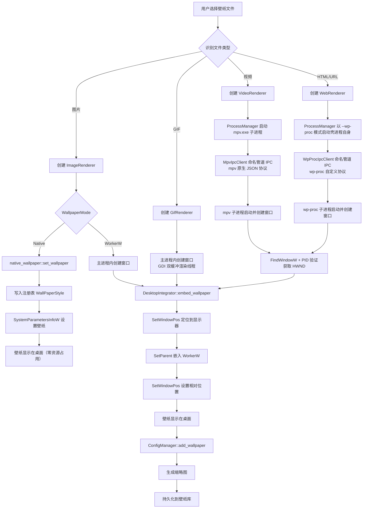
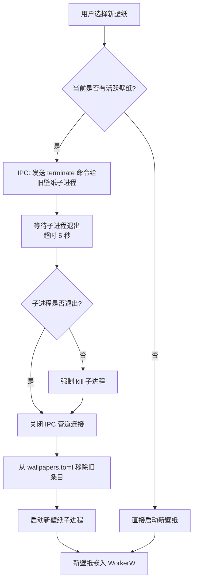

[← 返回文档索引](../index.md) > 架构与技术栈 > 依赖与数据流

# MirrorStar Wallpaper（镜星壁纸）— 依赖图与数据流

| 项目   | 内容                        |
| ---- | ------------------------- |
| 项目名称 | MirrorStar Wallpaper（镜星壁纸） |
| 文档版本 | v3.0                      |
| 更新日期 | 2026-10-11                |
| 文档状态 | 已实现（已按真实代码合并重组，2026-10）        |

***

## 1. 模块依赖图

```mermaid
graph LR
    Engine["壁纸引擎<br/>WallpaperEngine"]
    Desktop["桌面集成<br/>DesktopIntegrator"]
    Native["原生壁纸<br/>native_wallpaper"]
    ProcMgr["进程管理<br/>ProcessManager"]
    Config["配置管理<br/>ConfigManager"]
    Audio["音频控制<br/>AudioController"]
    Tray["系统托盘<br/>（lib.rs setup + state.rs）"]
    IPC["IPC 通信<br/>MpvIpcClient / WpProcIpcClient / ui_proto"]

    Engine --> Desktop : 嵌入壁纸窗口<br/>（WorkerW 模式）
    Engine --> Native : 设置原生壁纸<br/>（Native 模式）
    Engine --> ProcMgr : 创建/终止子进程
    Engine --> Config : 读取壁纸配置
    Engine --> Audio : 控制音频

    Native --> winreg["winreg crate<br/>注册表操作"]
    Native --> SPI["windows::Win32::UI::<br/>WindowsAndMessaging<br/>SystemParametersInfoW"]

    ProcMgr --> IPC : 与子进程通信<br/>（mpv + wp-proc 命名管道）

    Tray --> Engine : 暂停/恢复/退出
    Tray --> Config : 读取/修改设置

    Config -.-> Engine : 配置热重载通知

    style Engine fill:#81C784,stroke:#388E3C,color:#000
    style Desktop fill:#FFB74D,stroke:#F57C00,color:#000
    style Native fill:#FFB74D,stroke:#F57C00,color:#000
    style winreg fill:#E0E0E0,stroke:#9E9E9E,color:#000
    style SPI fill:#E0E0E0,stroke:#9E9E9E,color:#000
    style ProcMgr fill:#81C784,stroke:#388E3C,color:#000
    style Config fill:#81C784,stroke:#388E3C,color:#000
    style Audio fill:#81C784,stroke:#388E3C,color:#000
    style Tray fill:#4FC3F7,stroke:#0288D1,color:#000
    style IPC fill:#CE93D8,stroke:#7B1FA2,color:#000
```

### 依赖关系说明

| 依赖          | 方向 | 说明                      |
| ----------- | -- | ----------------------- |
| 壁纸引擎 → 桌面集成 | 单向 | 引擎调用桌面集成将壁纸窗口嵌入 WorkerW（仅 WorkerW 模式，Native 模式不依赖桌面集成） |
| 壁纸引擎 → 原生壁纸 | 单向 | 引擎调用 native_wallpaper 模块通过 Windows 原生 API 设置静态壁纸（Native 模式） |
| 原生壁纸 → winreg | 单向 | native_wallpaper 通过 winreg crate 读写注册表（WallPaperStyle/TileWallpaper） |
| 原生壁纸 → Windows API | 单向 | native_wallpaper 调用 SystemParametersInfoW（windows::Win32::UI::WindowsAndMessaging）设置壁纸 |
| 壁纸引擎 → 进程管理 | 单向 | 引擎通过进程管理器创建和终止壁纸子进程（视频→mpv.exe，网页→壳进程 `--wp-proc` 模式）     |
| 壁纸引擎 → 配置管理 | 单向 | 引擎读取壁纸配置和用户设置           |
| 壁纸引擎 → 音频控制 | 单向 | 引擎控制壁纸音频的音量和静音          |
| 进程管理 → IPC  | 单向 | 进程管理器通过命名管道与子进程通信（mpv 原生 JSON IPC + wp-proc 自定义协议；壳↔UI 另有 `ui_proto` stdio 通道）      |
| 系统托盘 → 壁纸引擎 | 单向 | 托盘菜单操作（内联于 lib.rs，仅 open / pause_resume / quit 三项）触发引擎暂停/恢复         |
| 系统托盘 → 配置管理 | 单向 | 托盘菜单修改设置（如开机自启）         |
| 配置管理 → 壁纸引擎 | 事件 | 配置热重载时通知引擎应用新配置         |

***

## 2. 数据流图

### 2.1 设置壁纸数据流



### 2.2 壁纸切换清理流程

壁纸切换时，必须先清理旧壁纸再启动新壁纸，避免资源泄漏：



**清理步骤详解：**

1. **发送 terminate 命令**：通过 IPC 通知子进程优雅退出
2. **等待退出**：设置 5 秒超时，等待子进程自行退出
3. **强制终止**：超时后调用 `child.kill()` 强制终止
4. **关闭管道**：关闭命名管道连接，释放资源
5. **更新持久化**：从 `wallpapers.toml` 中移除旧条目
6. **启动新壁纸**：创建新的子进程和 IPC 连接

### 2.3 暂停/恢复数据流

> **PauseSender 快速通道**：暂停/恢复/音量/静音等高频操作通过 `AppState.pause_senders`（mpsc 通道）直接发送到各渲染线程，绕过引擎 Mutex，避免锁竞争导致的延迟。机制细节详见《06-暂停恢复机制》。

```mermaid
flowchart TD
    A[SetWinEventHook 回调触发] --> B[is_foreground_fullscreen 检测]
    B --> C{前台窗口类型?}
    C -->|桌面/任务栏/自身窗口| D[恢复壁纸]
    C -->|普通窗口| E{窗口矩形是否完全<br/>覆盖显示器矩形?}

    E -->|是| F[暂停壁纸]
    E -->|否| D

    F --> G[WallpaperEngine::pause_wallpaper]
    G --> H[IPC: 发送 {"command":"pause","request_id":1}]
    H --> I[子进程暂停播放]
    G --> J[AudioController::mute_wallpaper]
    J --> K[ISimpleAudioVolume::SetMute(true)]
    G --> L[切换托盘菜单文本为"恢复壁纸"]

    D --> M[WallpaperEngine::resume_wallpaper]
    M --> N[IPC: 发送 {"command":"resume","request_id":2}]
    N --> O[子进程恢复播放]
    M --> P[AudioController::unmute_wallpaper]
    P --> Q[ISimpleAudioVolume::SetMute(false)]
    M --> R[切换托盘菜单文本为"暂停壁纸"]
```

### 2.4 配置变更数据流

```mermaid
flowchart TD
    A[配置文件变更] --> B[notify crate 触发事件]
    B --> C[ConfigManager 防抖处理]
    C --> D[重新解析 TOML]
    D --> E{解析是否成功?}
    E -->|是| F[更新内存中的配置]
    E -->|否| G[保留旧配置 + 记录日志]

    F --> H{配置项类型}
    H -->|音量变更| I[AudioController::set_volume]
    H -->|暂停策略变更| J[更新全屏检测逻辑<br/>（platform/fullscreen.rs SetWinEventHook 回调）]
    H -->|壁纸排列变更| K[WallpaperEngine::update_positions]
    H -->|开机自启变更| L[注册表/启动文件夹操作]

    I --> M[IPC: {"command":"set_volume","request_id":3,"volume":0.8}]
    J --> N[更新 Hook 回调逻辑]
    K --> O[重新计算所有壁纸位置]
    L --> P[写入/删除注册表项]
```

***

## 3. 通信机制概览

MirrorStar 采用三类跨进程通信通道（两套命名管道 + 一套 stdio），配合 mpsc 通道与事件钩子实现跨进程、跨线程的高效通信。

> **完整 IPC 设计（协议定义、消息类型、连接重试参数、HWND 获取）详见《03-进程架构与IPC》。**

### 3.1 通信方式概览

| 通信方式 | 说明 |
|----------|------|
| **壳 ↔ 原生 UI 子进程** | `ui_proto` NDJSON over stdio（壳与 `mirrorstar-ui` 共享定义） |
| **主线程 → 渲染线程** | mpsc 通道 + PostMessageW |
| **视频播放控制** | 命名管道 JSON IPC（MpvIpcClient，mpv 原生协议，`ipc/mpv_protocol.rs`） |
| **Web 壁纸通信** | 命名管道 JSON IPC（WpProcIpcClient，wp-proc 自定义协议，`ipc/wp_proc.rs`） |
| **全屏检测通知** | SetWinEventHook 回调 → AtomicBool 去抖 |
| **配置变更通知** | notify crate → RwLock（500ms 防抖） |
| **暂停/恢复控制** | PauseSender 快速通道（绕过引擎互斥锁） |
| **崩溃恢复** | Web 子进程异常退出通过退出监听（spawn_proc_exit_monitor）识别，OS 自动回收子进程，无自动 respawn |

### 3.2 关键设计说明

1. **三套独立 IPC 协议**：视频壁纸通过 `MpvIpcClient`（`ipc/mpv_protocol.rs`）使用 mpv 原生 JSON IPC 协议与 mpv.exe 通信；Web 壁纸通过 `WpProcIpcClient`（`ipc/wp_proc.rs`）使用 wp-proc 自定义协议与壳 `--wp-proc` 模式子进程通信；原生 UI 通过 `mirrorstar-core::ui_proto` 使用 NDJSON 行协议经 stdio 通信。三者独立设计，分别针对不同子进程的通信需求。

2. **渲染线程通信**：图片/GIF 渲染器在专用线程中运行，通过 mpsc 通道发送命令，PostMessageW 唤醒消息循环处理。该设计保证线程安全，避免并发阻塞 UI 主线程。

3. **PauseSender 快速通道**：绕过引擎互斥锁直接发送暂停/恢复/音量命令，避免高优先级操作被引擎锁阻塞，显著降低响应延迟。

4. **崩溃恢复**：Web 壁纸子进程异常退出由退出监听（`spawn_proc_exit_monitor`）识别并通知引擎；主进程崩溃时操作系统自动回收子进程（父子进程关系）。无需独立看门狗进程，依赖 Rust 的线程安全和 RAII 保证资源释放。

***

## 4. 配置管理

### 4.1 选择：TOML + serde + notify

- **TOML**：支持注释，适合人工编辑，Rust 生态标准
- **serde**（`serde 1` + `toml 0.8`）：反序列化，`#[serde(default)]` 支持字段默认值
- **notify 7**：跨平台文件系统监控，用于热重载

### 4.2 配置文件与数据根

应用所有用户数据收束于**数据根目录**（`mirrorstar-core::config::data_root()`），解析顺序：

1. `MIRRORSTAR_DATA_ROOT` 环境变量（如果设置且非空）
2. **exe 所在目录**（便携模式默认，portable-data-root）
3. 回退 `%APPDATA%\mirrorstar`

数据根下存储：

```
<data_root>/
├── config.toml        # 应用配置
├── wallpapers.toml    # 壁纸库（条目 + 元数据）
├── playback.toml      # 轮换播放状态（独立于配置，见《10-壁纸轮换调度器》）
├── wallpapers/        # 壁纸文件
├── thumbnails/        # 缩略图
├── logs/              # 日志（mirrorstar.log.<日期> + mpv-*.log），受保留上限约束
└── config.lock        # 写锁
```

### 4.3 AppConfig 结构（实测自 settings.rs）

`AppConfig`（`mirrorstar-core/src/config/settings.rs`）分 6 段：`general` / `audio` / `pause` / `display` / `video` / `gif`。

```toml
# config.toml（示例，含默认值）
[general]
auto_start = false          # 开机自启
minimize_to_tray = true     # 关闭窗口最小化到托盘

[audio]
volume = 0.8                # 全局音量 (0.0~1.0)
muted = false

[pause]
fullscreen_action = "terminate"  # 全屏处置 none/pause/terminate（默认 terminate）
pause_on_battery = false         # 电池供电时暂停

[display]
arrangement = "per_monitor"      # 壁纸排列 per_monitor/span

[video]
hwdec = true                # 硬件解码
speed = 1.0                 # 播放速度

[gif]
memory_strategy = "balanced"     # Aggressive/Balanced/Performance/Adaptive
balanced_keep_frames = 10        # 平衡模式保留帧数（[1,1000]）
max_memory_mb = 40               # 帧像素内存预算（[10,500]）
```

### 4.4 校验（validate 策略）

各子 config 的 `validate(&mut self)` 采用**"内部修正 + warn 日志，调用方透明"**策略（不返回 `Result`）：越界/非法值就地 clamp 或回退默认，通过 `tracing::warn!` 记录原值与修正后值。

- `AudioConfig.volume`：clamp 到 `[0.0, 1.0]`（NaN / 越界回退 0.8）
- `VideoConfig.speed`：`> 0` 且 ≤ `MAX_VIDEO_SPEED`（10.0），非法回退 1.0
- `GifConfig.balanced_keep_frames`：`≥ 1` 且 ≤ `MAX_BALANCED_KEEP_FRAMES`（1000）
- `GifConfig.max_memory_mb`：`[10, 500]`

### 4.5 热重载与持久化

- `ConfigManager` 管理 `config.toml` 与 `wallpapers.toml` 的读写（`mirrorstar-core/src/config/manager.rs`）
- 使用 `notify::RecommendedWatcher` 监控，**500ms 防抖**（hot_reload.rs）
- 配置加载失败（损坏/缺失）：记录 warn 并回退到默认配置，**保证应用可启动**；构造时的加载错误暂存 `pending_config_errors`，待 Tauri setup 后作为 `config-load-error` 事件通知
- 写路径使用 `fs2` 锁 + 防抖落盘 + 定期保存，避免频繁写入与并发冲突

***

## 5. 日志系统

### 5.1 选择：tracing + tracing-subscriber + tracing-appender

### 5.2 初始化（实测自 core::lib.rs::init_logging）

```rust
let log_dir = crate::config::data_root().join("logs");   // 数据根/logs
std::fs::create_dir_all(&log_dir)?;

let file_appender = RollingFileAppender::builder()
    .rotation(Rotation::DAILY)                        // 按日轮转
    .filename_prefix("mirrorstar.log")
    .max_log_files(APP_LOG_KEEP + 1)                  // 保留最新 KEEP 个（官方建议传 KEEP+1）
    .build(&log_dir)?;
let (non_blocking, guard) = tracing_appender::non_blocking(file_appender);

let env_filter = EnvFilter::try_from_default_env()        // 优先 RUST_LOG
    .unwrap_or_else(|_| EnvFilter::new("info"));          // 回退 info

tracing_subscriber::fmt()
    .with_env_filter(env_filter)
    .init();
// guard 由 run() 持有至程序退出，early drop 会丢失日志
```

要点：

- **日志目录**：`<data_root>/logs/mirrorstar.log.<日期>`，`Rotation::DAILY` 按日轮转
- **级别控制**：`RUST_LOG` 环境变量，默认 `info`
- **`guard` 生命周期**：`init_logging()` 返回 `WorkerGuard`，由 Tauri `run()` 持有至退出，提前 drop 会丢失尾部日志
- **mpv 日志**：写入同目录 `mpv-<uuid>.log`（见《05-壁纸渲染》）
- **日志保留策略**（`mirrorstar-core/src/log_retention.rs`，均 best-effort——目录缺失/删除失败（Windows 文件占用）仅 `tracing::warn` 忽略，绝不 panic）：
  - **应用日志**：按日轮转 + `max_log_files` 保留最新 `APP_LOG_KEEP = 7` 个（`max_log_files` 传 `KEEP + 1`，实际保留可能略低于设定值）；
  - **mpv 日志**：保留最新 `MPV_LOG_KEEP = 20` 个，创建新实例日志时**增量剪枝**（`build_mpv_log_path()` 内）+ **启动期兜底**（`prune_logs()`）；
  - **crash.log**：超过 `CRASH_LOG_MAX_BYTES = 1 MiB` 轮转为 `crash.log.1`；panic hook 每次追加写前亦按大小轮转，会话内自限幅（见《09-性能优化》§24）；
  - 启动期全量清理在 `mirrorstar-boot-cleanup` **后台线程**执行，不阻塞开机壁纸应用（见《09-性能优化》§24）
- **性能埋点**：`mirrorstar::perf` target（perf.rs），可用 `RUST_LOG=mirrorstar::perf=info` 单独过滤（见《09-性能优化》）

***

## 6. 异步运行时

### 6.1 选择：tokio 1.52

workspace 配置：`tokio = { version = "1.52", features = ["rt", "rt-multi-thread", "macros", "time", "fs", "sync", "io-util"] }`

### 6.2 使用场景

| 场景 | 说明 |
|------|------|
| 广播通道 | WallpaperEngine 状态变更 broadcast 订阅（`sync`） |
| 事件监听 | 全屏 / 电池事件驱动处理 |
| UI 通信 | 壳与原生 UI 子进程的 `ui_proto` 消息（stdio NDJSON） |

> **注意**：命名管道 IPC 使用同步 Win32 API，**不经过** tokio 异步运行时；文件监控热重载均在独立线程完成。

***

## 7. 序列化

### 选择：serde + serde_json + toml

- **serde 1**（`derive`）：`#[derive(Serialize, Deserialize)]`
- **serde_json 1**：IPC 消息（mpv JSON / wp-proc JSON / ui_proto NDJSON）
- **toml 0.8**：配置文件
- `#[serde(default)]` 支持字段默认值；`#[serde(rename = "...")]` 控制序列化键名（如 `per_monitor` / `span`）

***

**相关文档：**

- [01-架构与技术栈总览](./01-架构与技术栈总览-Architecture-and-Tech-Stack-Overview.md)
- [02-模块设计](./02-模块设计-Module-Design.md)
- [03-进程架构与IPC](./03-进程架构与IPC-Process-Architecture-and-IPC.md)
- [05-壁纸渲染](./05-壁纸渲染-Wallpaper-Rendering.md)
- [06-暂停恢复机制](./06-暂停恢复机制-Pause-Resume.md)
- [07-错误处理](./07-错误处理-Error-Handling.md)
- [10-壁纸轮换调度器](./10-壁纸轮换调度器-Rotation-Scheduler.md)