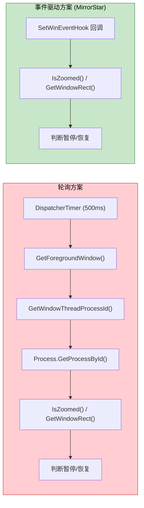

[← 返回文档索引](../index.md) > 架构与技术栈 > 性能优化

# MirrorStar Wallpaper（镜星壁纸）— 性能优化策略

| 项目   | 内容                        |
| ---- | ------------------------- |
| 项目名称 | MirrorStar Wallpaper（镜星壁纸） |
| 文档版本 | v3.0                      |
| 更新日期 | 2026-10-11                |
| 文档状态 | 已实现（已按真实代码合并重组，2026-10）        |

***

## 1. 零拷贝数据传输

在壁纸渲染管道中，尽量减少数据拷贝：

| 场景      | 优化方案                      |
| ------- | ------------------------- |
| 视频帧传输   | mpv 直接渲染到窗口表面，无需帧数据拷贝     |
| GIF 帧渲染 | 使用 GDI 双缓冲 直接写入窗口缓冲区   |
| IPC 消息  | 命名管道使用重叠 I/O，避免阻塞拷贝       |
| 配置读取    | 使用 `RwLock` 允许多读单写，读操作零拷贝 |

## 2. 懒初始化

非关键资源延迟到首次使用时初始化：

| 资源          | 初始化时机     |
| ----------- | --------- |
| WorkerW 句柄  | 首次设置壁纸时   |
| WebView2 环境 | 首次创建网页壁纸时 |
| 音频会话        | 首次需要音量控制时 |
| 文件监听器       | 配置管理器初始化时 |

## 3. 热路径最小化分配

在频繁执行的代码路径中避免堆分配：

| 热路径                | 优化                       |
| ------------------ | ------------------------ |
| SetWinEventHook 回调 | 仅获取 hwnd 后投递到异步任务，回调内零分配 |
| 窗口消息循环             | 使用栈上缓冲区处理消息              |
| IPC 消息解析           | 使用零拷贝字符串解析               |
| 全屏检测               | 缓存显示器信息，避免重复查询           |

## 4. 事件驱动 vs 轮询性能对比



| 指标        | 轮询 (500ms) | 事件驱动     |
| --------- | ---------- | -------- |
| 每秒系统调用次数  | ≥4 次       | 0 次（空闲时） |
| 每秒 CPU 时间 | \~0.5ms    | 0ms（空闲时） |
| 响应延迟      | 0\~500ms   | <50ms    |
| 电池影响      | 持续唤醒       | 无唤醒      |
| 代码复杂度     | 低          | 中        |

## 5. 内存使用优化

| 优化点     | 方案                                   | 预期效果        |
| ------- | ------------------------------------ | ----------- |
| 主进程工作集  | 使用 `SetProcessWorkingSetSize` 提示系统缩减 | 暂停态 < 20MB  |
| 配置缓存    | `RwLock<AppConfig>` 单实例共享            | 避免重复解析      |
| 缩略图     | 按需生成，磁盘缓存                            | 不占用运行时内存    |
| 日志缓冲    | `tracing-appender` 非阻塞写入             | 避免日志 I/O 阻塞 |
| IPC 缓冲区 | 固定大小缓冲区                              | 避免动态扩容      |

## 6. 启动性能优化

| 优化点   | 方案                   | 预期效果              |
| ----- | -------------------- | ----------------- |
| 壁纸恢复  | 并行启动多个壁纸子进程          | 多显示器场景快速恢复        |
| 配置加载  | 单次 TOML 解析，RwLock 缓存 | < 5ms             |
| 桌面集成  | WorkerW 句柄缓存，避免重复查找  | 首次 < 100ms，后续 0ms |
| UI 渲染 | 原生 UI 子进程（Slint）按需启动 | 主窗口显示 < 500ms |

> 开机自启场景的启动延迟分层归因与自启机制选型，见 §23《开机自启启动延迟优化》。

## 7. 主窗口 WebView2 懒创建 / 关闭即销毁（⚠️ 已被原生 UI 子进程方案取代，历史条目）

> **已被取代**：主窗口已重构为独立原生 UI 子进程 `mirrorstar-ui.exe`（Slint 软件渲染），壳不再创建任何 WebView2 主窗口。以下 WebView2 懒创建 / 关闭即销毁策略及其数值均为历史记录，仅作演进参考；当前策略与实测数值见 **§21**。

主窗口不再在启动时创建，仅创建系统托盘图标。用户需要时通过 `WebviewWindowBuilder` 按需创建主窗口；**关闭主窗口时不调用 `api.prevent_close()`，让 Tauri 默认销毁窗口，从而释放整棵 WebView2 子进程树**（`src-tauri/src/lib.rs` 的 `on_window_event` 主窗口 `CloseRequested` 分支）。窗口销毁后触发 `RunEvent::ExitRequested(code=None)`，由 `.run()` 回调 `api.prevent_exit()` 阻止应用退出以保持托盘驻留；用户下次打开时 `create_or_show_main_window` 走 build 路径重建窗口与 WebView2。

> 关于「懒创建/销毁」的历程：v8.0 起由「关闭即 `hide()`（保留 WebView2 实例）」改为「关闭即销毁窗口（释放 WebView2 子进程树）」。`hide()` 方案下窗口不可见但 WebView2 进程仍长期驻留 `msedgewebview2.exe`（约 5-6 进程 / 150-300MB），销毁方案将其整体归还 OS。

| 状态 | WebView2 进程 | 内存占用 |
|------|---------------|----------|
| 窗口打开 | 存在（约 5-6 进程） | 约 150-300MB |
| 窗口关闭（销毁） | 不存在 | 释放 WebView2 子进程树，仅保留主进程与托盘 |

**优化效果**：窗口关闭后不再长期保留 WebView2 子进程（约 150-300MB）；v8.0 时期按旧口径曾记录「暂停态内存 ~317MB → ~17MB（降幅 95%）」，属历史实测数据，本次内存专项未重复测量。**本轮（2026-10-02）各改动的优化前后实测数值待真机补测（用 `get_memory_report` 采集，见 §19）。**

## 8. Native 壁纸零资源

JPG/JPEG/PNG/BMP/TIF/TIFF/DIB 静态壁纸使用 `SystemParametersInfoW(SPI_SETDESKWALLPAPER)` + 注册表（`WallPaperStyle`/`TileWallpaper`）设置，而非 WorkerW 嵌入方案。两者在窗口/线程/GDI/内存维度上的完整对比见[壁纸渲染](./05-壁纸渲染-Wallpaper-Rendering.md)§1.2；就性能而言，Native 模式为 **~0MB 内存、零窗口/零线程/零 GDI 对象**，WorkerW 模式约 **10-30MB 内存**。

**优化效果**：静态壁纸零资源占用，无需创建窗口、线程或 GDI 对象。

## 9. PauseSender 快速通道

暂停/恢复/音量/静音操作绕过引擎 `Mutex<WallpaperEngine>`，通过 `tokio::sync::mpsc::UnboundedSender<PauseCommand>` 直接发送到渲染器线程。

| 场景 | 旧方案（Mutex） | 新方案（PauseSender） |
|------|----------------|---------------------|
| 无锁竞争 | ~1ms | ~0.01ms |
| 有锁竞争 | 10~100ms | ~0.01ms（不受 Mutex 阻塞） |

**优化效果**：暂停响应不受引擎 Mutex 阻塞，响应延迟降低 2~4 个数量级。机制见《06-暂停恢复机制》。

## 10. GIF 内存预算优化

GIF 内存预算从 200MB 降至 40MB（`MAX_GIF_MEMORY_MB`）。暂停时释放所有帧（仅保留当前帧），恢复时从文件重新解码。

| 状态 | 旧方案（200MB 预算） | 新方案（40MB 预算） |
|------|---------------------|---------------------|
| 播放中 | 最高 200MB | 最高 40MB |
| 暂停中 | 保留所有帧，仍占 200MB | 仅保留当前帧，~1-5MB |

**优化效果**：GIF 内存占用降低 80%，暂停态降低 95%+。

## 11. 子进程 IPC 连接超时优化

视频壁纸（mpv）与网页壁纸（wp-proc）子进程的 IPC 连接超时参数差异化配置，减少壁纸切换等待时间。两类子进程的管道就绪特性不同：

- **mpv**：外部进程，启动后 `--input-ipc-server` 创建命名管道典型 200-500ms 即就绪，2s 超时足够
- **wp-proc**：内部 Rust 子进程，但需启动 WebView2 运行时（冷启动较慢），定为 8s 兜底

**优化效果**：mpv 视频壁纸切换最坏情况等待时间约为 IPC 2s + 窗口查找 2s = 4s；wp-proc 保留 8s 超时以兼容 WebView2 冷启动场景。

> **完整连接重试参数表（mpv `MPV_CONNECT_RETRIES` / wp-proc `WP_PROC_CONNECT_RETRIES` / `WINDOW_FIND_RETRIES` 具体次数与间隔）见《03-进程架构与IPC》§4.3。** 参数通过常量定义，调用点 `ipc.connect(...)` 使用常量而非魔法数字，便于后续调整。

## 12. 图片像素数据暂停释放

静态图片渲染器（WorkerW 模式）暂停时释放 `pixels: Vec<u8>`，恢复时从文件重新加载（`load_and_downsample_image()`）。

| 状态 | 内存占用 |
|------|----------|
| 播放中 | ~5-30MB（取决于分辨率） |
| 暂停中 | ~0MB（像素数据已释放） |

**优化效果**：暂停态图片壁纸内存占用降至接近零。

## 13. 内存归因埋点（v17，Task 1）

为把「应用组到底占了多少内存、分别是谁占的」量化，`mirrorstar-core` 新增内存归因埋点（`crates/mirrorstar-core/src/perf.rs`）：

- `ProcessCategory`：按可执行文件名把进程树归类为 `Main`（主进程）/ `Mpv`（`mpv.exe`）/ `WpProc`（与壳进程同名且**非进程树根**的 `--wp-proc` 子进程）/ `WebView2`（`msedgewebview2.exe`）/ `Other`（其余后代，含 conhost 等）。
- `attribute_processes`：以当前进程 pid 为根，按父 pid 关系**迭代扩张**取后代集合（任意排序的进程列表都能正确建树，`included` 集合去重天然处理环/重复父 pid），因此不会误算系统上其他应用的 `msedgewebview2.exe`。
- `aggregate` → `MemoryUsageReport`：逐类别累计进程数、工作集（WorkingSetSize）与私有提交（PrivateUsage），`total` 恒等于各类别之和。
- `sample_memory_report`：一次进程快照 + 逐进程 `GetProcessMemoryInfo`（失败跳过并记日志，不 panic）。
- `spawn_memory_attribution_sampler(interval)`：后台周期采样线程，`interval` 被抬升到下限 `MIN_MEMORY_SAMPLE_INTERVAL`（30s）以上。

暴露入口：

| 入口 | 位置 | 说明 |
|------|------|------|
| Tauri 命令 `get_memory_report` | `src-tauri/src/commands/system.rs` | 按需同步返回分类别明细与总计，开销小，无需 async |
| 周期采样 | `src-tauri/src/lib.rs` setup | 启动时 `spawn_memory_attribution_sampler(Duration::from_secs(60))`，每 60s 输出一行归因日志 |

日志 target 为 `mirrorstar::perf`，message 形如 `MEM-ATTRIB: 应用组逐子进程内存归因`，结构化字段含 `main_procs/main_ws_mb/main_private_mb`、`mpv_*`、`wp_proc_*`、`webview2_*`、`other_*`、`total_procs/total_ws_mb/total_private_mb`（工作集 MB 与私有提交 MB）。可用 `RUST_LOG=mirrorstar::perf=info` 单独过滤。

**预期效果**：为后续所有内存改动提供同口径、可复现的量化基线（分类别 + 总计），使「优化是否有效」可被直接验证，而非凭经验判断。

## 14. 主窗口 WebView2 启动参数裁剪（⚠️ 已被原生 UI 子进程方案取代，历史条目）

> **已被取代**：壳不再创建 WebView2 主窗口，常量 `MAIN_WINDOW_BROWSER_ARGS` 与 `WebviewWindowBuilder::additional_browser_args` 均已随主窗口重构移除。以下内容为历史记录。

在 `src-tauri/src/state.rs` 集中定义常量 `MAIN_WINDOW_BROWSER_ARGS`，挂到主窗口 `WebviewWindowBuilder::additional_browser_args`：

```
--disable-features=msWebOOUI,msPdfOOUI,msSmartScreenProtection,BackForwardCache,MediaCache,FontCache,GpuMemDiscardable
--autoplay-policy=no-user-gesture-required
--renderer-process-limit=1
--js-flags=--max-old-space-size=512
--disk-cache-size=52428800
```

| 参数 | 用途 / 预期效果 |
|------|----------------|
| `msWebOOUI,msPdfOOUI,msSmartScreenProtection` | 去 Edge mini 菜单 / PDF 工具栏 / SmartScreen（**wry 默认项，必须保留**） |
| `BackForwardCache` | 禁用前进/后退整页缓存（主窗口是单页设置 UI，无导航历史） |
| `MediaCache` | 禁用媒体磁盘缓存（缩略图仍可解码显示，仅不落盘） |
| `FontCache` | 禁用字体缓存，减少字体相关内存 |
| `GpuMemDiscardable` | 减少 GPU 进程可丢弃内存 |
| `--autoplay-policy=no-user-gesture-required` | **wry 默认项，必须保留**（维持原媒体自动播放语义） |
| `--renderer-process-limit=1` | 复用单个 renderer 进程，省去额外 renderer 内存基线 |
| `--js-flags=--max-old-space-size=512` | 限制 renderer 的 V8 老生代堆上限（默认可达数 GB），压低 JS 堆峰值 |
| `--disk-cache-size=52428800` | 磁盘缓存上限 50MB（默认近乎无上限） |

**关键点（务必保留默认项）**：Tauri/wry 的 `additional_browser_args` 语义是「**替换**」而非「追加」wry 默认串——wry 0.55.1 在 `create_environment`（`wry-0.55.1/src/webview2/mod.rs:294`）对该字段使用 `unwrap_or_else(...)`。因此常量内**显式保留**了 wry 默认的 `msWebOOUI,msPdfOOUI,msSmartScreenProtection` 与 `--autoplay-policy=no-user-gesture-required`，否则会静默丢失默认 UI/SmartScreen 裁剪与自动播放策略。所有禁用特性合并进**同一个** `--disable-features=` 列表（Chromium 多值合并语义不保证确定）。

降级说明：Chromium 对未知 flag 静默忽略；`additional_browser_args` 仅写入字符串、不参与 `.build()` 成败判定，未知/不支持时主窗口仍可正常创建。

**明确不启用 `--disable-gpu`**：本项目无真实 GUI 运行时测量依据；软件合成（SwiftShader/CPU 光栅化）可能反而推高 renderer 内存与 CPU，且主窗口含 CSS 过渡/拖拽排序动效。按「不为优化引入回归风险」原则暂不启用，后续验证方法见 `state.rs` 常量后的注释。

**预期效果**：压低主窗口 WebView2（尤其 renderer/GPU 进程）的内存基线与磁盘缓存占用。实测数值待真机补测。

## 15. 非活跃态 WebView2 挂起 / 目标等级降级（⚠️ 已被原生 UI 子进程方案取代，历史条目）

> **已被取代**：模块 `src-tauri/src/platform/webview_memory.rs` 已随主窗口重构移除；壳不再管理 WebView2 主窗口，UI 子进程改为按空闲超时整体退出回收内存（见 §21）。以下内容为历史记录。

新增 `src-tauri/src/platform/webview_memory.rs`，在最小化等非活跃态做两件互补的 best-effort 回收：

1. **挂起**：`ICoreWebView2_3::TrySuspend`（`IsSuspended` 幂等判定）暂停脚本定时器/动画并最小化 renderer CPU；恢复时 `Resume`。
2. **内存使用目标等级降级**：`ICoreWebView2_19::SetMemoryUsageTargetLevel(Low)`，恢复时置回 `Normal`。

接入点：

| 场景 | 位置 | 动作 |
|------|------|------|
| 全屏自动最小化主窗口 | `state.rs` `minimize_main_window_on_fullscreen` | `suspend_main_webview` |
| 窗口恢复可见 | `state.rs` `create_or_show_main_window` 已存在分支（`unminimize`/`show` 之后） | `resume_main_webview` |
| 窗口重建 | `state.rs` build 分支 | `reset_main_webview_suspended_state` |
| 关闭主窗口前 | `lib.rs` `on_window_event` `CloseRequested` | best-effort `resume_main_webview`（缓解项） |
| 通用最小化/恢复 | `lib.rs` `on_window_event` `Resized`（`window.is_minimized()`） | `sync_main_webview_active_state`（边沿触发去抖） |

**`TrySuspend` 前置条件与降级策略**：微软文档明确「调用时 `CoreWebView2Controller.IsVisible` 必须为 false，否则返回 `HRESULT_FROM_WIN32(ERROR_INVALID_STATE)`；且为 best-effort，失败时完成回调以 `isSuccessful=false` 上报」。本模块**不**主动把 controller `IsVisible` 置 false（窗口最小化不等价于 WebView 不可见，强置若恢复有闪失会导致白屏），因此最小化场景下 `TrySuspend` **很可能失败**。由于「目标等级降级」无此前置条件，**挂起失败时该路径仍然生效**，保证非活跃态始终有内存回收动作。所有失败仅 `tracing::warn!`，绝不 panic、绝不影响窗口操作；旧运行时无 `ICoreWebView2_19`/`ICoreWebView2_3` 时优雅跳过。

依赖版本：`src-tauri/Cargo.toml` 固定 `webview2-com = "0.38"` 并以别名 `windows61` 引入 `windows 0.61`，**必须与 wry 0.55.1 / tauri-runtime-wry 2.11.2 同源**（否则 `ICoreWebView2*` 会出现两套不互通类型）。

**预期效果**：主窗口最小化（含长时间被全屏应用遮挡而自动最小化的场景）时，WebView2 renderer 工作集下降；挂起成功时下降更明显，仅等级降级生效时下降幅度较小但仍低于可见稳态。实测数值待真机补测。

## 16. mpv 解码限流（v17，Task 4）

`crates/mirrorstar-core/src/wallpaper/video.rs` 的 `build_mpv_args` 在 v10/v11 限流基础上追加两个参数：

| 新增参数 | 说明 / 预期效果 |
|----------|----------------|
| `--vd-lavc-threads=4` | 限制视频解码线程数。mpv 默认 0（按 CPU 核数自动上探，最多 16）；帧级多线程解码会为每条线程保留参考帧缓冲（1080p 单帧 ≈3MB、4K ≈12MB），hwdec 失败回退软解时最耗内存。固定 4：软解 1080p/4K 壁纸仍流畅，同时显著压低线程缓冲上限。`--hwdec=auto` 走硬件解码时不参与软解线程创建，无副作用、不影响画质 |
| `--demuxer-readahead-secs=0.5` | demuxer 前向预读时间窗由默认 1s 减半。`--cache=no` 下虽无 stream 缓存层，demuxer 仍按本参数预读数据包进入其包队列；降低该值可直接压缩该队列内存。本地文件循环播放，0.5s 预读绰绰有余 |

既有限流参数**全部保留**：`--cache=no`、`--vd-queue-max-bytes=16777216`、`--ad-queue-max-bytes=4194304`、`--demuxer-max-back-bytes=0`、`--cache-secs=0`、`--hwdec=auto`、`--vo=gpu` 等。

> **项目硬约束：禁止新增 `--demuxer-max-bytes=`**。该参数会把解复用器缓冲上限清零，导致 demuxer 无法缓冲任何数据包（`Too many packets in the demuxer packet queues: 0 packets`），mpv 立即 video EOF + `No media data to loop` 退出，桌面黑屏、壁纸设置失败。

**预期效果**：降低视频壁纸软解场景的线程参考帧缓冲与 demuxer 前向预读包队列占用。实测数值待真机补测。

## 17. 网页壁纸裁剪与环境共享评估（v17，Task 5）

`crates/mirrorstar-wp-proc/src/webview.rs` 抽出**纯函数** `build_additional_browser_args()`（不触碰 COM，便于单测断言参数契约），并新增两项裁剪参数：

| 新增参数 | 说明 / 预期效果 |
|----------|----------------|
| `--renderer-process-limit=1` | wp-proc 只渲染一个页面，限制渲染进程数为 1，省去多余 renderer 进程内存基线。风险低：跨域 iframe 会与主 frame 共用 renderer（牺牲站点隔离、单 renderer 内存略升），但该进程是 fail-closed 沙箱面，隔离损失可接受 |
| `--js-flags=--max-old-space-size=512` | 把 V8 老生代堆上限压到 512MB（64 位默认约 2-4GB），约束失控增长。取值保守（普通网页堆通常 <100MB，WebGL 纹理不占 V8 堆），避免 OOM/白屏 |

既有的 `--autoplay-policy=no-user-gesture-required`（E2E 免手势播放必需）、`--disk-cache-size=10485760`、`--disable-gpu-program-cache`、`--disable-gpu-shader-disk-cache`、`--disable-features=MediaCache,FontCache,GpuMemDiscardable,BackForwardCache` **全部保留**。

**环境共享评估结论：放弃**。目标本是让主窗口与 wp-proc 共用同一 UDF + 环境选项以省下一份 `msedgewebview2` 基线（约 5-6 进程 / 150-300MB）。经核实，WebView2 官方文档明确跨进程共享同一 UDF 是**被支持**的，故放弃共享**不是技术不可行，而是架构取舍**：

1. **崩溃隔离回退（决定性）**：wp-proc 存在的首要理由就是崩溃隔离；壁纸页面是不受信任的第三方网页（fail-closed 沙箱面），是崩溃概率最高的一方。共享 browser 进程后其崩溃会一并拖垮主窗口设置 UI。
2. **多显示器能力回退（决定性）**：per-PID UDF 让每个 wp-proc 成为独立进程集合，多显示器可同时开多个 Web 壁纸、各自独立 terminate/重启；共享单一 UDF 后所有实例落进同一 browser 进程集合，且 `cleanup_wp_proc_user_data_folder` 会在实例退出时 `remove_dir_all` 整个 UDF，破坏仍在运行的环境。
3. **环境选项无法对齐**：主窗口由 Tauri/wry 托管，wp-proc 无法控制其 UDF 与参数；壁纸侧需要主窗口不应有的进程级配置（免手势自动播放、`WEBVIEW2_DEFAULT_BACKGROUND_COLOR` 透明注入、CDP 注入等）。
4. **净收益不确定**：即便省下一份基线，也需集中式 UDF 生命周期管理 + 全参数对齐，复杂度与风险远超预期收益。

结论已写入 `webview.rs` 中 `build_webview2_user_data_folder` 的文档注释（含未来若仍要共享的前置条件）。

**预期效果**：约束单个网页壁纸子进程的 renderer 进程数与 JS 堆峰值；不因共享环境而回退崩溃隔离与多显示器能力。

## 18. 预览媒体呈现策略（⚠️ 已被原生 UI 预览方案取代，历史条目）

> **已被取代**：前端（`src/scripts/ui/preview-modal.ts`）已删除，预览改由 `mirrorstar-ui.exe` 原生实现（图片自绘 / 视频 UI 进程内 mpv 子窗口 / GIF 逐帧动画 / 网页按需临时 WebView2 子窗口）。以下前端 `wpfile://` + `<video>` 策略为历史记录。

`src/scripts/ui/preview-modal.ts` 的预览媒体按类型区分呈现，**不再统一静态化**：

- **视频（Video）：真实 `<video>` 流式播放**（`showVideoPreview`）。`video.src = convertFileSrc(wp.file_path, "wpfile")`，并设 `preload="metadata"`、`playsInline=true`、`loop=false`；有缩略图时设 `video.poster`，无缩略图时 `removeAttribute("poster")`。关闭预览或切换预览时 `resetMedia` 调用 `releaseVideoElement` 清空 `src` 并同时清理 poster，释放媒体引用。

- **GIF：保持静态缩略图并显示显式降级提示**（`showGifStaticPreview`）。优先使用 `wp.thumbnail`（320x180 JPEG 缩略图）作为 `` 显示，无缩略图时回退为类型图标占位（`typeIcon`，容器为 `index.html` 的 `#preview-placeholder`），同时显示「动图预览暂不可用，当前显示缩略图」提示（`index.html` 的 `#preview-gif-note`，样式 `.preview-gif-note` 见 `src/styles/main.css`）。

**视频「内存有界」的依据**：`wpfile://` 自定义协议已支持 HTTP Range 流式读取（`src-tauri/src/lib.rs` 的 `wpfile` handler）——视频播放器按需请求字节范围，handler 返回 `206 Partial Content` 并携带 `Accept-Ranges: bytes`，且单次 Range 被限制为最多 1MB（`MAX_RANGE_LEN`）；HEAD 请求仅返回 `Content-Length`/`Accept-Ranges` 供播放器探测文件大小。因此 `<video>` 是**按需流式解码、内存有界**，而非一次性拉取并解码整段视频。据此，Task 6「`<video>` 会二次解码整段视频、应统一静态化」的优化前提不成立（且已构成「视频预览功能消失」的功能回归），故本轮（变更 `restore-video-preview-playback`）恢复视频真实播放。

> **注**：`wpfile://` 自定义协议随旧前端一并废弃；原生 UI 预览改由 UI 进程内 mpv 子窗口实现。

**GIF 静态化的依据**：Chromium 的 `<video>` 不支持 `image/gif`，塞入 `<video>` 本就不工作，故保持静态缩略图并显式提示降级。

仅使用 class 切换与 `textContent`（DOM API）操作，遵守无 `unsafe-inline` 的 CSP。

**预期效果**：视频预览按需流式解码、内存有界（单次 Range ≤1MB），关闭预览即释放媒体引用；GIF 预览明确降级并提示用户。实测数值待真机补测（可对比打开/关闭预览前后 `get_memory_report` 的总计）。

## 19. 本轮内存实测基线采集方法（待真机）

本次（v17，2026-10-02）的 6 项改动均已完成实现与单元测试，但**优化前后对比需真实 GUI 环境**，本机（无 GUI 运行条件、且可能正有应用在运行）不做真实测量、不伪造数据。真机采集步骤：

1. 运行应用 → 打开主窗口 → 播放视频壁纸 → 稳态 ≥60s；
2. 触发 `get_memory_report` 命令，或读取 `logs/mirrorstar.log` 中 target `mirrorstar::perf` 的 `MEM-ATTRIB` 日志，按类别（主进程 / `msedgewebview2` / `mpv` / `wp-proc`）与总计记录工作集与私有提交；
3. 与优化前基线（同口径）对比；
4. 额外记录**最小化态**与**预览开关态**内存，分别验证 §15（Task 3）与 §18（视频流式播放按需解码、关闭预览即释放引用）的效果。
5. 若需定位**启动 / 打开主窗口的秒级峰值**（既有 60s 周期采样无法捕捉），见 §20 的启动期内存时间线（`MEM-TIMELINE` / `MEM-MARK`）采集方法。

## 20. 启动期内存时间线（v17，`optimize-startup-memory-peak`）

> **说明**：本节为历史优化记录。其中涉及前端（`src/scripts/main.ts` / `report_lifecycle_mark` / `main_window_created` / `frontend_init_done` / `wallpaper_list_rendered`）与主窗口 WebView2 的埋点、标记与数值，已随前端删除、主窗口原生 UI 重构而**失效**；后端 `mirrorstar::perf` 归因采样（`MEM-ATTRIB` / `MEM-TIMELINE` / `MEM-MARK`）机制仍然有效。当前主窗口内存数值见 §21。

**背景**：既有内存归因埋点为 60 秒周期采样（见 §13 的 `spawn_memory_attribution_sampler` / `MEM-ATTRIB`）。60 秒粒度**无法捕捉启动与打开主窗口阶段的秒级峰值**，导致「约 500MB 峰值由谁产生、为何回落」无法定量归因。本次变更在 `crates/mirrorstar-core/src/perf.rs` 新增启动期细粒度时间线与生命周期事件打点。

**新增 API（`mirrorstar-core::perf`）**：

| API | 作用 |
|-----|------|
| `startup_elapsed_ms()` | 返回相对进程启动基准（首次调用惰性初始化的 `Instant`）的耗时（ms），非阻塞、无系统调用，可在任意线程安全调用 |
| `mark_lifecycle(label)` | 立即采集一次并输出一条事件打点；非阻塞、best-effort、失败不 panic |
| `spawn_startup_memory_timeline(total, interval)` | 启动后 `total` 时长内按 `interval` 间隔输出时间线；到达 `total` 后线程自行结束；线程创建失败返回 `None`，不 panic |

**日志类型**（target 均为 `mirrorstar::perf`）：

| message 前缀 | 触发时机 | 说明 |
|-------------|---------|------|
| `MEM-TIMELINE` | 启动后前 60 秒，每 ~1 秒一条（`label = "timeline"`） | 应用启动时以 `spawn_startup_memory_timeline(Duration::from_secs(60), Duration::from_secs(1))` 启动；60 秒后停止，回落到既有 60 秒周期采样（`MEM-ATTRIB` 语义不变） |
| `MEM-MARK` | 生命周期事件发生即刻 | `label` 为事件标签，用于把时间线上的峰值对齐到具体阶段 |

两者字段与既有 `MEM-ATTRIB` 一致（分类别工作集 / 私有提交与总计：`main_*` / `mpv_*` / `wp_proc_*` / `webview2_*` / `other_*` / `total_*`，含 `*_ws_mb` 与 `*_private_mb`），额外携带 `label` 与 `elapsed_ms`。可用 `RUST_LOG=mirrorstar::perf=info` 单独过滤。

**开关**：环境变量 `MIRRORSTAR_MEM_TRACE`，值为 `0` 或 `off`（大小写不敏感、忽略首尾空白）时关闭；未设置时默认开启启动期 60 秒采集（**v17 Task 4 起改为默认关闭（opt-in），仅显式设为非 `0`/`off` 值才开启，见 §23**）。关闭时不启动时间线线程，`mark_lifecycle` 静默无输出。采样仅做进程树枚举与 `GetProcessMemoryInfo`，不持有引擎 / 桌面锁、不阻塞主线程；60 秒后无持续高频开销。

**可归因的生命周期阶段**（`label` 与打点位置）：

| label | 打点位置 | 含义 |
|-------|---------|------|
| `log_init` | `src-tauri/src/lib.rs` `log_init` | 日志初始化完成（首个打点，同时初始化启动基准时刻） |
| `engine_ready` | `src-tauri/src/lib.rs` setup | 引擎 / 配置等基础设施初始化完成 |
| `boot_wallpaper_applied <key:Type,...>` | `src-tauri/src/scheduler.rs` `apply_boot` 后 | 开机壁纸应用完成，含各显示单元壁纸类型（如 `boot_wallpaper_applied primary:Video,secondary:Image`；无壁纸时为 `none`） |
| `main_window_created` | `src-tauri/src/state.rs` `create_or_show_main_window` 成功分支 | 主窗口创建成功 |
| `main_window_page_loaded` | `src-tauri/src/state.rs` `on_page_load` 的 `PageLoadEvent::Finished` | 主窗口页面加载完成 |
| `frontend_init_done` | `src/scripts/main.ts` `init()` 末尾（经命令 `report_lifecycle_mark` 上报） | 前端初始化完成（**已随前端删除失效**） |
| `wallpaper_list_rendered` | `src/scripts/main.ts` 壁纸列表渲染后（经命令 `report_lifecycle_mark` 上报） | 壁纸列表渲染完成（**已随前端删除失效**） |

**真机采集方法**：分别采集两条时间线，读取 `logs/mirrorstar.log` 中 target `mirrorstar::perf` 的 `MEM-TIMELINE` / `MEM-MARK` 记录，比较各分类别峰值与回落时机：

1. **仅启动（不打开主窗口）**：启动应用后静置 ≥60s，不打开主窗口。观察 `log_init` / `engine_ready` / `boot_wallpaper_applied …` 处的 `MEM-MARK` 跳变，以及前 60s `MEM-TIMELINE` 各分类别（主进程 / `msedgewebview2` / `mpv` / `wp-proc` / 其他）的峰值与回落时机——此线用于隔离「主进程 + 开机壁纸子进程」基线，不含主窗口 WebView2。
2. **打开主窗口**：启动后打开主窗口，观察各 `MEM-MARK` 差值，定位打开瞬间的峰值由哪一阶段 / 哪一类别拉起，以及何时回落。

对比两条线各分类别峰值与总计峰值，即可判断峰值主因（WebView2 冷启动基线 / 开机壁纸子进程 / 前端列表渲染 / 其他）；建议每场景重复 ≥3 次取中位数以降低噪声。

**实测归因结论（2026-10-02，`target/debug/logs/mirrorstar.log.2026-10-02`，历史口径）**：

| 阶段 | 相对启动 | 总计 WS (MB) | 总计私有提交 (MB) | WebView2 进程数 |
|------|---------|-------------|------------------|----------------|
| `log_init` | 0ms | 11.5 | 5.4 | 0 |
| `boot_wallpaper_applied DISPLAY1:none` | 35ms | 18.6 | 6.9 | 0 |
| 启动后 60s 静置（无主窗口） | 0–60s | 18.8 | 约 7 | 0 |
| `main_window_created` | 71937ms | 245.7 | 97.6 | 6 |
| `main_window_page_loaded` | 72102ms | 319.0 | 179.3 | 6 |
| `frontend_init_done` | 72144ms | 324.4 | 182.9 | 6 |
| `wallpaper_list_rendered` | 72150ms | 325.0 | 183.2 | 6 |
| `wallpaper_list_rendered`（视频壁纸 mpv 已在跑） | 91595ms | 518.3 | 599.0 | 6 |

结论（历史）：启动本身极轻；约 500MB 峰值只出现在「打开主窗口」瞬间，来自当时的主窗口 WebView2；主窗口关闭后 WebView2 进程全部退出无残留。该口径已被 §21 的原生 UI 子进程方案取代。

## 21. 主窗口原生 UI 子进程内存/CPU（当前策略，`rewrite-main-window-native-ui`）

主窗口已由 Tauri 内嵌 WebView2 重构为独立原生 UI 子进程 `mirrorstar-ui.exe`（Slint 1.18，**绑定软件渲染**：`default-features=false` + 仅 `renderer-software`，不编译 femtovg/skia，避免 winit 选 OpenGL 后端导致 +67MB 内存）。壳不再创建任何 WebView2 主窗口，也不再裁剪 WebView2 启动参数或做 WebView2 挂起（§14 / §15 已失效）。

**当前内存/CPU 策略：**

| 措施 | 说明 |
|------|------|
| 原生 UI 子进程 | 主窗口 UI 运行在 `mirrorstar-ui.exe`，经 `ui_proto` NDJSON（stdio）与壳通信 |
| 软件渲染绑定 | 仅启用 Slint `renderer-software`，规避 GPU/OpenGL 后端内存开销 |
| 按需启动 + 空闲退出 | 窗口隐藏超时（默认 300s，`MIRRORSTAR_UI_IDLE_TIMEOUT_SECS`）后整体退出 UI 子进程回收内存，再次请求重新拉起；同一时刻至多一个实例 |
| 虚拟化网格 | 仅实例化可见区间 ±2 行缓冲，避免全量卡片实例化 |
| 缩略图直读 | 按本地文件路径直读，不经 IPC 传字节 |
| 用户主动唤起时置前聚焦 | 托盘 / 菜单 / 二次启动触发时 `SetForegroundWindow`（壳侧先 `AllowSetForegroundWindow`），使任务栏按钮一次点击最小化；纯净模式等非用户主动场景仍禁止抢前台 |

**验收实测结论（对比改造前基线）：**

| 指标 | 改造前（WebView2 主窗口） | 当前（原生 UI 子进程） |
|------|--------------------------|----------------------|
| 主窗口打开并静置：壳 + UI 合计 private | 213.7MB private / 360.6MB WS（其中 `msedgewebview2`×6 = 204.2MB） | **≈16.8MB**（验收门槛 ≤40MB） |
| 关闭（UI 退出）后 | 回落至壳内存量级 | ≈7.6MB |
| idle CPU | — | ≈0.4% |
| 网格滚动 CPU | 47.6% | **10.5%** |

> 结论：原生 UI 子进程方案以"整体进程按需启停"替代了 WebView2 的"参数裁剪 + 非活跃态挂起"，在内存与 CPU 上均大幅下降。
>
> **数值归口**：上表的验收基线数值已并入 §22「资源占用穷举清单」（作为"无壁纸 + 主窗口开/关"情形的基线来源）。如需完整口径、其它情形与来源标注，一律以 §22 为准，其它章节不再重复维护同一事实。

**e2e / 驱动脚本**：`crates/mirrorstar-ui/` 下的 PowerShell 脚本（`measure_grid.ps1`、`measure_scroll_reverify.ps1`、`measure_preview.ps1`、`keyboard_smoke.ps1`，以及 `shell_measure.ps1`、`single_instance_check.ps1`）用于真机采集上述数值。

## 22. 资源占用穷举清单（`enumerate-wallpaper-resource-usage`）

> 本节为**资源占用的权威清单**：穷举「壁纸类型 × 运行状态 × 叠加态」下应用组的系统资源占用情形与资源持有者。其它章节涉及资源数值时以本节为准（如需引用请指向本节），避免重复维护同一事实。

### 22.1 口径与来源标注

**进程分类口径**：`Main`＝壳根进程 `mirrorstar-wallpaper.exe`；`WpProc`＝与壳同名但**非根**的 `--wp-proc` 子进程；`Mpv`＝`mpv.exe`；`WebView2`＝`msedgewebview2.exe`；`Other`＝其余后代（如 `conhost.exe`）。以上五类即 `crates/mirrorstar-core/src/perf.rs::ProcessCategory` 的归因口径；本清单的采集脚本（见 §22.2）在其基础上把 `mirrorstar-ui.exe` 从 `Other` 中单独拆出记为 `UI`，便于观察主窗口 UI 子进程——注意 `perf.rs` 自身并不区分 `UI`，`mirrorstar-ui.exe` 在 `perf.rs` 归因中仍计入 `Other`。

**资源维度**：进程分类与数量、线程数、GDI 对象数、USER 对象数、私有提交（Private）、工作集（WS）、GPU 显存（独占/共享）、CPU、句柄数、磁盘占用（缩略图缓存 / 日志 / WebView2 UDF）。

**来源标注**：
- **【实】**＝本机实测（对正在运行的实例做只读采集，见 §22.4）。
- **【底】**＝复用既有验收/需求基线（§21、NFR-001/002 等），未重复测量。
- **【导】**＝代码推导（资源持有者由代码确证；绝对数值**待实测**，不伪造）。

### 22.2 采集环境与工具

| 项 | 值 |
|---|---|
| OS | Windows 10 22H2（`10.0.19045`） |
| CPU | 12th Gen Intel Core i3-12100F（4 核 / 8 逻辑处理器） |
| 内存 | 32,607 MB |
| GPU | NVIDIA GeForce RTX 5060 |
| 采集工具 | `.trae/scripts/measure-resource-matrix.ps1`（**纯只读**：不停止进程、不写安装目录、不改配置） |
| 采集时刻 | 2026-10-13（被采实例：视频壁纸，PID 8120） |
| 数据根 | 安装目录 `C:\Tools\Mirror Star Wallpaper`（便携式，`MIRRORSTAR_DATA_ROOT` 未设置） |

> 说明：应用为**单实例**（命名互斥体 `MirrorStarWallpaper_SingleInstance`），受控全矩阵实测需独占运行。本次采集**不干扰**用户正在运行的实例，仅对其做只读采样；其余情形在 §22.3 标【导】并附代码来源。

### 22.3 情形 × 资源占用穷举矩阵

| # | 情形 | 状态 | 资源持有者（进程 / 线程 / 窗口 / 对象） | 进程数（分类） | 线程 | GDI/USER | 私有提交 | 工作集 | GPU | CPU | 来源 |
|---|---|---|---|---|---|---|---|---|---|---|---|
| 1 | 无壁纸·仅壳（托盘常驻） | 无壁纸 | 壳进程；托盘 + 调度主循环 + 看护(5s) + 热插拔(3s) + WorkerW 检查(300s) | Main×1 | 待实测 | 待实测 | 【实】壳 10.4MB | 【实】壳 28.3MB | — | 【底】<0.1% | 【实/底】 |
| 2 | 无壁纸 + 主窗口打开 | 无壁纸 | +`mirrorstar-ui.exe`（Slint 软件渲染，虚拟化网格） | Main×1 + UI×1 | 待实测 | 待实测 | 【底】壳+UI ≈16.8MB | 待实测 | — | 【底】idle ≈0.4% / 滚动 10.5% | 【底】(§21) |
| 3 | 无壁纸 + 主窗口关闭（UI 空闲超时退出） | 无壁纸 | 仅壳（UI 进程在默认 300s 空闲超时后退出） | Main×1 | 待实测 | 待实测 | 【底】≈7.6MB | 待实测 | — | 待实测 | 【底】(§21) |
| 4 | Native 静态图（jpg/jpeg/png/bmp/tif/tiff/dib）播放 | 播放 | **无渲染器**：`SystemParametersInfoW` + 注册表，由系统承载 | Main×1 | 壁纸侧 0 | 壁纸侧 0 | 壁纸侧 ~0 | 壁纸侧 ~0 | — | ~0 | 【导】`desktop/native_wallpaper.rs` |
| 5 | Native 静态图 暂停 | 暂停 | 空操作（no-op，无渲染器可暂停） | Main×1 | 0 | 0 | ~0 | ~0 | — | ~0 | 【导】`mode_dispatch.rs` |
| 6 | WorkerW 静态图（WebP）播放 | 播放 | 壳内壁纸线程 `mirrorstar-wallpaper` + GDI 双缓冲窗口（`mem_dc`/`mem_bitmap`/`image_bitmap`） | Main×1 | +1 壁纸线程 | 窗口 + GDI DC/Bitmap | 【导】像素 ~5–30MB（随分辨率） | 【导】~10–30MB | — | 低 | 【导】`wallpaper/image.rs`、`gdi_cache.rs` |
| 7 | WorkerW 静态图（WebP）暂停 | 暂停 | 释放像素 + `mem_bitmap`（保留 `image_bitmap` 与线程） | Main×1 | 保留线程 | 保留 `image_bitmap` | 下降至接近 0 | 下降 | — | ~0 | 【导】`image.rs` Pause 分支 |
| 8 | GIF 播放 | 播放 | 壳内 GIF 线程 `mirrorstar-gif-wallpaper` + 帧像素 + `WM_TIMER` + 可选预取线程 | Main×1 | +1（+预取） | 窗口 + GDI | 【导】≤40MB（帧预算 `max_memory_mb`） | 【导】~10–50MB | — | 中 | 【导】`wallpaper/gif.rs`、`gif_decode.rs` |
| 9 | GIF 暂停·Aggressive | 暂停 | 仅保留当前帧，释放其余帧像素 | Main×1 | 保留线程 | 保留窗口/GDI | 【导】~1–5MB | 下降 | — | ~0 | 【导】`gif_memory.rs` |
| 10 | GIF 暂停·Balanced（默认） | 暂停 | 保留当前帧 ±`balanced_keep_frames`（默认 10） | Main×1 | 保留线程 | 保留窗口/GDI | 【导】介于 9/11 之间 | 折中 | — | ~0 | 【导】`gif_memory.rs`、`config/settings.rs` |
| 11 | GIF 暂停·Performance | 暂停 | 保留全部帧像素 | Main×1 | 保留线程 | 保留窗口/GDI | 【导】≤40MB（不释放） | 不下降 | — | ~0 | 【导】`gif_memory.rs` |
| 12 | GIF 暂停·Adaptive | 暂停 | 按可用内存自动选保留帧数（目标占用可用内存 2%） | Main×1 | 保留线程 | 保留窗口/GDI | 【导】自适应 | 自适应 | — | ~0 | 【导】`gif_memory.rs` |
| 13 | 视频 播放（硬解 `--hwdec=auto`） | 播放 | **外部 `mpv.exe`**（Job 2GB）+ WorkerW 嵌入 + 音频线程 `mirrorstar-video-audio` | Main×1 + Mpv×1 | 【实】113（合计） | 【实】33/64（合计） | 【实】407.8MB | 【实】193.8MB | 【实】独占 545.2 / 共享 30.7MB | 【实】采样时刻≈0 | 【实】`video.rs::build_mpv_args` |
| 14 | 视频 播放（软解回退，`--vd-lavc-threads=4`） | 播放 | 同上，解码下沉到 CPU 多线程 | Main×1 + Mpv×1 | +解码线程 | 同上 | 更高（参考帧缓冲） | 更高 | 更低 | 更高 | 【导】`video.rs` |
| 15 | 视频 暂停（手动 / 全屏 pause 策略） | 暂停 | **mpv 常驻、不释放**：IPC `pause` + 静音，停留当前帧 | Main×1 + Mpv×1 | 不释放 | 不释放 | ≈播放态 | ≈播放态 | ≈播放态 | ~0 | 【导】`video.rs::pause` |
| 16 | 视频 全屏 terminate 策略 | 终止 | `pause_for_fullscreen()`＝`terminate()`：销毁 mpv 进程 | Main×1 | 释放 | 释放 | 回落至壳量级 | 回落 | — | — | 【导】`video.rs::pause_for_fullscreen` |
| 17 | 网页 播放 | 播放 | **壳 `--wp-proc` 子进程** + WebView2（多进程）+ IPC 命名管道 | Main×1 + WpProc×1 + WebView2×n | 待实测 | 待实测 | 待实测（WebView2 基线属 150–300MB 量级，历史口径） | 待实测 | GPU 合成 | 中 | 【导】`wallpaper/web.rs`、`mirrorstar-wp-proc/src/webview.rs` |
| 18 | 网页 暂停（手动 / 全屏 pause 策略） | 暂停 | **子进程常驻、不释放**：仅 IPC 暂停渲染 | 同 #17 | 不释放 | 不释放 | ≈播放态 | ≈播放态 | ≈播放态 | ~0 | 【导】`web.rs` |
| 19 | 网页 全屏 terminate 策略 | 终止 | 销毁 `--wp-proc` 子进程 + 清理 per-PID UDF（`remove_dir_all`） | Main×1 | 释放 | 释放 | 回落至壳量级 | 回落 | — | — | 【导】`web.rs::terminate` |
| 20 | 图片预览打开 | 叠加 | UI 进程内解码（上限 1280×720，关闭必须显式释放否则常驻） | +UI×1 | +1 | +宿主子窗 | 【导】≤~2.6MB（RGB8） | 【导】小 | — | 低 | 【导】`preview/photo.rs` |
| 21 | GIF 预览打开 | 叠加 | UI 进程内惰性逐帧（常驻＝当前帧 + 下一帧解码峰值） | +UI×1 | +1 | +宿主子窗 | 【导】≈2 帧像素 | 【导】小 | — | 低 | 【导】`preview/gif.rs` |
| 22 | 视频预览打开 | 叠加 | **UI 进程内另起独立 mpv**（`--wid` 宿主方案，与壁纸 mpv 完全独立，+1 进程） | +UI×1 + Mpv×1 | 另计 | 另计 | 另计（独立 mpv） | 另计 | GPU 解码 | 中 | 【导】`preview/video.rs` |
| 23 | 网页预览打开 | 叠加 | UI 进程内 WebView2 + 独立 UDF（`webview2-cache/ui-<pid>`） | +UI×1 + WebView2×n | 另计 | 另计 | 另计（WebView2） | 另计 | GPU 合成 | 中 | 【导】`preview/web.rs` |
| 24 | 预览全屏 | 叠加 | 同 #20–#23，几何铺满整窗，控制条空闲 1.5s 隐藏 | 同对应预览 | | | 同对应预览 | | | | 【导】`preview/mod.rs` |
| 25 | 纯净壁纸模式 | 叠加 | 壁纸窗口置顶 `HWND_TOPMOST` + `WS_EX_NOACTIVATE` + 低级输入钩子 + 存活看护线程 | 同底层渲染器 | +钩子/看护线程 | — | 增（Native 下需**另建临时顶层呈现窗口**） | 增 | 同底层 | + | 【导】`platform/pure_mode.rs`、`pure_mode_input.rs` |
| 26 | 多屏·PerMonitor（默认） | 叠加 | 每显示器一个渲染器实例（N＝显示器数） | ×N 相应子进程 | ×N | ×N | ×N | ×N | ×N | ×N | 【导】`scheduler.rs`、`wallpaper/manager.rs` |
| 27 | 多屏·AllSame | 叠加 | 各屏同壁纸，仍为 N 个渲染器 | ×N（同上） | ×N | ×N | ×N | ×N | ×N | ×N | 【导】`config/settings.rs` |
| 28 | 多屏·Span（跨屏拉伸） | 叠加 | **单**跨屏渲染器贯通虚拟桌面 | 壁纸侧 ×1 | ×1 | ×1 | ×1 | ×1 | ×1 | 低 | 【导】`desktop/worker_w.rs::embed_wallpaper` |
| 29 | 壁纸轮换调度运行 | 叠加 | 壳内单条 tokio 主循环（`select!`），无「每显示器一线程」 | Main×1 | 复用 | — | 复用 | 复用 | — | 切换瞬时 | 【导】`scheduler.rs` |
| 30 | 电池供电暂停（`pause_on_battery`） | 叠加 | `pause_all_fast(BATTERY)`，语义同对应类型的暂停 | 同底层类型 | 同暂停语义 | 同暂停语义 | 同暂停语义 | 同暂停语义 | — | ~0 | 【导】`platform/power.rs` |
| 31 | 全屏暂停（`fullscreen_action=pause`） | 叠加 | 同对应类型的暂停（视频/网页**仅 IPC，不释放子进程**） | 同底层类型 | 不释放 | 不释放 | ≈播放态 | ≈播放态 | ≈播放态 | ~0 | 【导】`platform/fullscreen.rs` |
| 32 | 全屏终止（`fullscreen_action=terminate`，默认） | 叠加 | 销毁子进程（视频 mpv / 网页 wp-proc+WebView2） | Main×1 | 释放 | 释放 | 回落 | 回落 | — | — | 【导】`fullscreen.rs` |
| 33 | 显示器热插拔 3s 轮询 | 叠加 | 壳内 `interval(3s)`，仅集合真变时推 `displays-changed` 并重建 | Main×1 | 复用 | — | 复用 | 复用 | — | ~0 | 【导】`scheduler.rs` |
| 34 | 启动期峰值 | 叠加 | 冷启动初始化（引擎/配置/WorkerW/开机壁纸） | Main×1（UI 不创建） | — | — | 【底】历史口径见 §20（WebView2 时代，**已失效**） | — | — | — | 【底】 |

### 22.4 实测明细（对正在运行的视频壁纸实例，只读采样）

被采实例为**视频壁纸**（`mpv.exe` 命令含 `--hwdec=auto --vo=gpu --idle=yes`，IPC 管道 `mirrorstar-mpv-<guid>`）；采样时刻**无** `mirrorstar-ui.exe` / `msedgewebview2.exe` / `--wp-proc` 子进程。3 次采样结果一致。

| 成员 | PID | 类别 | 私有提交 | 工作集 | 线程 | 句柄 | GDI | USER |
|---|---|---|---|---|---|---|---|---|
| `mirrorstar-wallpaper.exe` | 8120 | Main（根） | 10.4MB | 28.3MB | 69 | 273 | 15 | 29 |
| `mpv.exe` | 13512 | Mpv | 397.4MB | 165.5MB | 44 | 585 | 18 | 35 |
| **合计** | — | 2 进程 | **407.8MB** | **193.8MB** | **113** | **858** | **33** | **64** |

- **GPU**：独占 545.2MB / 共享 30.7MB（RTX 5060 + `--hwdec=auto` 硬解；随分辨率/码率变化）。
- **CPU**：采样 6s 内各类别均 ≈0%（经独立复核：mpv 累计 CPU 在该时刻近乎不动，判定为**空闲/暂停**时刻，非采样故障）。
- **磁盘**：数据根下 `logs` 6.53MB、`thumbnails` 0.06MB；`webview2-cache` 目录不存在（该实例未用网页壁纸）。
- **说明**：`mpv` 私有提交 397.4MB 为该素材（视频文件）在硬解下的常驻解码/表面占用，属**素材相关**，4K 高码率会更接近理论上界（见 §22.5）。

**复用基线（来自既有验收 / 需求，同口径，未重复测量）：**

| 情形 | 数值 | 来源 |
|---|---|---|
| 主窗口打开并静置（壳 + UI 合计 private） | ≈16.8MB（验收门槛 ≤40MB） | §21 |
| 主窗口关闭（UI 空闲超时退出）后 | ≈7.6MB | §21 |
| 主窗口打开时 idle CPU | ≈0.4% | §21 |
| 网格滚动 CPU | 10.5% | §21 |
| 暂停态主进程（工作集） | ≈17.14MB（2026-07-24 运行时记录 17.1MB） | NFR-001 / 架构与技术栈总览 |

### 22.5 代码推导的资源上界 / 预算（绝对值待实测）

| 资源点 | 上界 / 预算 | 代码来源 |
|---|---|---|
| 视频/网页子进程内存 | Job Object 单进程上限 `SUBPROCESS_MEMORY_LIMIT_BYTES = 2GB` | `wallpaper/subprocess_base.rs` |
| mpv 解码内存限流 | `--cache=no`（省 ~75MB）、`--vd-queue-max-bytes=16MB`、`--ad-queue-max-bytes=4MB`、`--demuxer-max-back-bytes=0`、`--cache-secs=0`、`--demuxer-readahead-secs=0.5`、`--vd-lavc-threads=4`；队列自适应 `max(16MB, 帧字节×3)` | `video.rs::build_mpv_args`/`probe_video_size_and_tune_queue` |
| GIF 帧像素预算 | 配置层默认 `max_memory_mb = 40`（合法 10–500）；库解码层默认 `DEFAULT_MAX_GIF_MEMORY_MB = 15`；帧数上限 `.min(1000)`；单帧预取 ≤8MB | `config/settings.rs`、`gif_decode.rs` |
| GIF 暂停保留帧 | `balanced_keep_frames = 10`（合法 1–1000）；流式窗口 `current±1` | `gif_memory.rs`、`gif_decode.rs` |
| 网页 WebView2 限流 | `--renderer-process-limit=1`、`--js-flags=--max-old-space-size=512`、`--disk-cache-size=10MB`、禁用 `MediaCache,FontCache,GpuMemDiscardable,BackForwardCache` | `mirrorstar-wp-proc/src/webview.rs` |
| 图片解码上限 | `MAX_WALLPAPER_DIMENSION=7680`、`MAX_UPSCALE_FACTOR=2.0`、`MAX_IMAGE_DIMENSION=16384` | `wallpaper/image.rs` |
| 预览图片上限 | `PREVIEW_MAX_W=1280` × `PREVIEW_MAX_H=720` | `preview/photo.rs` |
| 内存归因能力 | `sample_memory_report()`（分类别进程数/WS/Private/总计）、`MEM-ATTRIB` 周期采样（≥30s）、`MEM-TIMELINE`/`MEM-MARK` 启动期；入口 Tauri 命令 `get_memory_report` | `crates/mirrorstar-core/src/perf.rs`、`src-tauri/src/commands/system.rs` |

### 22.6 关键结论（易被忽略的占用点）

1. **Native 静态图是唯一「零运行时资源」情形**：无渲染器、无窗口、无线程、无 GDI，仅写注册表 + `SystemParametersInfoW`；其暂停为 no-op。WebP 因不在原生支持集而**必然**回退 WorkerW/GDI。
2. **视频 / 网页的「暂停」不等于释放**：`pause()` 仅发 IPC，`mpv.exe` / `--wp-proc`+WebView2 **持续常驻**；只有全屏 `terminate`（默认策略）才真正销毁子进程。因此「暂停态内存低」的直觉对视频/网页类型不成立。
3. **预览会叠加额外子进程**：视频预览在 UI 进程内**另起独立 mpv**（+1 进程）；网页预览在 UI 进程内**另起 WebView2**（+若干 `msedgewebview2.exe`）。它们与壁纸侧渲染器完全独立、不可复用。
4. **多屏按显示器数线性放大**：PerMonitor/AllSame 下渲染器与子进程数 ≈ 显示器数（N 个视频屏 ⇒ 最多 N 个 `mpv.exe`；N 个网页屏 ⇒ 最多 N 套 `--wp-proc`+WebView2）；Span 则为单跨屏渲染器。
5. **纯净模式**有额外常驻（置顶窗口 + 低级输入钩子 + 存活看护线程）；Native 壁纸下还需为此**另建临时顶层呈现窗口**（打破其「零窗口」特性）。
6. **壳侧常驻线程**：调度主循环、看护(5s)、热插拔(3s)、WorkerW 检查(300s) 均常驻，是「仅壳」情形的固定成本来源。
7. **主窗口 UI 是独立进程且按需启停**：打开 ≈16.8MB（壳+UI，§21），关闭后 UI 空闲超时退出回落 ≈7.6MB——UI 不常驻。

### 22.7 缺口（待实测）

以下情形因应用为单实例、且本次不干扰用户正在运行的实例而**未实测**，已在矩阵中标注来源，后续可在独占环境按 §22.8 复现：Native/WebP 静态图、GIF（含 4 策略）、网页壁纸、四类预览、纯净模式、多屏排列（PerMonitor/AllSame/Span）、纯净模式下的临时窗口、以及各类别在「播放（非空闲）」时刻的 CPU/GPU 峰值。

### 22.8 如何自行复现

```powershell
# 只读采样应用组（自动定位根进程，排除 --wp-proc 子进程）
powershell.exe -NoProfile -ExecutionPolicy Bypass `
  -File ".trae\scripts\measure-resource-matrix.ps1" -SampleSeconds 6 -Repeat 3
# 可选：-RootPid <pid>；-DataRoot <dir> 指定数据根以统计磁盘占用
```

脚本输出每维度一行 `KEY=value`（`COUNT_*` / `PRIV_*` / `WS_*` / `THREADS_*` / `HANDLES_*` / `GDI_*` / `USER_*` / `GPU_*` / `CPU_*` / `DISK_*`），可解析后填入 §22.3 矩阵。若要覆盖全部情形，需在**独占运行**下逐一切换壁纸类型与状态后重复采样。

## 23. 开机自启启动延迟优化（v17，Task 4）

> 本节聚焦「随 Windows 登录自启」场景下的启动延迟：先给出主流壁纸软件的自启机制调研与本项目选型，再给出可操作的延迟归因方法。本轮**不改变**默认自启机制，仅补齐**与内存无关、始终启用**的启动关键路径耗时埋点，使「登录 → 壁纸就绪」的延迟可被分层测量。

### 23.1 主流开机自启设计调研对比

| 方案 | 自启机制 | 启动时机 | 权限 / 可靠性 |
|------|---------|---------|--------------|
| Lively Wallpaper | `HKCU\Software\Microsoft\Windows\CurrentVersion\Run` 写 `Lively = <安装路径>\Lively.exe` | 登录后由 Explorer 处理 Run 项启动 | 无需提权；实现简单可靠 |
| Wallpaper Engine（普通模式） | 设置项写入 Run 键，静默后台启动（托盘常驻） | 同上（登录后由 Explorer 拉起 Run 项） | 无需提权；与 Lively 同级 |
| Wallpaper Engine（高优先级模式） | 注册 **Windows 服务** | 早于其它自启程序启动 | 需安装服务；**可靠性较差，易被杀软拦截** |
| 通用可靠替代（计划任务） | **计划任务**「登录时」触发器（可设延迟等待依赖就绪） | 由任务计划程序在登录时触发，**绕过 Explorer 启动节流** | 创建当前用户任务通常**无需提权**；比服务可靠 |
| Windows 内置启动延迟 | `HKCU\Software\Microsoft\Windows\CurrentVersion\Explorer\Serialize` 下 `StartupDelayInMSec=0` + `WaitForIdleState=0` | 作用于 Explorer 启动**所有** Run 项 | 关闭系统人为延迟；属**用户全局**设置，需谨慎 |

### 23.2 本项目选型决策

**默认机制保持 `HKCU\Software\Microsoft\Windows\CurrentVersion\Run`（`tauri-plugin-autostart`，对应 FR-022「写入注册表启动项，无需管理员权限」）**，理由：

1. 与 Lively Wallpaper、Wallpaper Engine 普通模式对齐，属社区主流、用户可预期；
2. 写当前用户 Run 键**无需提权**（`src-tauri/src/commands/system.rs` 的 `toggle_auto_start` / `get_auto_start_status` 直接经插件管理器读写）；
3. 实现简单，不引入服务安装/卸载、安全软件拦截等额外故障面。

**高优先级机制（Windows 服务 / 计划任务）与 `Serialize` 注册表调整列为「非目标」**：本轮不做，仅记录于此；待**真机冷启动实测**证明「OS 侧启动调度（Explorer 逐个拉起 Run 项的人为节流）」为延迟主要瓶颈后，再单独立项评估。

### 23.3 启动延迟分析方法

**（1）应用侧归因**：读取日志中 target `mirrorstar::perf` 的一行 `PERF-BOOT: 启动阶段耗时汇总`，逐字段比较（字段按日志输出顺序）：

| 字段 | 打点位置 | 含义 |
|------|---------|------|
| `process_start_ms` | `src-tauri/src/lib.rs` `run()` 首语句 | 进程基线（≈0） |
| `log_init_ms` | `run()` 日志初始化之后 | 日志系统就绪 |
| `phase1_ready_ms` | `run()` Phase 1 完成处 | 基础设施 + runtime 就绪（即将进入 Tauri Builder） |
| `setup_ready_ms` | `run()` setup 收尾 | 托盘 / WorkerW 兜底等 setup 尾部完成，并在此输出汇总 |
| `scheduler_started_ms` | `run()` setup 内 `scheduler.start()` 之后 | 轮换调度器主循环已启动 |
| `boot_wallpaper_applied_ms` | `src-tauri/src/scheduler.rs` `run_loop` `apply_boot` 之后 | 开机壁纸应用完成 |

各值为相对进程基线的 `elapsed_ms`，**未到达阶段为 `-1`**；相邻阶段（按时间先后）相减即该阶段净耗时。注意日志字段顺序 ≠ 时间顺序：`scheduler_started` 与 `setup_ready` 同在 setup 内、前者略早，故 `setup_ready_ms − scheduler_started_ms` 反映 **setup 尾部（托盘创建 / WorkerW 兜底）** 耗时。据此判断瓶颈是否落在「setup 尾部」或「渲染器（mpv / WebView2 / UI 子进程）启动」：若 `setup_ready_ms` 相比 `phase1_ready_ms` 明显偏大，瓶颈在 setup 尾部；若其后（即时日志中）`boot_wallpaper_applied` 仍大幅滞后，瓶颈在渲染器启动。

> 单阶段实时值亦可直接读即时日志 `PERF-BOOT: <label>`（字段 `stage` / `stage_ms`）。汇总在 setup 收尾输出，此时调度器若尚未走到 `apply_boot`，`boot_wallpaper_applied_ms` 记为 `-1`，可改读其后的 `PERF-BOOT: boot_wallpaper_applied` 即时日志。

**（2）OS 侧归因**：对比**日志首行时间戳**（`PERF-BOOT: process_start`，即进程创建时刻）与**系统登录时间**（Windows 事件日志 / 任务管理器「启动」时间）。二者差值反映「用户登录 → 本进程被拉起」的间隔，即 Explorer 启动 Run 项的延迟，属 OS 侧启动调度，应用侧无法优化。

**（3）内存维度（可选）**：上述启动关键路径埋点**与内存无关、始终启用**；如需同时观察启动期内存时间线，设置 `MIRRORSTAR_MEM_TRACE=1` 重新启用既有的 `MEM-MARK` / `MEM-TIMELINE`（**默认已关闭**，见 §20）。

### 23.4 非目标与后续立项条件

| 项 | 状态 | 立项触发条件 |
|----|------|-------------|
| 计划任务（「登录时」触发器，可设延迟等待依赖就绪） | 非目标 | OS 侧归因显示「登录 → 进程拉起」延迟为主要瓶颈时评估 |
| Windows 服务（高优先级） | 非目标 | 仅当需早于其它自启程序、且能接受可靠性下降时评估 |
| `Serialize\StartupDelayInMSec=0` / `WaitForIdleState=0` | 非目标 | 明确接受改动**用户全局**自启行为时评估；默认不触碰 |

**本轮相关改动（均为「可测量化 / 去阻塞」，未产出实测数值，待真机冷启动实测）**：新增始终启用的启动关键路径埋点（`perf::mark_boot_stage` / `perf::emit_boot_summary`，target `mirrorstar::perf`）；启动期内存埋点改为默认关闭（opt-in）；非关键启动清理（`cleanup_corrupted_thumbnails` / `cleanup_webview2_cache`）从 Phase 1 主线程同步链移入后台线程（与 WorkerW 预初始化并行），`cleanup_stale_child_processes` 仍先于任何子进程 spawn。

**来源**：

- Wallpaper Engine 自动启动帮助页：`https://help.wallpaperengine.io/en/functionality/automaticstartup.html`
- Microsoft Q&A：Windows 11 启动应用被人为延迟：`https://learn.microsoft.com/en-us/answers/questions/4059183/startup-apps-artificially-delayed-on-windows-11`
- Run / RunOnce 注册表键文档：`https://learn.microsoft.com/en-us/Windows/Win32/setupapi/run-and-runonce-registry-keys`

## 24. 日志保留与自动清理（v17）

> 本节解决「日志目录随运行时间无限增长」的问题：应用日志按日轮转但从不清理旧文件、mpv 每个实例一个日志文件随轮换 / 多屏反复创建渲染器线性增长、`crash.log` 追加写无上限。策略集中在新增模块 `mirrorstar-core/src/log_retention.rs`，全部为 best-effort，失败仅 warn 不 panic。

### 24.1 问题

- **应用日志**：按日轮转，但无数量上限，长期运行后旧日志文件不断累积；
- **mpv 日志**：每个 mpv 实例写一个 `mpv-<uuid>.log`，轮换播放 / 多屏反复创建渲染器时文件数**线性增长**，长会话下无界；
- **crash.log**：追加写、无大小上限，反复崩溃时可持续膨胀。

### 24.2 保留策略

| 日志 | 保留策略 | 上限常量 | 触发时机 |
| ---- | -------- | -------- | -------- |
| `mirrorstar.log.<日期>` | 按日轮转 + `max_log_files` | 保留最新 `APP_LOG_KEEP = 7` 个 | 轮转时 |
| `mpv-*.log` | 按数量保留最新 K 个 | `MPV_LOG_KEEP = 20` | 创建新实例日志时（增长点）+ 启动兜底 |
| `crash.log` | 大小轮转 | `CRASH_LOG_MAX_BYTES = 1 MiB`，超出转 `crash.log.1` | 追加写前 + 启动时 |

`PruneReport` 字段：`mpv_deleted` / `app_deleted` / `crash_rotated` / `freed_bytes`。

### 24.3 调用点

1. **应用日志轮转**：`mirrorstar-core/src/lib.rs` `init_logging()` 改用 `RollingFileAppender::builder().rotation(Rotation::DAILY).filename_prefix("mirrorstar.log").max_log_files(APP_LOG_KEEP + 1).build(&log_dir)`；初始化失败返回 `MirrorStarError` 而非 panic，其余语义（日志目录 `<数据根>/logs`、`RUST_LOG` 级别、返回 `WorkerGuard`）不变。`max_log_files` 传 `KEEP + 1` 为官方建议（实际保留可能略低于设定值）。
2. **mpv 日志增长点剪枝**：`mirrorstar-core/src/wallpaper/video.rs` `build_mpv_log_path()` 在返回路径前调用 `prune_mpv_logs(&data_root, MPV_LOG_KEEP)`，使长会话（轮换 / 多屏反复创建渲染器）下 mpv 日志总数有界。
3. **启动兜底**：`src-tauri/src/lib.rs` 既有后台线程 `mirrorstar-boot-cleanup` 内（紧随缩略图 / WebView2 缓存清理之后）调用 `prune_logs(&data_root())`，并输出一条 `tracing::info!` 统计日志（字段 `mpv_deleted` / `app_deleted` / `crash_rotated` / `freed_bytes`，message 为「启动日志清理完成」）。除启动期轮转外，panic hook（`trace_panic_info`）在每次追加写 `crash.log` **之前**亦调用 `rotate_crash_log`，使同一会话内反复崩溃（含被 `catch_unwind` 捕获、进程不终止者）时 `crash.log` 仍在会话内自限幅。

### 24.4 best-effort 语义

- 目录缺失 / 删除失败（Windows 文件占用）仅 `tracing::warn` 忽略，**绝不 panic**；
- 启动期全量清理（`prune_logs`）在 detached 后台线程 `mirrorstar-boot-cleanup` 内执行，**不阻塞**开机壁纸应用。

***

## 25. 资源自动无限增长审查（审查结论）

> 本节记录一次面向「随时间 / 事件累积、无上界、无自动回收」的资源专项审查结论（change-id `audit-resource-growth`）。审查覆盖磁盘、进程/线程/句柄、内存集合/通道三个维度，逐项给出「有界 / 无界」判定与证据；对确认的无界增长缺陷已落地修复。

### 25.1 日志保留改动的正确性复核

复核 `add-log-retention`（§24）改动：日志文件名仍为 `mirrorstar.log.<日期>`、`RUST_LOG` 级别控制与 `WorkerGuard` 语义未变；剪枝按 mtime 保留最新 N 个，删除失败（Windows 共享冲突）仅 `warn` 不 panic，不误删在用文件；`init_logging` 失败返回 `Err`（调用方仅打印 stderr 继续运行，不 panic）；启动期 `prune_logs` 在后台 `mirrorstar-boot-cleanup` 线程执行，不阻塞壁纸应用；`build_mpv_log_path` 内的 `prune_mpv_logs` 仅遍历 `logs/` 下少量 `mpv-*.log`，无竞态、无可感知延迟。**结论：无回归。**

### 25.2 三维度有界 / 无界判定表

| 维度 | 资源项 | 判定 | 上界 / 回收时机 | 证据 |
|------|--------|------|----------------|------|
| 磁盘 | 应用日志 `mirrorstar.log.<日期>` | 有界 | 按日轮转 + `max_log_files(8)`；启动期剪枝保留 7 | `log_retention.rs`；`lib.rs::init_logging` |
| 磁盘 | mpv 实例日志 `mpv-*.log` | 有界 | 每次构建新路径前剪枝保留 20；启动期兜底 | `wallpaper/video.rs::build_mpv_log_path` |
| 磁盘 | `crash.log` | 有界（修复后） | 每次追加前按 1 MiB 轮转（新增）+ 启动期轮转；最多一份 `.1` | `lib.rs::trace_panic_info`；`log_retention.rs::rotate_crash_log` |
| 磁盘 | `thumbnails/` 缩略图 | 有界（修复后） | 移除库条目即回收 `entry.thumbnail` 与派生缓存 | `commands/wallpaper.rs::remove_wallpaper` |
| 磁盘 | WebView2 UDF `webview2-cache/<pid>` | 有界 | 渲染器 `terminate()` / `Drop` 即回收；启动期兜底 | `wallpaper/web.rs` |
| 磁盘 | 抽帧临时目录 / 临时文件 | 有界 | `TmpDirGuard` / `TmpFileGuard` RAII 析构即删 | `config/thumbnail.rs` |
| 磁盘 | `config.lock` | 有界 | 孤儿锁启动期清理 | `config/manager.rs::cleanup_orphan_lock_files` |
| 进程/线程/句柄 | mpv / wp-proc 子进程 | 有界 | Job Object `KILL_ON_JOB_CLOSE` + `terminate`；启动期清理孤儿 | `lib.rs::cleanup_stale_child_processes` |
| 进程/线程/句柄 | 每渲染器线程（`video-pause`/`video-audio`/`web-pause`/`proc-monitor`） | 有界 | 通道 sender 全部 drop / 子进程退出后线程退出 | `wallpaper/video.rs`；`wallpaper/mod.rs::spawn_proc_exit_monitor` |
| 进程/线程/句柄 | 全屏监控线程 + WinEvent 钩子 | 有界 | 二次启动先 `UnhookWinEvent` + `WM_QUIT` + `join` | `platform/fullscreen.rs`；`state.rs` |
| 进程/线程/句柄 | 全屏周期复查线程 | 有界 | `RUNNING=false` + `join` | `platform/fullscreen.rs` |
| 进程/线程/句柄 | 纯净模式输入线程 | 有界 | 退出/超时路径 `join` | `platform/pure_mode_input.rs` |
| 进程/线程/句柄 | UI 子进程 `mirrorstar-ui.exe` | 有界 | 空闲超时退出回收 | `ui_process/mod.rs::should_exit_idle` |
| 进程/线程/句柄 | 命名管道句柄 | 有界 | `OwnedHandle` / `File` RAII | `mirrorstar-wp-proc/src/ipc_server.rs` |
| 进程/线程/句柄 | 缩略图任务句柄 | 有界 | 槽上限 50 + 回收已完成 | `commands/wallpaper.rs` |
| 内存集合/通道 | `DISPLAYS_SETTING` 去重集 | 有界 | RAII `DisplaySettingGuard::Drop` 移除 | `commands/wallpaper.rs` |
| 内存集合/通道 | 存活看护探针 map | 有界 | 每轮用当前快照整体替换收敛 | `platform/liveness_watchdog.rs` |
| 内存集合/通道 | UI `missing_ids` / `thumb_failed_paths` | 有界 | `reconcile_references` 按库 `retain` | `mirrorstar-ui/src/store.rs` |
| 内存集合/通道 | UI 视频缩略图 `dispatched` 去重集 | 有界 | 会话级去重；UI 进程空闲退出即释放 | `mirrorstar-ui/src/videothumb.rs` |
| 内存集合/通道 | `pause_senders` 通道 | 有界 | 随渲染器生命周期；消费方按用户操作消费 | `wallpaper/mod.rs` |

### 25.3 本次修复

1. **`crash.log` 会话内自限幅**：panic hook 每次追加前调用 `rotate_crash_log`，使同一会话内反复崩溃（含被 `catch_unwind` 捕获者）时 `crash.log` 仍受 1 MiB 上界约束（原实现仅在启动期轮转）。
2. **移除库条目时回收缩略图**：`remove_wallpaper` 不再将缩略图回收绑定在 `delete_file` 分支内——库条目移除后缩略图即为孤儿，无论是否删除源文件都回收，避免「移除库但保留文件」反复操作累积孤儿缩略图。

## 26. 发布件体积构成与臃肿审查（审查结论）

> 本节记录一次针对「项目臃肿与打包体积」的专项归因审查（change-id `investigate-project-bloat`），审查范围包括**体积构成**（安装包与随包载荷的字节/占比）、**依赖膨胀**（多版本依赖、未使用依赖、冗余特性）、**代码臃肿**（重复实现、过度抽象、死代码）与**测试规模**（`#[test]` / `#[ignore]` 数量与价值）四个维度。
>
> **落位说明**：本审查原计划将「臃肿清单与整改建议」写入 `docs/.../10-实施路线图.md` 的 §10.19.4，但**经核实本仓库不存在该文件与该章节**；既有的「全模块深度审查」结论实际分散登记于 `docs/04-优化文档/` 各模块文档的「深度审查」章节，以及《11-附录C-跨模块一致性规范》。本着「合并进既有文档、不新建重复文档」的原则，本审查的全部结论统一落到本节，并与既有登记项显式去重。

### 26.1 体积构成与主因排序

下表中「压缩后占安装包比例」按 NSIS 实际 LZMA 压缩后的口径估算：

| 项目 | 字节 | MiB | 证据 | 压缩后占安装包比例 |
| ---- | ---- | --- | ---- | ------------------ |
| NSIS 安装包 | 43,048,937 B | 41.05 MiB | `target/release/bundle/nsis/MirrorStar Wallpaper_0.1.2_x64-setup.exe` | 100% |
| 随包 `mpv/mpv.exe` | 123,164,160 B | 117.46 MiB | bundle resources | 压缩后 ≈ 34.1 MiB，≈ **83%** |
| 随包 `mirrorstar-ui.exe` | 11,689,984 B | 11.15 MiB | bundle resources | 压缩后 ≈ 4.16 MiB，≈ **10%** |
| 随包 `mirrorstar-wallpaper.exe` | 9,648,128 B | 9.20 MiB | bundle 主程序 | 压缩后 ≈ 2.79 MiB，≈ **7%** |
| 随包 `mpv/license` | 19,873 B | — | bundle resources | 可忽略 |
| **未压缩载荷合计** | **144,522,145 B** | **137.83 MiB** | 上列随包载荷求和 | — |

**压缩证据**：内存内 Deflate(Optimal) 实测压缩率——`mpv.exe` 39.5%、`mirrorstar-ui.exe` 51.0%、主 `mirrorstar-wallpaper.exe` 41.4%（v0.1.1 同构载荷基线）；NSIS 采用 LZMA，实压缩比 Deflate 再优约 **26.5%**（v0.1.2 安装包 43,048,937 / Deflate 合计 58,528,630 ≈ 0.736）。

> **版本复核（v0.1.2，2026-10-26）**：上表的安装包与随包 exe 字节数已按 `MirrorStar Wallpaper_0.1.2_x64-setup.exe` 重新打包后复核更新（本次实测：安装包 43,048,937 B / 41.05 MiB，`mirrorstar-ui.exe` 11,689,984 B，`mirrorstar-wallpaper.exe` 9,648,128 B）；`mpv.exe` 与 `mpv/license` 未变（未纳入版本控制，体积不可由 git 追溯）。

**主因排序**：

1. **`mpv.exe`（绝对主因，占安装包约 80–85%）**：单个外部二进制即贡献了绝大部分压缩体积，其余所有因素相加不及其量级。
2. **依赖树 / 自研代码（次要因素）**：`cargo metadata` 解析出 **875 个包**，两个自研 exe 压缩后合计约 **7 MiB ≈ 17%**；已做多项裁剪（见 §26.4），进一步压缩空间有限。
3. **构建配置（几乎无剩余空间）**：`[profile.release]` 的 `lto` / `codegen-units = 1` / `strip = symbols` / `panic = abort` 已**全部启用**，无进一步压榨余地。

### 26.2 增长归因（「为何越来越大」）

1. **commit `06adc98`「Update」（2026-10-10）引入独立的 Slint UI 子进程**：新增 `crates/mirrorstar-ui`（Slint 1.18 renderer-software），`bundle.resources` 由 `mirrorstar-wp-proc.exe` 改为 `mirrorstar-ui.exe`，随包新增 **11.63 MiB** exe；同时 `Cargo.lock` 由 5364 行增至 8552 行（**+59%**），依赖树显著膨胀。
2. **同一 commit 合并了 wp-proc bin 入口**：独立 `mirrorstar-wp-proc` bin 入口被删除、代码并入主壳 exe，导致**主 exe 自身增重**，但随包不再包含 `mirrorstar-wp-proc.exe`（净体积为 exe 内部增长）。
3. **`mpv/mpv.exe` 未纳入版本控制（体积不可追溯的主要风险点）**：`.gitignore` 含 `mpv/*`，`git ls-files mpv` 仅列出 `license`，故其 **117.46 MiB** 体积变化**无法用 git 归因**——该文件属手工放置的外部二进制，任何替换/升级都不会在版本历史中留下痕迹。

### 26.3 三类增长来源评估

| 来源 | 结论 | 可操作性 | 风险 |
| ---- | ---- | -------- | ---- |
| ① 随包资源 | `mpv` 独占约 **83%** 压缩体积，`ui` 约 **10%**，`license` 可忽略 | **高杠杆**，但需功能回归（mpv 精简构建或按需下载） | Medium |
| ② 代码 / 依赖 | 875 个包，两 exe 压缩后合计约 **17%** | 已做 `image default-features = false`、tauri feature 裁剪、wp-proc 合并，**进一步裁剪收益有限** | Low |
| ③ 构建配置 | `lto` / `strip` / `codegen-units` / `panic = abort` 已全部启用，几无空间 | 几无可操作项（`opt-level = "z"` 收益小且有性能风险） | Low |

### 26.4 依赖与二进制膨胀

**关键多版本依赖**（代表性）：

| 依赖 | 版本 | 来源 | 可否合并 | 风险 |
| ---- | ---- | ---- | -------- | ---- |
| `windows` | 0.58 / 0.61.3 / 0.62.2 | 0.58 直接；0.61 ← tauri/tao/wry/webview2-com 0.38；0.62 ← slint | **不可合并**（生态锁定） | High |
| `webview2-com` | 0.34 / 0.38.2 | 直接 0.34 vs tauri 传递 0.38 | 不可（跨版本 `Param` trait 不互通，已有决策保留） | Medium |
| `windows-sys` | ×4：0.52 / 0.59 / 0.60.2 / 0.61.2 | 传递依赖 | 不可 | Medium |
| `winreg` | 0.55 / 0.10.1 | 0.10.1 经 tauri-plugin-autostart → auto-launch | 不可 | Low |
| `thiserror` | 1.x / 2.x | 直接 + 传递 | 不可 | Low |
| `toml` | 0.8 / 0.9 / 1.1 | 直接 + 传递 | 不可 | Low |
| `hashbrown` | ×4 | 传递依赖 | 不可 | Low |
| `png` / `syn` / `bitflags` / `getrandom` | 0.17·0.18 / 2·3 / 1·2 / 0.3·0.4 | 传递依赖 | 不可 | Low |

> **注意**：`Cargo.toml` 注释称「对齐 winreg 0.55 避免编译两份」，但实际仍存在 `0.10.1`（链路为 tauri-plugin-autostart → auto-launch），**该目标未完全达成**，如实记录。

**疑似未使用依赖（3 项，均可删，但体积收益 ≈ 0，属依赖卫生问题）**：

- `crates/mirrorstar-wp-proc/Cargo.toml` 的 `serde`；
- `src-tauri/Cargo.toml` 的 `tracing-subscriber`；
- `crates/mirrorstar-ui/Cargo.toml` 的 `serde`。

**特性审查**：

- 根 `windows` 的 `Win32_System_IO` 疑似无引用（但可能被 `Win32_System_Pipes` **隐式启用**，故实际收益可能为 0）；
- `mirrorstar-ui` 的 windows target 追加特性中 `Win32_System_Memory` / `Win32_System_Com` / `Win32_System_LibraryLoader` / `Win32_Graphics_Gdi` 与根声明**重复**（冗余，零收益）。

**结论句**：真正影响体积的是 `windows` / `webview2-com` 的**三版本并存**，属高风险的生态锁定问题，维持现状更稳妥。

### 26.5 代码臃肿审查（复核 + 增量）

本项目已于 2026-10-10 ~ 11 完成「全模块深度审查」（覆盖 98 个受控 `.rs` 文件），跨模块重复实现与待确认项已**分散登记**于 `docs/04-优化文档/` 各模块文档的「深度审查」章节与《11-附录C》（约 15 项）。本轮为**复核 + 增量**。

**本轮新增 2 项（均 Low 级「疑似」）**：

1. **预览速度量程 `[0.25, 4.0]` 重复硬编码**：在 `crates/mirrorstar-ui/src/settings.rs:367-370` 与 `crates/mirrorstar-core/src/ipc/mpv_protocol.rs:211` 各硬编码一份，**无共享常量**。
2. **三套速度校验语义不同且分散**：`core/src/wallpaper/mod.rs:810`（`> 0`）、`core/src/ipc/mpv_protocol.rs:211`（`[0.25, 4.0]`）、`core/src/config/validation.rs:29`（`(0, 10]`），跨层定义、规则不一致。

**其余复核结论**：

- **无新增过度抽象**：唯一自定义 trait `WallpaperRenderer` 有 4 个生产实现；泛型均 ≥ 2 处实例化；命令层单行委托属命令适配层职责，**合理**。
- **无新增死代码**：既有死/弱引用项均已在各模块文档登记（如 `volume.rs::get_process_volume`、`mpv_protocol.rs::set_volume`、`JobObjectGuard` 的 `impl Debug` 等）。

**结论句**：代码层面**未发现新的、高价值的臃肿项**，主要重复实现已在历史深度审查中登记。

### 26.6 测试规模与价值评估

| crate | `#[test]` | `#[ignore]` | ignore 占比 | LOC |
| ----- | --------- | ----------- | ----------- | --- |
| `mirrorstar-core` | 754 | 30 | 4.0% | ~35.9k |
| `mirrorstar-ui` | 178 | 0 | 0 | ~11.3k |
| `mirrorstar-wp-proc` | 128 | 0 | 0 | ~5.3k |
| `src-tauri` | 217 | 38 | 17.5% | ~14.6k |
| **合计** | **1,277** | **68** | **≈ 5.3%** | — |

**关键澄清**：`cargo build --release` **不编译** `#[cfg(test)]`，因此**测试对发布件体积与发布构建时间零影响**；仅 `cargo test` / `cargo check --all-targets` 才会编译全部 1,277 个测试。

**抽样证据（每类 ≥ 2 例）**：

- **重复**：速度/音量校验规则在约 **6 处**被重测——`core/config/validation.rs` 为唯一定义，却在 `core/wallpaper/gif.rs:1512-1564`、`core/config/settings.rs:804-859`、`core/ipc/mpv_protocol.rs:310-332`、`ui/settings.rs:373`、`ui/preview/video.rs:714`、`src-tauri/commands/wallpaper.rs:1827` 各自重测同一规则。
- **样板**：`core/src/ipc/wp_proc.rs:315-399` 七个 `wp_proc_command_*_serialization` 逐枚举变体手写；`:404-456` 七个仅断言 getter 的用例。本可参数化却手写展开。
- **低价值**：`core/wallpaper/manager.rs:2688/2723/2744/2754` 默认值与 setter 断言；`src-tauri/commands/wallpaper.rs:1385-1404` 三例纯映射。
- **`#[ignore]`**：68 处**全部为环境门控**（需真机 COM / 音频 / 注册表 / 开发者模式符号链接等），**无长期失效未清理**，但仍参与编译、成为纯开销。

**判定**：存在**局部、可控的过度测试**（约 90% 为有价值的行为/回归测试），最突出的是 `core`（样板簇 + 重复校验），`src-tauri` 次之（高 ignore 比、自动化验证信号低却高编译成本）。预计经表驱动/参数化合并与删除薄包装重测，可削减约 **40 个**测试而不损覆盖。

**反例（高价值、勿删）**：

- `core/ui_proto/framing.rs`；
- `core` 的 GIF 解码 / 内存安全回归测试；
- `wp-proc/webview.rs` 的 `javascript:` 拒绝与 `parse_rect` 边界；
- `ui/protocol.rs::validate_hello` 与 `store.rs` 空 payload / 未知事件鲁棒性；
- `src-tauri` 的 `validate_wallpaper_file_path`（符号链接 / 父目录）与 `fullscreen.rs` 的 `is_rect_covering_monitor` / `should_trigger_resume`（修复真实缺陷）。

### 26.7 整改建议（分两档）

**零风险可落地**（含预期收益 / 风险 / 验证；整改进度见 change-id `apply-zero-risk-cleanups`）：

1. **删除 3 项未使用依赖**（wp-proc `serde`、src-tauri `tracing-subscriber`、ui `serde`）——收益：依赖卫生（体积/时长 ≈ 0）；风险 Low；验证：`cargo check --workspace` + `cargo clippy --workspace --all-targets`。**已完成**（change-id `apply-zero-risk-cleanups`）。
2. **收敛预览速度量程为单一共享常量**（对应 §26.5 新增项 1）——收益：消除跨 crate 字面量漂移；风险 Low。**已完成**（change-id `apply-zero-risk-cleanups`）：`core` 的 `ipc/mpv_protocol.rs` 定义 `SPEED_MIN`/`SPEED_MAX`，ui `settings.rs` 改为别名引用。
3. **清理 `windows` 冗余/疑似多余 feature**（`Win32_System_IO` + ui target 4 项重复）——收益：清单准确（**体积收益可能为 0**）；风险 Low。**部分完成并修订**（change-id `apply-zero-risk-cleanups`）：ui target 的 4 项重复 feature 已移除；但根 `Win32_System_IO` 经编译验证证实**非冗余**（`ConnectNamedPipe` 门控于该 feature，`Win32_System_Pipes` 不隐含它），已回退保留。
4. **测试表驱动化/参数化合并、删除薄包装重测**（预计削减约 40 个）——收益：降低 `cargo test` 编译时长与维护面；风险 Low（**须保留 §26.6 反例**）。**部分完成**（change-id `apply-zero-risk-cleanups`）：本轮仅合并 `core/src/ipc/wp_proc.rs` 的 7 个序列化测试 + 7 个 `request_id` 测试（14 → 2 个表驱动测试），其余留待后续。

**需权衡（本轮不动）**：

5. **`mpv.exe` 体积治理**（精简构建 / 按需下载 / 版本治理）——收益最高（潜在减少安装包约 **80%**）；风险 Medium（功能回归 + 分发策略变更 + mpv 未纳入 VCS 的不可追溯问题）。
6. **`windows`（0.58 / 0.61 / 0.62）与 `webview2-com`（0.34 / 0.38）版本收敛**——收益：体积 / 编译时长；风险 **High**（跨 3 个 minor 的 API 改名风险，维持现状更稳妥）。

***

## 附录 A：技术架构选型

| 维度    | MirrorStar 方案              | 说明            |
| ----- | --------------------------- | --------------- |
| 语言    | Rust                    | 内存安全、零成本抽象、无 GC |
| UI 框架 | Slint 1.18（原生 UI 子进程）+ Tauri 壳 | 更低内存的原生 UI 方案 |
| 进程监控  | SetWinEventHook 事件驱动    | CPU 占用从持续到近零    |
| 壁纸类型  | 4 种                     | 精简非核心类型         |
| IPC   | 三套协议（mpv 原生命名管道 + wp-proc 自定义命名管道 + 壳↔UI `ui_proto` stdio） | 分别针对不同子进程的通信需求  |
| 配置    | TOML                    | 更好的可读性和手动编辑体验   |
| 看门狗   | 无独立看门狗进程（watchdog 已移除，依赖 OS 自动回收子进程） | 更简洁，无需额外进程     |
| 暂停方式  | 逻辑暂停 PauseSender + VolumeMixer | 逻辑暂停更安全，避免死锁    |
| 日志    | tracing                 | Rust 生态标准方案     |
| 二进制体积 | 单文件 < 10MB              | 无运行时依赖          |

## 附录 B：关键 Windows API 参考

关键 Windows API（桌面嵌入、全屏/电池事件、音频控制、原生壁纸等）的清单与用途，统一维护在《04-桌面集成与Windows系统API》的「Windows 系统 API」章节，此处不再重复。

## 附录 C：关键性能策略

| 维度 | MirrorStar 策略 |
|----------|-----------|
| **全屏检测** | SetWinEventHook 事件驱动(0 CPU) + AtomicBool 去抖 |
| **图片加载** | 超屏幕分辨率自动降采样 + 暂停释放像素 |
| **GIF 内存** | 40MB 内存预算 + 暂停释放帧 + 速度控制 |
| **GIF 渲染** | GDI 对象缓存 + 双缓冲 + WM_TIMER |
| **WorkerW 检查** | 5min 间隔（Tokio 异步运行时） |
| **缩略图生成** | image crate，320x180，JPEG 质量 85 |
| **配置写入** | 原子写入(文件锁+临时文件+rename) + 300ms 防抖 |
| **进程暂停** | 逻辑暂停(PauseSender 快速通道绕过引擎锁) |
| **原生壁纸 API** | SystemParametersInfoW + 注册表（零资源占用） |
| **主窗口 UI** | 原生 UI 子进程（Slint 软件渲染，按需启动，空闲超时退出，虚拟化网格） |
| **WebView2** | 仅网页壁纸子进程（按需启动，关闭即销毁）+ 参数裁剪（renderer 限单、V8 堆上限）；主窗口已不使用 WebView2 |
| **mpv 限流** | 解码队列/缓存/demuxer 限流 + 解码线程数上限（`--vd-lavc-threads=4`） |
| **内存归因** | `MEM-ATTRIB` 周期埋点（60s）+ `get_memory_report` 命令（分类别 + 总计） |
| **COM 接口缓存** | 有（音量控制优化） |

### 优化要点分析

1. **CPU 优化**：全屏检测使用事件驱动 + AtomicBool 去抖，空闲时 CPU 占用接近 0%。

2. **内存优化**：对大图片和 GIF 做了降采样处理 + 40MB 内存预算 + 暂停释放帧/像素，显著减少内存占用。

3. **原生壁纸 API**：对静态图片使用 SystemParametersInfoW + 注册表设置，零资源占用（无窗口、无线程）。

4. **PauseSender 快速通道**：绕过引擎互斥锁，直接发送暂停/恢复/音量命令，避免高优先级操作被阻塞。

5. **WebView2 按需子进程**：WebView2 运行在独立子进程（壳进程 `--wp-proc` 模式，仍是独立进程）中，仅在设置 Web 壁纸时启动，关闭 Web 壁纸即终止子进程，释放全部内存。

6. **进程暂停安全性**：使用逻辑暂停（PauseSender 快速通道），安全且需要每种渲染器单独实现，避免线程挂起导致的死锁风险。

***

**相关文档：**

- [01-架构与技术栈总览](./01-架构与技术栈总览-Architecture-and-Tech-Stack-Overview.md)
- [02-模块设计](./02-模块设计-Module-Design.md)
- [03-进程架构与IPC](./03-进程架构与IPC-Process-Architecture-and-IPC.md)
- [04-桌面集成与Windows系统API](./04-桌面集成与Windows系统API-Desktop-Integration-and-Windows-API.md)
- [05-壁纸渲染](./05-壁纸渲染-Wallpaper-Rendering.md)
- [06-暂停恢复机制](./06-暂停恢复机制-Pause-Resume.md)
- [08-依赖与数据流](./08-依赖与数据流-Dependency-and-Data-Flow.md)