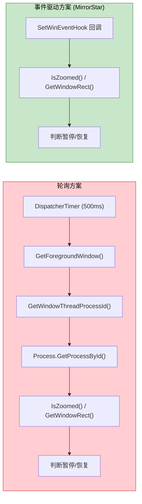

[← 返回文档索引](../../README.md) > [架构设计](./01-架构概述与系统架构-Architecture-Overview.md) > 性能优化

# MirrorStar Wallpaper（镜星壁纸）架构设计 — 性能优化策略

> 文档版本：v2.1 ｜ 更新日期：2026-10-02 ｜ 状态：已实现（基于最新代码审计）

## 11. 性能优化策略

### 11.1 零拷贝数据传输

在壁纸渲染管道中，尽量减少数据拷贝：

| 场景      | 优化方案                      |
| ------- | ------------------------- |
| 视频帧传输   | mpv 直接渲染到窗口表面，无需帧数据拷贝     |
| GIF 帧渲染 | 使用 GDI 双缓冲 直接写入窗口缓冲区   |
| IPC 消息  | 命名管道使用重叠 I/O，避免阻塞拷贝       |
| 配置读取    | 使用 `RwLock` 允许多读单写，读操作零拷贝 |

### 11.2 懒初始化

非关键资源延迟到首次使用时初始化：

| 资源          | 初始化时机     |
| ----------- | --------- |
| WorkerW 句柄  | 首次设置壁纸时   |
| WebView2 环境 | 首次创建网页壁纸时 |
| 音频会话        | 首次需要音量控制时 |
| 文件监听器       | 配置管理器初始化时 |

### 11.3 热路径最小化分配

在频繁执行的代码路径中避免堆分配：

| 热路径                | 优化                       |
| ------------------ | ------------------------ |
| SetWinEventHook 回调 | 仅获取 hwnd 后投递到异步任务，回调内零分配 |
| 窗口消息循环             | 使用栈上缓冲区处理消息              |
| IPC 消息解析           | 使用零拷贝字符串解析               |
| 全屏检测               | 缓存显示器信息，避免重复查询           |

### 11.4 事件驱动 vs 轮询性能对比



| 指标        | 轮询 (500ms) | 事件驱动     |
| --------- | ---------- | -------- |
| 每秒系统调用次数  | ≥4 次       | 0 次（空闲时） |
| 每秒 CPU 时间 | \~0.5ms    | 0ms（空闲时） |
| 响应延迟      | 0\~500ms   | <50ms    |
| 电池影响      | 持续唤醒       | 无唤醒      |
| 代码复杂度     | 低          | 中        |

### 11.5 内存使用优化

| 优化点     | 方案                                   | 预期效果        |
| ------- | ------------------------------------ | ----------- |
| 主进程工作集  | 使用 `SetProcessWorkingSetSize` 提示系统缩减 | 暂停态 < 20MB  |
| 配置缓存    | `RwLock<AppConfig>` 单实例共享            | 避免重复解析      |
| 缩略图     | 按需生成，磁盘缓存                            | 不占用运行时内存    |
| 日志缓冲    | `tracing-appender` 非阻塞写入             | 避免日志 I/O 阻塞 |
| IPC 缓冲区 | 固定大小缓冲区                              | 避免动态扩容      |

### 11.6 启动性能优化

| 优化点   | 方案                   | 预期效果              |
| ----- | -------------------- | ----------------- |
| 壁纸恢复  | 并行启动多个壁纸子进程          | 多显示器场景快速恢复        |
| 配置加载  | 单次 TOML 解析，RwLock 缓存 | < 5ms             |
| 桌面集成  | WorkerW 句柄缓存，避免重复查找  | 首次 < 100ms，后续 0ms |
| UI 渲染 | 原生 UI 子进程（Slint）按需启动 | 主窗口显示 < 500ms |

### 11.7 主窗口 WebView2 懒创建 / 关闭即销毁（⚠️ 已被原生 UI 子进程方案取代，历史条目）

> **已被取代**：主窗口已重构为独立原生 UI 子进程 `mirrorstar-ui.exe`（Slint 软件渲染），壳不再创建任何 WebView2 主窗口。以下 WebView2 懒创建 / 关闭即销毁策略及其数值均为历史记录，仅作演进参考；当前策略与实测数值见 **11.21**。

主窗口不再在启动时创建，仅创建系统托盘图标。用户需要时通过 `WebviewWindowBuilder` 按需创建主窗口；**关闭主窗口时不调用 `api.prevent_close()`，让 Tauri 默认销毁窗口，从而释放整棵 WebView2 子进程树**（`src-tauri/src/lib.rs` 的 `on_window_event` 主窗口 `CloseRequested` 分支）。窗口销毁后触发 `RunEvent::ExitRequested(code=None)`，由 `.run()` 回调 `api.prevent_exit()` 阻止应用退出以保持托盘驻留；用户下次打开时 `create_or_show_main_window` 走 build 路径重建窗口与 WebView2。

> 关于「懒创建/销毁」的历程：v8.0 起由「关闭即 `hide()`（保留 WebView2 实例）」改为「关闭即销毁窗口（释放 WebView2 子进程树）」。`hide()` 方案下窗口不可见但 WebView2 进程仍长期驻留 `msedgewebview2.exe`（约 5-6 进程 / 150-300MB），销毁方案将其整体归还 OS。

| 状态 | WebView2 进程 | 内存占用 |
|------|---------------|----------|
| 窗口打开 | 存在（约 5-6 进程） | 约 150-300MB |
| 窗口关闭（销毁） | 不存在 | 释放 WebView2 子进程树，仅保留主进程与托盘 |

**优化效果**：窗口关闭后不再长期保留 WebView2 子进程（约 150-300MB）；v8.0 时期按旧口径曾记录「暂停态内存 ~317MB → ~17MB（降幅 95%）」，属历史实测数据，本次内存专项未重复测量。**本轮（2026-10-02）各改动的优化前后实测数值待真机补测（用 `get_memory_report` 采集，见 11.19）。**

### 11.8 Native 壁纸零资源

JPG/JPEG/PNG/BMP/TIF/TIFF/DIB 静态壁纸使用 `SystemParametersInfoW(SPI_SETDESKWALLPAPER)` + 注册表（`WallPaperStyle`/`TileWallpaper`）设置，而非 WorkerW 嵌入方案。

| 维度 | Native 模式 | WorkerW 模式 |
|------|-------------|--------------|
| 窗口 | 无 | 需创建无边框窗口 |
| 线程 | 无 | 需渲染线程 |
| GDI 对象 | 无 | GDI 双缓冲 表面 |
| 内存占用 | ~0MB | ~10-30MB |

**优化效果**：静态壁纸零资源占用，无需创建窗口、线程或 GDI 对象。

### 11.9 PauseSender 快速通道

暂停/恢复/音量/静音操作绕过引擎 `Mutex<WallpaperEngine>`，通过 `tokio::sync::mpsc::UnboundedSender<PauseCommand>` 直接发送到渲染器线程。

| 场景 | 旧方案（Mutex） | 新方案（PauseSender） |
|------|----------------|---------------------|
| 无锁竞争 | ~1ms | ~0.01ms |
| 有锁竞争 | 10~100ms | ~0.01ms（不受 Mutex 阻塞） |

**优化效果**：暂停响应不受引擎 Mutex 阻塞，响应延迟降低 2~4 个数量级。

### 11.10 GIF 内存预算优化

GIF 内存预算从 200MB 降至 40MB（`MAX_GIF_MEMORY_MB`）。暂停时释放所有帧（仅保留当前帧），恢复时从文件重新解码。

| 状态 | 旧方案（200MB 预算） | 新方案（40MB 预算） |
|------|---------------------|---------------------|
| 播放中 | 最高 200MB | 最高 40MB |
| 暂停中 | 保留所有帧，仍占 200MB | 仅保留当前帧，~1-5MB |

**优化效果**：GIF 内存占用降低 80%，暂停态降低 95%+。

### 11.11 子进程 IPC 连接超时优化

视频壁纸（mpv）与网页壁纸（wp-proc）子进程的 IPC 连接超时参数差异化配置，减少壁纸切换等待时间。两类子进程的管道就绪特性不同：
- **mpv**：外部进程，启动后 `--input-ipc-server` 创建命名管道典型 200-500ms 即就绪，2s 超时足够
- **wp-proc**：内部 Rust 子进程，但需启动 WebView2 运行时（冷启动较慢），定为 8s 兜底

| 操作 | 渲染器 | 参数 | 总超时 | 说明 |
|------|--------|------|--------|------|
| IPC 连接 | Video (mpv) | 40 次 * 50ms | 2000ms (2s) | mpv 管道就绪典型 200-500ms，2s 足够 |
| IPC 连接 | Web (wp-proc) | 160 次 * 50ms | 8000ms (8s) | 需覆盖 WebView2 冷启动，定为 8s |
| 窗口查找 | Video (mpv) | 20 次 * 100ms | 2000ms (2s) | mpv 窗口创建典型 < 500ms |

参数通过常量定义（`MPV_CONNECT_RETRIES` / `MPV_CONNECT_INTERVAL_MS` / `WP_PROC_CONNECT_RETRIES` / `WP_PROC_CONNECT_INTERVAL_MS`），调用点 `ipc.connect(...)` 使用常量而非魔法数字，便于后续调整。

**优化效果**：mpv 视频壁纸切换最坏情况等待时间约为 IPC 2s + 窗口查找 2s = 4s；wp-proc 保留 8s 超时以兼容 WebView2 冷启动场景。

### 11.12 图片像素数据暂停释放

静态图片渲染器（WorkerW 模式）暂停时释放 `pixels: Vec<u8>`，恢复时从文件重新加载（`load_and_downsample_image()`）。

| 状态 | 内存占用 |
|------|----------|
| 播放中 | ~5-30MB（取决于分辨率） |
| 暂停中 | ~0MB（像素数据已释放） |

**优化效果**：暂停态图片壁纸内存占用降至接近零。

### 11.13 内存归因埋点（v17，Task 1）

为把「应用组到底占了多少内存、分别是谁占的」量化，`mirrorstar-core` 新增内存归因埋点（`crates/mirrorstar-core/src/perf.rs`）：

- `ProcessCategory`：按可执行文件名把进程树归类为 `Main`（主进程）/ `Mpv`（`mpv.exe`）/ `WpProc`（与壳进程同名且**非进程树根**的 `--wp-proc` 子进程）/ `WebView2`（`msedgewebview2.exe`）/ `Other`（其余后代，含 conhost 等）。
- `attribute_processes`：以当前进程 pid 为根，按父 pid 关系**迭代扩张**取后代集合（任意排序的进程列表都能正确建树，`included` 集合去重天然处理环/重复父 pid），因此不会误算系统上其他应用的 `msedgewebview2.exe`。
- `aggregate` → `MemoryUsageReport`：逐类别累计进程数、工作集（WorkingSetSize）与私有提交（PrivateUsage），`total` 恒等于各类别之和。
- `sample_memory_report`：一次进程快照 + 逐进程 `GetProcessMemoryInfo`（失败跳过并记日志，不 panic）。
- `spawn_memory_attribution_sampler(interval)`：后台周期采样线程，`interval` 被抬升到下限 `MIN_MEMORY_SAMPLE_INTERVAL`（30s）以上。

暴露入口：

| 入口 | 位置 | 说明 |
|------|------|------|
| Tauri 命令 `get_memory_report` | `src-tauri/src/commands/system.rs` | 按需同步返回分类别明细与总计，开销小，无需 async |
| 周期采样 | `src-tauri/src/lib.rs` setup | 启动时 `spawn_memory_attribution_sampler(Duration::from_secs(60))`，每 60s 输出一行归因日志 |

日志 target 为 `mirrorstar::perf`，message 形如 `MEM-ATTRIB: 应用组逐子进程内存归因`，结构化字段含 `main_procs/main_ws_mb/main_private_mb`、`mpv_*`、`wp_proc_*`、`webview2_*`、`other_*`、`total_procs/total_ws_mb/total_private_mb`（工作集 MB 与私有提交 MB）。可用 `RUST_LOG=mirrorstar::perf=info` 单独过滤。

**预期效果**：为后续所有内存改动提供同口径、可复现的量化基线（分类别 + 总计），使「优化是否有效」可被直接验证，而非凭经验判断。

### 11.14 主窗口 WebView2 启动参数裁剪（⚠️ 已被原生 UI 子进程方案取代，历史条目）

> **已被取代**：壳不再创建 WebView2 主窗口，常量 `MAIN_WINDOW_BROWSER_ARGS` 与 `WebviewWindowBuilder::additional_browser_args` 均已随主窗口重构移除。以下内容为历史记录。

在 `src-tauri/src/state.rs` 集中定义常量 `MAIN_WINDOW_BROWSER_ARGS`，挂到主窗口 `WebviewWindowBuilder::additional_browser_args`：

```
--disable-features=msWebOOUI,msPdfOOUI,msSmartScreenProtection,BackForwardCache,MediaCache,FontCache,GpuMemDiscardable
--autoplay-policy=no-user-gesture-required
--renderer-process-limit=1
--js-flags=--max-old-space-size=512
--disk-cache-size=52428800
```

| 参数 | 用途 / 预期效果 |
|------|----------------|
| `msWebOOUI,msPdfOOUI,msSmartScreenProtection` | 去 Edge mini 菜单 / PDF 工具栏 / SmartScreen（**wry 默认项，必须保留**） |
| `BackForwardCache` | 禁用前进/后退整页缓存（主窗口是单页设置 UI，无导航历史） |
| `MediaCache` | 禁用媒体磁盘缓存（缩略图仍可解码显示，仅不落盘） |
| `FontCache` | 禁用字体缓存，减少字体相关内存 |
| `GpuMemDiscardable` | 减少 GPU 进程可丢弃内存 |
| `--autoplay-policy=no-user-gesture-required` | **wry 默认项，必须保留**（维持原媒体自动播放语义） |
| `--renderer-process-limit=1` | 复用单个 renderer 进程，省去额外 renderer 内存基线 |
| `--js-flags=--max-old-space-size=512` | 限制 renderer 的 V8 老生代堆上限（默认可达数 GB），压低 JS 堆峰值 |
| `--disk-cache-size=52428800` | 磁盘缓存上限 50MB（默认近乎无上限） |

**关键点（务必保留默认项）**：Tauri/wry 的 `additional_browser_args` 语义是「**替换**」而非「追加」wry 默认串——wry 0.55.1 在 `create_environment`（`wry-0.55.1/src/webview2/mod.rs:294`）对该字段使用 `unwrap_or_else(...)`。因此常量内**显式保留**了 wry 默认的 `msWebOOUI,msPdfOOUI,msSmartScreenProtection` 与 `--autoplay-policy=no-user-gesture-required`，否则会静默丢失默认 UI/SmartScreen 裁剪与自动播放策略。所有禁用特性合并进**同一个** `--disable-features=` 列表（Chromium 多值合并语义不保证确定）。

降级说明：Chromium 对未知 flag 静默忽略；`additional_browser_args` 仅写入字符串、不参与 `.build()` 成败判定，未知/不支持时主窗口仍可正常创建。

**明确不启用 `--disable-gpu`**：本项目无真实 GUI 运行时测量依据；软件合成（SwiftShader/CPU 光栅化）可能反而推高 renderer 内存与 CPU，且主窗口含 CSS 过渡/拖拽排序动效。按「不为优化引入回归风险」原则暂不启用，后续验证方法见 `state.rs` 常量后的注释。

**预期效果**：压低主窗口 WebView2（尤其 renderer/GPU 进程）的内存基线与磁盘缓存占用。实测数值待真机补测。

### 11.15 非活跃态 WebView2 挂起 / 目标等级降级（⚠️ 已被原生 UI 子进程方案取代，历史条目）

> **已被取代**：模块 `src-tauri/src/platform/webview_memory.rs` 已随主窗口重构移除；壳不再管理 WebView2 主窗口，UI 子进程改为按空闲超时整体退出回收内存（见 11.21）。以下内容为历史记录。

新增 `src-tauri/src/platform/webview_memory.rs`，在最小化等非活跃态做两件互补的 best-effort 回收：

1. **挂起**：`ICoreWebView2_3::TrySuspend`（`IsSuspended` 幂等判定）暂停脚本定时器/动画并最小化 renderer CPU；恢复时 `Resume`。
2. **内存使用目标等级降级**：`ICoreWebView2_19::SetMemoryUsageTargetLevel(Low)`，恢复时置回 `Normal`。

接入点：

| 场景 | 位置 | 动作 |
|------|------|------|
| 全屏自动最小化主窗口 | `state.rs` `minimize_main_window_on_fullscreen` | `suspend_main_webview` |
| 窗口恢复可见 | `state.rs` `create_or_show_main_window` 已存在分支（`unminimize`/`show` 之后） | `resume_main_webview` |
| 窗口重建 | `state.rs` build 分支 | `reset_main_webview_suspended_state` |
| 关闭主窗口前 | `lib.rs` `on_window_event` `CloseRequested` | best-effort `resume_main_webview`（缓解项） |
| 通用最小化/恢复 | `lib.rs` `on_window_event` `Resized`（`window.is_minimized()`） | `sync_main_webview_active_state`（边沿触发去抖） |

**`TrySuspend` 前置条件与降级策略**：微软文档明确「调用时 `CoreWebView2Controller.IsVisible` 必须为 false，否则返回 `HRESULT_FROM_WIN32(ERROR_INVALID_STATE)`；且为 best-effort，失败时完成回调以 `isSuccessful=false` 上报」。本模块**不**主动把 controller `IsVisible` 置 false（窗口最小化不等价于 WebView 不可见，强置若恢复有闪失会导致白屏），因此最小化场景下 `TrySuspend` **很可能失败**。由于「目标等级降级」无此前置条件，**挂起失败时该路径仍然生效**，保证非活跃态始终有内存回收动作。所有失败仅 `tracing::warn!`，绝不 panic、绝不影响窗口操作；旧运行时无 `ICoreWebView2_19`/`ICoreWebView2_3` 时优雅跳过。

依赖版本：`src-tauri/Cargo.toml` 固定 `webview2-com = "0.38"` 并以别名 `windows61` 引入 `windows 0.61`，**必须与 wry 0.55.1 / tauri-runtime-wry 2.11.2 同源**（否则 `ICoreWebView2*` 会出现两套不互通类型）。

**预期效果**：主窗口最小化（含长时间被全屏应用遮挡而自动最小化的场景）时，WebView2 renderer 工作集下降；挂起成功时下降更明显，仅等级降级生效时下降幅度较小但仍低于可见稳态。实测数值待真机补测。

### 11.16 mpv 解码限流（v17，Task 4）

`crates/mirrorstar-core/src/wallpaper/video.rs` 的 `build_mpv_args` 在 v10/v11 限流基础上追加两个参数：

| 新增参数 | 说明 / 预期效果 |
|----------|----------------|
| `--vd-lavc-threads=4` | 限制视频解码线程数。mpv 默认 0（按 CPU 核数自动上探，最多 16）；帧级多线程解码会为每条线程保留参考帧缓冲（1080p 单帧 ≈3MB、4K ≈12MB），hwdec 失败回退软解时最耗内存。固定 4：软解 1080p/4K 壁纸仍流畅，同时显著压低线程缓冲上限。`--hwdec=auto` 走硬件解码时不参与软解线程创建，无副作用、不影响画质 |
| `--demuxer-readahead-secs=0.5` | demuxer 前向预读时间窗由默认 1s 减半。`--cache=no` 下虽无 stream 缓存层，demuxer 仍按本参数预读数据包进入其包队列；降低该值可直接压缩该队列内存。本地文件循环播放，0.5s 预读绰绰有余 |

既有限流参数**全部保留**：`--cache=no`、`--vd-queue-max-bytes=16777216`、`--ad-queue-max-bytes=4194304`、`--demuxer-max-back-bytes=0`、`--cache-secs=0`、`--hwdec=auto`、`--vo=gpu` 等。

> **项目硬约束：禁止新增 `--demuxer-max-bytes=`**。该参数会把解复用器缓冲上限清零，导致 demuxer 无法缓冲任何数据包（`Too many packets in the demuxer packet queues: 0 packets`），mpv 立即 video EOF + `No media data to loop` 退出，桌面黑屏、壁纸设置失败。

**预期效果**：降低视频壁纸软解场景的线程参考帧缓冲与 demuxer 前向预读包队列占用。实测数值待真机补测。

### 11.17 网页壁纸裁剪与环境共享评估（v17，Task 5）

`crates/mirrorstar-wp-proc/src/webview.rs` 抽出**纯函数** `build_additional_browser_args()`（不触碰 COM，便于单测断言参数契约），并新增两项裁剪参数：

| 新增参数 | 说明 / 预期效果 |
|----------|----------------|
| `--renderer-process-limit=1` | wp-proc 只渲染一个页面，限制渲染进程数为 1，省去多余 renderer 进程内存基线。风险低：跨域 iframe 会与主 frame 共用 renderer（牺牲站点隔离、单 renderer 内存略升），但该进程是 fail-closed 沙箱面，隔离损失可接受 |
| `--js-flags=--max-old-space-size=512` | 把 V8 老生代堆上限压到 512MB（64 位默认约 2-4GB），约束失控增长。取值保守（普通网页堆通常 <100MB，WebGL 纹理不占 V8 堆），避免 OOM/白屏 |

既有的 `--autoplay-policy=no-user-gesture-required`（E2E 免手势播放必需）、`--disk-cache-size=10485760`、`--disable-gpu-program-cache`、`--disable-gpu-shader-disk-cache`、`--disable-features=MediaCache,FontCache,GpuMemDiscardable,BackForwardCache` **全部保留**。

**环境共享评估结论：放弃**。目标本是让主窗口与 wp-proc 共用同一 UDF + 环境选项以省下一份 `msedgewebview2` 基线（约 5-6 进程 / 150-300MB）。经核实，WebView2 官方文档明确跨进程共享同一 UDF 是**被支持**的，故放弃共享**不是技术不可行，而是架构取舍**：

1. **崩溃隔离回退（决定性）**：wp-proc 存在的首要理由就是崩溃隔离；壁纸页面是不受信任的第三方网页（fail-closed 沙箱面），是崩溃概率最高的一方。共享 browser 进程后其崩溃会一并拖垮主窗口设置 UI。
2. **多显示器能力回退（决定性）**：per-PID UDF 让每个 wp-proc 成为独立进程集合，多显示器可同时开多个 Web 壁纸、各自独立 terminate/重启；共享单一 UDF 后所有实例落进同一 browser 进程集合，且 `cleanup_wp_proc_user_data_folder` 会在实例退出时 `remove_dir_all` 整个 UDF，破坏仍在运行的环境。
3. **环境选项无法对齐**：主窗口由 Tauri/wry 托管，wp-proc 无法控制其 UDF 与参数；壁纸侧需要主窗口不应有的进程级配置（免手势自动播放、`WEBVIEW2_DEFAULT_BACKGROUND_COLOR` 透明注入、CDP 注入等）。
4. **净收益不确定**：即便省下一份基线，也需集中式 UDF 生命周期管理 + 全参数对齐，复杂度与风险远超预期收益。

结论已写入 `webview.rs` 中 `build_webview2_user_data_folder` 的文档注释（含未来若仍要共享的前置条件）。

**预期效果**：约束单个网页壁纸子进程的 renderer 进程数与 JS 堆峰值；不因共享环境而回退崩溃隔离与多显示器能力。

### 11.18 预览媒体呈现策略（⚠️ 已被原生 UI 预览方案取代，历史条目）

> **已被取代**：前端（`src/scripts/ui/preview-modal.ts`）已删除，预览改由 `mirrorstar-ui.exe` 原生实现（图片自绘 / 视频 UI 进程内 mpv 子窗口 / GIF 逐帧动画 / 网页按需临时 WebView2 子窗口）。以下前端 `wpfile://` + `<video>` 策略为历史记录。

`src/scripts/ui/preview-modal.ts` 的预览媒体按类型区分呈现，**不再统一静态化**：

- **视频（Video）：真实 `<video>` 流式播放**（`showVideoPreview`）。`video.src = convertFileSrc(wp.file_path, "wpfile")`，并设 `preload="metadata"`、`playsInline=true`、`loop=false`；有缩略图时设 `video.poster`，无缩略图时 `removeAttribute("poster")`。关闭预览或切换预览时 `resetMedia` 调用 `releaseVideoElement` 清空 `src` 并同时清理 poster，释放媒体引用。
- **GIF：保持静态缩略图并显示显式降级提示**（`showGifStaticPreview`）。优先使用 `wp.thumbnail`（320x180 JPEG 缩略图）作为 `` 显示，无缩略图时回退为类型图标占位（`typeIcon`，容器为 `index.html` 的 `#preview-placeholder`），同时显示「动图预览暂不可用，当前显示缩略图」提示（`index.html` 的 `#preview-gif-note`，样式 `.preview-gif-note` 见 `src/styles/main.css`）。

**视频「内存有界」的依据**：`wpfile://` 自定义协议已支持 HTTP Range 流式读取（`src-tauri/src/lib.rs` 的 `wpfile` handler）——视频播放器按需请求字节范围，handler 返回 `206 Partial Content` 并携带 `Accept-Ranges: bytes`，且单次 Range 被限制为最多 1MB（`MAX_RANGE_LEN`）；HEAD 请求仅返回 `Content-Length`/`Accept-Ranges` 供播放器探测文件大小。因此 `<video>` 是**按需流式解码、内存有界**，而非一次性拉取并解码整段视频。据此，Task 6「`<video>` 会二次解码整段视频、应统一静态化」的优化前提不成立（且已构成「视频预览功能消失」的功能回归），故本轮（变更 `restore-video-preview-playback`）恢复视频真实播放。

**GIF 静态化的依据**：Chromium 的 `<video>` 不支持 `image/gif`，塞入 `<video>` 本就不工作，故保持静态缩略图并显式提示降级。

仅使用 class 切换与 `textContent`（DOM API）操作，遵守无 `unsafe-inline` 的 CSP。

**预期效果**：视频预览按需流式解码、内存有界（单次 Range ≤1MB），关闭预览即释放媒体引用；GIF 预览明确降级并提示用户。实测数值待真机补测（可对比打开/关闭预览前后 `get_memory_report` 的总计）。

### 11.19 本轮内存实测基线采集方法（待真机）

本次（v17，2026-10-02）的 6 项改动均已完成实现与单元测试，但**优化前后对比需真实 GUI 环境**，本机（无 GUI 运行条件、且可能正有应用在运行）不做真实测量、不伪造数据。真机采集步骤：

1. 运行应用 → 打开主窗口 → 播放视频壁纸 → 稳态 ≥60s；
2. 触发 `get_memory_report` 命令，或读取 `logs/mirrorstar.log` 中 target `mirrorstar::perf` 的 `MEM-ATTRIB` 日志，按类别（主进程 / `msedgewebview2` / `mpv` / `wp-proc`）与总计记录工作集与私有提交；
3. 与优化前基线（同口径）对比；
4. 额外记录**最小化态**与**预览开关态**内存，分别验证 11.15（Task 3）与 11.18（视频流式播放按需解码、关闭预览即释放引用）的效果。
5. 若需定位**启动 / 打开主窗口的秒级峰值**（既有 60s 周期采样无法捕捉），见 11.20 的启动期内存时间线（`MEM-TIMELINE` / `MEM-MARK`）采集方法。

### 11.20 启动期内存时间线（v17，`optimize-startup-memory-peak`）

> **说明**：本节为历史优化记录。其中涉及前端（`src/scripts/main.ts` / `report_lifecycle_mark` / `main_window_created` / `frontend_init_done` / `wallpaper_list_rendered`）与主窗口 WebView2 的埋点、标记与数值，已随前端删除、主窗口原生 UI 重构而**失效**；后端 `mirrorstar::perf` 归因采样（`MEM-ATTRIB` / `MEM-TIMELINE` / `MEM-MARK`）机制仍然有效。当前主窗口内存数值见 11.21。

**背景**：既有内存归因埋点为 60 秒周期采样（见 11.13 的 `spawn_memory_attribution_sampler` / `MEM-ATTRIB`）。60 秒粒度**无法捕捉启动与打开主窗口阶段的秒级峰值**，导致「约 500MB 峰值由谁产生、为何回落」无法定量归因。本次变更在 `crates/mirrorstar-core/src/perf.rs` 新增启动期细粒度时间线与生命周期事件打点。

**新增 API（`mirrorstar-core::perf`）**：

| API | 作用 |
|-----|------|
| `startup_elapsed_ms()` | 返回相对进程启动基准（首次调用惰性初始化的 `Instant`）的耗时（ms），非阻塞、无系统调用，可在任意线程安全调用 |
| `mark_lifecycle(label)` | 立即采集一次并输出一条事件打点；非阻塞、best-effort、失败不 panic |
| `spawn_startup_memory_timeline(total, interval)` | 启动后 `total` 时长内按 `interval` 间隔输出时间线；到达 `total` 后线程自行结束；线程创建失败返回 `None`，不 panic |

**日志类型**（target 均为 `mirrorstar::perf`）：

| message 前缀 | 触发时机 | 说明 |
|-------------|---------|------|
| `MEM-TIMELINE` | 启动后前 60 秒，每 ~1 秒一条（`label = "timeline"`） | 应用启动时以 `spawn_startup_memory_timeline(Duration::from_secs(60), Duration::from_secs(1))` 启动；60 秒后停止，回落到既有 60 秒周期采样（`MEM-ATTRIB` 语义不变） |
| `MEM-MARK` | 生命周期事件发生即刻 | `label` 为事件标签，用于把时间线上的峰值对齐到具体阶段 |

两者字段与既有 `MEM-ATTRIB` 一致（分类别工作集 / 私有提交与总计：`main_*` / `mpv_*` / `wp_proc_*` / `webview2_*` / `other_*` / `total_*`，含 `*_ws_mb` 与 `*_private_mb`），额外携带 `label` 与 `elapsed_ms`。可用 `RUST_LOG=mirrorstar::perf=info` 单独过滤。

**开关**：环境变量 `MIRRORSTAR_MEM_TRACE`，值为 `0` 或 `off`（大小写不敏感、忽略首尾空白）时关闭；未设置时默认开启启动期 60 秒采集。关闭时不启动时间线线程，`mark_lifecycle` 静默无输出。采样仅做进程树枚举与 `GetProcessMemoryInfo`，不持有引擎 / 桌面锁、不阻塞主线程；60 秒后无持续高频开销。

**可归因的生命周期阶段**（`label` 与打点位置）：

| label | 打点位置 | 含义 |
|-------|---------|------|
| `log_init` | `src-tauri/src/lib.rs` `log_init` | 日志初始化完成（首个打点，同时初始化启动基准时刻） |
| `engine_ready` | `src-tauri/src/lib.rs` setup | 引擎 / 配置等基础设施初始化完成 |
| `boot_wallpaper_applied <key:Type,...>` | `src-tauri/src/scheduler.rs` `apply_boot` 后 | 开机壁纸应用完成，含各显示单元壁纸类型（如 `boot_wallpaper_applied primary:Video,secondary:Image`；无壁纸时为 `none`） |
| `main_window_created` | `src-tauri/src/state.rs` `create_or_show_main_window` 成功分支 | 主窗口创建成功 |
| `main_window_page_loaded` | `src-tauri/src/state.rs` `on_page_load` 的 `PageLoadEvent::Finished` | 主窗口页面加载完成 |
| `frontend_init_done` | `src/scripts/main.ts` `init()` 末尾（经命令 `report_lifecycle_mark` 上报） | 前端初始化完成 |
| `wallpaper_list_rendered` | `src/scripts/main.ts` 壁纸列表渲染后（经 `report_lifecycle_mark` 上报） | 壁纸列表渲染完成 |

前端上报入口：Tauri 命令 `report_lifecycle_mark(label)`（`src-tauri/src/commands/system.rs`）→ `ipc.ts` 封装 `reportLifecycleMark` → `main.ts` 调用，使前端事件与后端时间线对齐。

**真机采集方法**：分别采集两条时间线，读取 `logs/mirrorstar.log` 中 target `mirrorstar::perf` 的 `MEM-TIMELINE` / `MEM-MARK` 记录，比较各分类别峰值与回落时机：

1. **仅启动（不打开主窗口）**：启动应用后静置 ≥60s，不打开主窗口。观察 `log_init` / `engine_ready` / `boot_wallpaper_applied …` 处的 `MEM-MARK` 跳变，以及前 60s `MEM-TIMELINE` 各分类别（主进程 / `msedgewebview2` / `mpv` / `wp-proc` / 其他）的峰值与回落时机——此线用于隔离「主进程 + 开机壁纸子进程」基线，不含主窗口 WebView2。
2. **打开主窗口**：启动后打开主窗口，观察 `main_window_created` → `main_window_page_loaded` → `frontend_init_done` → `wallpaper_list_rendered` 之间的 `MEM-MARK` 差值，定位打开瞬间的峰值由哪一阶段 / 哪一类别拉起，以及何时回落。

对比两条线各分类别峰值与总计峰值，即可判断峰值主因（WebView2 冷启动基线 / 开机壁纸子进程 / 前端列表渲染 / 其他）；建议每场景重复 ≥3 次取中位数以降低噪声。

**本轮优化：前端非关键加载延后（`scheduleAfterFirstPaint`）**。针对「打开主窗口瞬间，壁纸列表渲染 + 缩略图 / 视频首帧解码与 WebView2 冷启动叠加抬高瞬时峰值」这一来源，`src/scripts/main.ts` 新增 `scheduleAfterFirstPaint(task)`，把非关键加载（`refreshWallpaperList()` → 上报 `wallpaper_list_rendered` → `renderPoolsFromCache()`）延后到首屏绘制之后执行；首屏关键路径（`loadConfig`、显示器下拉、播放按钮状态、事件绑定与监听器注册）保持原顺序，功能与既有懒加载语义不变（详见 `05-优化文档/08-前端.md` 的 v17.0 章节）。

**实测归因结论（2026-10-02，`target/debug/logs/mirrorstar.log.2026-10-02`）**：

| 阶段 | 相对启动 | 总计 WS (MB) | 总计私有提交 (MB) | WebView2 进程数 |
|------|---------|-------------|------------------|----------------|
| `log_init` | 0ms | 11.5 | 5.4 | 0 |
| `boot_wallpaper_applied DISPLAY1:none` | 35ms | 18.6 | 6.9 | 0 |
| 启动后 60s 静置（无主窗口） | 0–60s | 18.8 | 约 7 | 0 |
| `main_window_created` | 71937ms | 245.7 | 97.6 | 6 |
| `main_window_page_loaded` | 72102ms | 319.0 | 179.3 | 6 |
| `frontend_init_done` | 72144ms | 324.4 | 182.9 | 6 |
| `wallpaper_list_rendered` | 72150ms | 325.0 | 183.2 | 6 |
| `wallpaper_list_rendered`（视频壁纸 mpv 已在跑） | 91595ms | 518.3 | 599.0 | 6 |

结论：

1. **启动本身极轻**：开机不应用壁纸时，启动后 60s 静置稳定在 18.8MB WS / 约 7MB 私有提交，未出现约 500MB 峰值。
2. **约 500MB 峰值只出现在「打开主窗口」瞬间，且 100% 来自主窗口 WebView2**：主窗口 `build()` 成功即 +227MB WS（约 +91MB 私有，6 个 Chromium 进程），页面加载再 +73MB WS（约 +82MB 私有）；主窗口总计约 +306MB WS / +176MB 私有。Rust 主进程全程仅约 30MB，**不是峰值来源**。
3. **本轮「前端非关键加载延后」在本机几乎无效果**：`frontend_init_done` → `wallpaper_list_rendered` 仅相隔 6ms、内存差 0.6MB（`requestIdleCallback` 立即触发，未真正把加载摊开）。
4. **主窗口关闭后 WebView2 进程全部退出，无残留泄漏**：关闭态 `webview2_*` 进程数为 0，总计回落到约 221–223MB（仅视频壁纸 mpv 约 190 + 主进程约 30）。
5. **观测口径提醒**：工作集（WS）在多进程上累加会重复计入共享页——周期采样中主窗口开启时 `webview2` WS 波动达 464–715MB 即源于此；归因时**私有提交（private）更可靠**。

**结论（超出本次可接受范围，交用户决策，未擅自扩大改动）**：主窗口内存的可控杠杆集中在「前端渲染器占用（约 82MB 私有）」与「Chromium 基建 / 特性裁剪（约 91MB 私有）」；唯一的架构级根除手段是「设置 UI 去 Chromium 化」。共享 WebView2 环境 / 进程在本机收益≈0（无网页壁纸，窗口关闭时已无 WebView2 可共享）。

### 11.21 主窗口原生 UI 子进程内存/CPU（当前策略，`rewrite-main-window-native-ui`）

主窗口已由 Tauri 内嵌 WebView2 重构为独立原生 UI 子进程 `mirrorstar-ui.exe`（Slint 1.18，**绑定软件渲染**：`default-features=false` + 仅 `renderer-software`，不编译 femtovg/skia，避免 winit 选 OpenGL 后端导致 +67MB 内存）。壳不再创建任何 WebView2 主窗口，也不再裁剪 WebView2 启动参数或做 WebView2 挂起（11.14 / 11.15 已失效）。

**当前内存/CPU 策略：**

| 措施 | 说明 |
|------|------|
| 原生 UI 子进程 | 主窗口 UI 运行在 `mirrorstar-ui.exe`，经 `ui_proto` NDJSON（stdio）与壳通信 |
| 软件渲染绑定 | 仅启用 Slint `renderer-software`，规避 GPU/OpenGL 后端内存开销 |
| 按需启动 + 空闲退出 | 窗口隐藏超时（默认 300s，`MIRRORSTAR_UI_IDLE_TIMEOUT_SECS`）后整体退出 UI 子进程回收内存，再次请求重新拉起；同一时刻至多一个实例 |
| 虚拟化网格 | 仅实例化可见区间 ±2 行缓冲，避免全量卡片实例化 |
| 缩略图直读 | 按本地文件路径直读，不经 IPC 传字节 |
| 显隐不激活 | `WS_EX_NOACTIVATE` 瞬时覆盖 + `SWP_NOACTIVATE`，不抢前台，避免误触发全屏检测/纯净模式 |

**验收实测结论（对比改造前基线）：**

| 指标 | 改造前（WebView2 主窗口） | 当前（原生 UI 子进程） |
|------|--------------------------|----------------------|
| 主窗口打开并静置：壳 + UI 合计 private | 213.7MB private / 360.6MB WS（其中 `msedgewebview2`×6 = 204.2MB） | **≈16.8MB**（验收门槛 ≤40MB） |
| 关闭（UI 退出）后 | 回落至壳内存量级 | ≈7.6MB |
| idle CPU | — | ≈0.4% |
| 网格滚动 CPU | 47.6% | **10.5%** |

> 结论：原生 UI 子进程方案以"整体进程按需启停"替代了 WebView2 的"参数裁剪 + 非活跃态挂起"，在内存与 CPU 上均大幅下降。

**e2e / 驱动脚本**：`crates/mirrorstar-ui/` 下的 PowerShell 脚本（`measure_grid.ps1`、`measure_scroll_reverify.ps1`、`measure_preview.ps1`、`keyboard_smoke.ps1`，以及 `shell_measure.ps1`、`single_instance_check.ps1`）用于真机采集上述数值。

***

## 附录 A：技术架构选型

| 维度    | MirrorStar 方案              | 说明            |
| ----- | --------------------------- | --------------- |
| 语言    | Rust                    | 内存安全、零成本抽象、无 GC |
| UI 框架 | Slint 1.18（原生 UI 子进程）+ Tauri 壳 | 更低内存的原生 UI 方案 |
| 进程监控  | SetWinEventHook 事件驱动    | CPU 占用从持续到近零    |
| 壁纸类型  | 4 种                     | 精简非核心类型         |
| IPC   | 三套协议（mpv 原生命名管道 + wp-proc 自定义命名管道 + 壳↔UI `ui_proto` stdio） | 分别针对不同子进程的通信需求  |
| 配置    | TOML                    | 更好的可读性和手动编辑体验   |
| 看门狗   | 无独立看门狗进程（watchdog 已移除，依赖 OS 自动回收子进程） | 更简洁，无需额外进程     |
| 暂停方式  | 逻辑暂停 PauseSender + VolumeMixer | 逻辑暂停更安全，避免死锁    |
| 日志    | tracing                 | Rust 生态标准方案     |
| 二进制体积 | 单文件 < 10MB              | 无运行时依赖          |

## 附录 B：关键 Windows API 参考

| API                                           | 用途              | 模块   |
| --------------------------------------------- | --------------- | ---- |
| `FindWindowW("Progman", None)`                | 查找桌面管理器窗口       | 桌面集成 |
| `SendMessageTimeoutW(0x052C)`                 | 触发创建 WorkerW    | 桌面集成 |
| `EnumWindows`                                 | 遍历查找 WorkerW    | 桌面集成 |
| `SetParent`                                   | 嵌入壁纸窗口到 WorkerW | 桌面集成 |
| `MapWindowPoints`                             | 坐标系转换           | 桌面集成 |
| `SetWinEventHook(EVENT_SYSTEM_FOREGROUND)`    | 监听前台窗口切换        | 进程监控 |
| `IsZoomed`                                    | 检查窗口是否最大化       | 进程监控 |
| `MonitorFromWindow`                           | 获取窗口所在显示器       | 全屏检测 |
| `GetSystemPowerStatus`                       | 获取电源状态（ACLineStatus） | 电池监测 |
| `IMMDeviceEnumerator`                         | 获取音频设备          | 音频控制 |
| `ISimpleAudioVolume::SetMute`                 | 设置进程静音          | 音频控制 |
| `SystemParametersInfoW(SPI_SETDESKWALLPAPER)` | 刷新桌面            | 桌面集成 |

***

## 附录 C：关键性能策略

| 维度 | MirrorStar 策略 |
|----------|-----------|
| **全屏检测** | SetWinEventHook 事件驱动(0 CPU) + AtomicBool 去抖 |
| **图片加载** | 超屏幕分辨率自动降采样 + 暂停释放像素 |
| **GIF 内存** | 40MB 内存预算 + 暂停释放帧 + 速度控制 |
| **GIF 渲染** | GDI 对象缓存 + 双缓冲 + WM_TIMER |
| **WorkerW 检查** | 5min 间隔（Tokio 异步运行时） |
| **缩略图生成** | image crate，320x180，JPEG 质量 85 |
| **配置写入** | 原子写入(文件锁+临时文件+rename) + 300ms 防抖 |
| **进程暂停** | 逻辑暂停(PauseSender 快速通道绕过引擎锁) |
| **原生壁纸 API** | SystemParametersInfoW + 注册表（零资源占用） |
| **主窗口 UI** | 原生 UI 子进程（Slint 软件渲染，按需启动，空闲超时退出，虚拟化网格） |
| **WebView2** | 仅网页壁纸子进程（按需启动，关闭即销毁）+ 参数裁剪（renderer 限单、V8 堆上限）；主窗口已不使用 WebView2 |
| **mpv 限流** | 解码队列/缓存/demuxer 限流 + 解码线程数上限（`--vd-lavc-threads=4`） |
| **内存归因** | `MEM-ATTRIB` 周期埋点（60s）+ `get_memory_report` 命令（分类别 + 总计） |
| **COM 接口缓存** | 有（音量控制优化） |

### 优化要点分析

1. **CPU 优化**：全屏检测使用事件驱动 + AtomicBool 去抖，空闲时 CPU 占用接近 0%。

2. **内存优化**：对大图片和 GIF 做了降采样处理 + 40MB 内存预算 + 暂停释放帧/像素，显著减少内存占用。

3. **原生壁纸 API**：对静态图片使用 SystemParametersInfoW + 注册表设置，零资源占用（无窗口、无线程）。

4. **PauseSender 快速通道**：绕过引擎互斥锁，直接发送暂停/恢复/音量命令，避免高优先级操作被阻塞。

5. **WebView2 按需子进程**：WebView2 运行在独立子进程（壳进程 `--wp-proc` 模式，仍是独立进程）中，仅在设置 Web 壁纸时启动，关闭 Web 壁纸即终止子进程，释放全部内存。

6. **进程暂停安全性**：使用逻辑暂停（PauseSender 快速通道），安全且需要每种渲染器单独实现，避免线程挂起导致的死锁风险。

***

**相关文档：**

- [架构概述与系统架构](./01-架构概述与系统架构-Architecture-Overview.md)
- [模块设计](./03-模块设计-Module-Design.md)
- [进程架构](./04-进程架构-Process-Architecture.md)
- [依赖与数据流](./05-依赖与数据流-Dependency-and-Data-Flow.md)
- [桌面集成](./06-桌面集成-Desktop-Integration.md)
- [暂停恢复机制](./07-暂停恢复机制-Pause-Resume.md)
- [错误处理](./08-错误处理-Error-Handling.md)